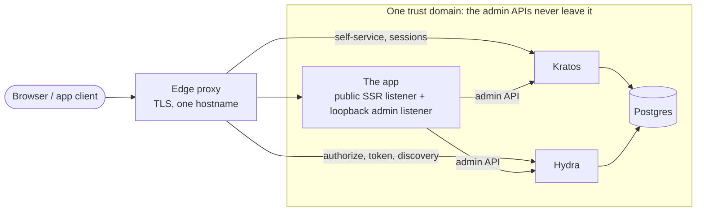

# Architecture

Why the pieces are arranged the way they are. What each one *does* is in the code and in the tests
named below.

## Components

| Piece | Role |
|---|---|
| **Kratos** | Identity. Self-service login, recovery, verification, settings, credentials. Public API through the edge; admin API pod-internal only. |
| **Hydra** | OAuth2 / OIDC. Issues tokens; ships no UI and no authorization model by design. Public API through the edge; admin API pod-internal only. |
| **Postgres** | Separate databases for Kratos and Hydra. |
| **The app** (`portal/`) | Everything Ory leaves to the integrator: Hydra's login and consent providers, the access gate, the claims builder, the forward-auth endpoint, the client registrar, the admin UI, and the rendered Kratos self-service pages. |
| **The edge** | A reverse proxy terminating TLS and routing one hostname across the three upstreams. `caddy/Caddyfile` is a worked example, not shipped deploy config. |

It is one application rather than a service per concern because every one of those concerns needs an
Ory **admin** API, and the admin APIs are the thing that must never be reachable from the network.
One process keeps every admin-API caller inside one trust domain, and invents no service-to-service
authorization problem to solve a decomposition nobody needed.

## Trust boundary

**The network sees three ports.** The edge routes to Kratos's public port, Hydra's public port, and
the app's public SSR port. Neither admin API is exposed, and no app in front of this stack is ever
given an admin credential.

**The app runs two listeners in one process** (`portal/src/server/listen.mjs`). The public listener
serves the Astro handler. The admin listener binds `ADMIN_HOST` (loopback by default) with its own
mux, `ADMIN_GET_ROUTES` and `ADMIN_POST_ROUTES`, that never delegates to the Astro handler. The two
route sets are disjoint *by construction* rather than by a routing rule that could be edited wrong;
`portal/scripts/public-mux-disjoint.test.mjs` and `portal/scripts/admin-port.test.mjs` are what hold
that. Admin routes authenticate with `bearerMatches`, which is constant-time and returns false when
no secret is configured, so a misconfigured deployment refuses rather than opens.

**Inbound headers are never an identity claim.** Group membership and identity id come from Kratos,
never from a request header. `caddy/snippets/forward-auth.caddy` strips the whole `X-Remote-*` /
`X-Forwarded-User` / `X-Auth-Request-*` family before proxying, and clears the inbound identity id
before the auth call so the upstream receives only the value taken from the auth response. Those
steps sit in a `route` block, because Caddy's default directive order would otherwise run
`forward_auth` ahead of `request_header` and strip the verified id. The
`oidc-app` snippet removes only the Kratos session cookie and leaves the app's own cookies.

**Admin authority is a marker, not a group.** Kratos strips `metadata_admin` from
`/sessions/whoami`, so it can only be written and read through the admin API. `isAdminMarker`
(`portal/src/lib/admin-auth.ts`) is the sole authority check, and it must be handed an identity
fetched fresh from the admin API. A string named `admin` inside `metadata_admin.groups` confers
nothing. `requireAdminSession` (`portal/src/lib/admin.ts`) demands three things together: an active
session, `authenticator_assurance_level === 'aal2'`, and the marker.

## The access model

Two questions, two bindings, nothing derived.

**Entry** comes from an access group, always. A manifest's `presentation.access` list is the entry
binding; `parseAccessGroups` (`portal/src/lib/access-groups.ts`) normalizes it into `accessGroups`,
and membership in any one of them admits (OR-semantics). This is the only thing that grants entry.

**Role** comes from *additionally* holding a group that the same manifest's `consent.group_role_map`
maps to a declared role. A role-mapped group grants no entry of its own. An identity holding only the
role group is denied at the gate before any claim is composed, which is the intended outcome: that is
a misconfigured identity, not a shortcut.

Nothing else participates. There is no `access-<clientId>` name synthesized from a client id, and
admin does not imply access: an admin is admitted because they hold the entry group like everyone
else. A group's *type* is a property of its bindings, never of its spelling, which is what
`portal/src/lib/group-registry.ts` derives (`identity` from the configured identity-group list,
`access` from an entry binding, `role` from a role map). The abolition of derived entry is pinned by
`e2e/playwright/tests/t-access-model.spec.ts`, cases T1 through T10: both orders of a two-group
identity, the role group alone, neither group, and the same matrix again at the forward-auth edge.

`enforceAccessGate` (`portal/src/lib/gate.ts`) evaluates in a fixed order, and the order is the
design:

1. **identity present** — a failed lookup denies rather than proceeding on nothing;
2. **`state === 'active'`** — exactly that string, anything else denies;
3. **every stored group is canonical** (`refuseNonCanonical`);
4. **`skip_access_check`**, if the manifest sets it, bypasses only what follows;
5. **membership in a bound access group.**

Steps 2 and 3 sit *above* the escape hatch on purpose. They are facts about the identity, not about
one app's binding, so no manifest may waive them. `skip_access_check` waives the group check alone.

**The group-name policy.** `GROUP_RE` in `portal/src/lib/access-groups.ts` is the one canonical form
a group name may take anywhere in the app. No prefix is required, and that one canonical definition
is what lets the group comparisons scattered across the app compare raw strings and agree by
construction. Every write path enforces it (`validateGroups` in
`portal/src/lib/metadata-admin.ts`, the manifest loader, the lint, the forward-auth query parameter).
Step 3 above is the *read* boundary, and it exists because Kratos's admin API is a write path this
codebase does not own: a name that no owned boundary could have produced means the record was written
out of band. Denying every app and naming the offending group is the only outcome that can neither
grant access nor pass unnoticed. Coercing the name would admit an identity nothing here would create;
skipping it would make the group behave as if it were never stored. The admin form's repair path
(`planGroupSave`, also in `portal/src/lib/gate.ts`) is the way out, and it refuses to write anything
while a non-canonical name is still held, because a write path that could re-emit one would retire the
property that makes the check meaningful.

That literal is written out once more, in `kratos/identity.schema.json`. It does not enforce it
(Kratos validates `traits` only), but it must still match: when the two diverged, the schema advertised
names the read gate then refused, which is a lockout with no error message anywhere. Nothing checks
the schema against `GROUP_RE`, so that agreement is UNENFORCED and held by hand.

**Role resolution is order-independent.** `lookupRole` (`portal/src/lib/claims.ts`) takes a per-client
override if it names a declared role, and otherwise maps every held group through `group_role_map`
and keeps the role ranked highest by its index in `manifest.roles`. It is not a first-match walk over
stored order. Holding both the entry group and the role group is the normal case, not an edge case,
and a first-match walk over an alphabetically sorted array would have handed those identities the
lesser role. There is exactly one resolver: the consent path and the admin UI's effective-access view
(`computeEffectiveAccess`, `portal/src/lib/access.ts`) both call it, so they agree structurally rather
than by two walks staying in sync.

## The forward-auth request path

For apps with no OIDC support. The edge makes a subrequest before passing traffic through, and the
answer is computed entirely from the Kratos session and the admin-managed groups.

1. The edge calls `GET`/`HEAD /api/forward-auth?group=<name>`, forwarding the original request's
   cookies. The required group is **static edge configuration**, operator-controlled, never client
   input.
2. The parameter is checked against `GROUP_RE`. Absent, empty, or malformed denies.
3. The Kratos session is verified from the request's own `Cookie` header.
4. The identity is re-fetched through the Kratos **admin** API by the session's identity id, because
   neither `state` nor `metadata_admin.groups` appears in the public whoami.
5. `enforceGroupGate` applies steps 1 through 3 and 5 of the gate above, with no escape hatch:
   forward-auth has no manifest to grant one.
6. On allow, the response carries the identity id in a header set from the server-verified value.

`GET` and `HEAD` share one `decide` function verbatim, because a `HEAD` that answers differently from
the `GET` is an authorization bypass.

### The status contract

The body is advisory; the edge keys on the status.

| Status | Meaning |
|---|---|
| **200** | Allow. |
| **401** | No usable session, or aal2 step-up due. |
| **403** | Refused. Either **on the merits** (inactive identity, a non-canonical stored group, or a group miss) **or** a missing or malformed `group` parameter. **403 therefore does not mean exactly one thing.** |
| **503** | Kratos or its admin API did not answer. |

The odd member is the malformed parameter, and it is deliberate: that is a broken deployment, static
per site, denying every request to that site rather than one person's. It is not an outage, so it
does not belong in 503.

**Why 503 is separate at all.** Caddy's `forward_auth` treats any non-2xx as a denial and copies the
response back, so fail-closed is unchanged either way. What the separation buys is that an edge can
keep an outage out of its redirect arm. An edge matching `status 401 403` into a login redirect would,
if outages arrived as 403, bounce the visitor to the login page of the very app that just failed to
answer, and do it again on every retry. `caddy/snippets/forward-auth.caddy` documents 503's
deliberate absence from that matcher for exactly this reason. Whether any denial becomes a redirect is
the edge's decision, not this endpoint's; the endpoint's job is to make the distinction expressible.

Every failure path is exercised in `portal/scripts/forward-auth.test.mjs`, including the two
properties that are easy to lose: no path returns 2xx, and no denial body echoes the required group
or the identity id.

There are two archetypes. `caddy/snippets/forward-auth.caddy` is the *session-only* one: it points
`forward_auth` straight at Kratos and establishes only that a session exists. This endpoint is the
*session-and-group* one, and the edge config calling it is written per site, because the group is a
per-site value.

## The OIDC path

`handleLogin` and `handleConsent` (`portal/src/lib/oauth2-handlers.ts`) are what Hydra redirects to.

On a login challenge, the subject is resolved and then gated. When Hydra reports `skip` (it remembers
this subject), the handler still re-verifies a live Kratos session whose identity matches the
remembered subject before honouring it. Hydra remembers; Kratos authenticates. Honouring a remembered
login after the user signed out of Kratos would be a silent re-SSO.

The gate result is not leaked to the relying party. A denial is logged server-side with its real
reason and rejected upstream with an opaque `access_denied`, so group names and identity-state
distinctions do not travel out through Hydra into the RP redirect.

On consent, the gate runs **again** rather than trusting that login just passed, and the id_token
claims are composed by `composeIDTokenClaims` (`portal/src/lib/claims.ts`): identity claims, then the
groups claim dropped unless the manifest opts in, then the resolved role's `claim_emit` merged in,
then any claim whose required scope was not requested removed.

Revocation is one in-process fan-out, `revokeSubject` (`portal/src/lib/revoke.ts`), shared by admin
force-logout, user sign-out-everywhere, and deactivation. Kratos sessions and Hydra's remembered
login and consent sessions are all cut, because cutting only the Kratos session leaves a remembered
Hydra login able to mint fresh tokens. There is no identity cache to invalidate: the login and
consent paths always fetch a fresh identity, so a deactivated subject fails the state check on the
next request by construction.

## OIDC client registration

Hydra's client list is reconciled *from* the manifests rather than maintained by hand.
`registerAllClients` (`portal/src/lib/register-clients.ts`) narrows the catalog to manifests that
actually declare an `oidc:` block, runs the full manifest lint, and then, per client, reads the
current state from Hydra to decide create versus update. Only `oidc:`-derived fields cross the wire;
the `consent:` block is a namespace this app owns and Hydra never sees it. The secret is set as a
typed field on the request body, never interpolated into a JSON string. Registration is
create-or-update only and never deletes, so a decommissioned client survives until it is removed
deliberately.

`portal/src/server/registrar.ts` drives it on boot with bounded retry (Hydra may still be starting)
and again on `SIGHUP`, and never lets a registration failure take down the listeners: an app that
cannot reach Hydra must still serve the admin surface an operator would use to find out why.

## Manifests and failure posture

Manifests are read at request time behind a short cache, so adding or removing an app is a change to
the manifest directory with no image rebuild. That creates one hazard: a *syntax* error in one file
is isolated and skipped, but a *semantic* error is set-wide, and the strict loader throws on any
finding. Left alone, one bad edit would 500 every OIDC login and the entire admin UI at once,
including the surface needed to diagnose it. `portal/src/lib/manifest-store.ts` is the split that
prevents it: the registrar and the lint call the strict loader and must throw, while every request
path calls the serving loader, which never throws. On a failed load it keeps serving the last known
good set and reports `stale` through `manifestHealth`, so nothing reads stale as live; with no last
known good set it serves the empty set, which is fail-closed everywhere it lands, because the gate
denies a client whose manifest is missing. It retries on every call, so recovery needs no restart.

## Configuration and the one-way choices

One image serves any instance; `OTHALA_*` variables define the deployment, and `.env.example` is the
annotated contract. Ory does not expand `${VAR}` inside its own YAML, so `kratos/kratos.yml` and
`hydra/hydra.yml` are templates rendered by `scripts/render-config.sh`, which derives the required
variable set from the template itself and fails listing missing *names* only, never rendered content
that could carry a secret into a log. The e2e harness and the deploy plane call the same render, so
what is validated and what is deployed differ in values, not in mechanism.

Four settings become commitments the moment anyone enrols a credential against them, and should be
chosen deliberately rather than discovered later:

- **`OTHALA_WEBAUTHN_RP_ID`** — changing it invalidates every enrolled passkey.
- **`OTHALA_PUBLIC_URL`** — Hydra's issuer. Every client's discovery and every issued token carry it.
- **`OTHALA_APEX`** — the Kratos cookie domain, and the ceiling on which hostnames can share the
  session.
- **Hydra's `subject_identifiers`** — `public` subjects mean the subject id is the identity id
  everywhere; switching to pairwise later changes every downstream app's notion of who a user is.

## Where behaviour is pinned

The gate, the group-name policy, the status contract, the mux disjointness, and the manifest lint
carry unit tests under `portal/scripts/` and `portal/src/lib/`, with fuzz suites over the recovery
gate, CSRF, claims injection, and manifest validation. The access model is asserted end to end in
`e2e/playwright/tests/`, against the same manifest fixtures described here. When a statement in this
file and a test disagree, the test is right.
