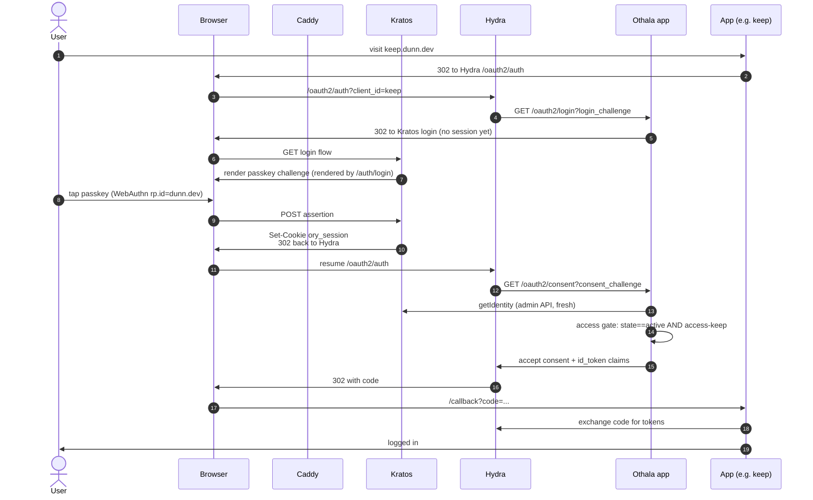
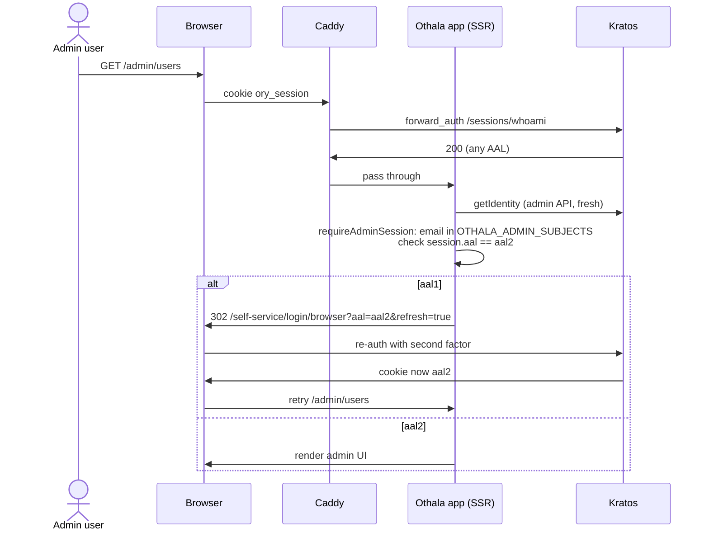
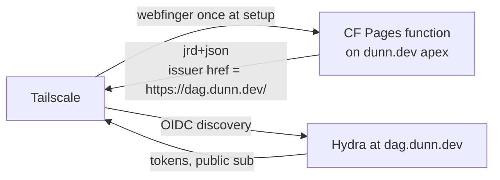

# Architecture map

Load-bearing decisions catalog + topology + flows. Read this if you
(human or LLM) are picking up Othala cold and need to understand where
the landmines are.

This is NOT a tutorial. It is a finger-pointer at the decisions that
matter: what they are, where the code lives, and what would break if you
changed them. Each entry is short on purpose; follow the cross-references
for depth.

## Doc source-of-truth hierarchy

Each doc has exactly one job. Follow this when editing or reading:

- **ARCHITECTURE.md** (this file): cold-start orientation + load-bearing decisions. The authoritative anchor; all other docs defer to it.
- **docs/STATUS.md**: the only place release/version state is asserted. Do not state versions elsewhere.
- **README.md**: front door; links the others; asserts no version of its own.
- **DEPLOY.md**: consumption contract; links ARCHITECTURE.md LB-12 rather than restating it.

This hierarchy is what prevents doc drift from recurring.

## Reading order

1. **Right now (this file)**: what is load-bearing, where to find it, topology + flows.
2. `docs/golden-path.md`: the upgrade-durability commitments.
3. `docs/decision.md`: historical substrate rationale (the Ory choice). Architecture section superseded by this file.
4. `docs/STATUS.md`: current release state + what is next.
5. `DEPLOY.md`: bidirectional pointer to `dunn.dev/iac` where production lives.

## The converged application

At HEAD the auth surface is ONE all-TypeScript application: the Othala
app (`portal/`, an Astro Node SSR app). It fronts the upstream Ory
substrate (Kratos + Hydra + Postgres) and a separate Go LDAP bridge.
Read this before the load-bearing list; it is the shape every decision
below sits inside.

The app holds, all in one process:

- **Kratos self-service browser flows**: login, registration, recovery, settings, verification. Every flow except login renders generically through ONE `ui.nodes` dispatcher (`portal/src/components/FlowNodes.astro`); login keeps a bespoke passkey-first / password-in-disclosure UX plus the ᛞ→ᛟ rune greeting, and is intentionally NOT a `FlowNodes` consumer (`portal/src/pages/auth/login.astro`).
- **Hydra login / consent / logout CHALLENGE handlers** (`/oauth2/{login,consent,logout}`, `portal/src/lib/oauth2-handlers.ts`). Hydra ships no UI by design; this app IS Hydra's login + consent provider.
- **The access gate** (`portal/src/lib/gate.ts`): two fail-closed checks on BOTH the login and consent challenge: `access-<clientId>` group membership AND identity `state === 'active'`. A failed identity lookup is a closed gate. See LB-13.
- **The id_token claims builder** (`portal/src/lib/claims.ts`).
- **A dual-listener** (`portal/src/server/listen.mjs`): a public Astro SSR listener and a SEPARATE loopback / pod-only admin listener. Admin endpoints live off the public mux by construction. See LB-14.
- **The revoke fan-out** (`portal/src/lib/revoke.ts`, `revokeSubject`): in-process, wired to admin force-logout, user sign-out-everywhere, and deactivate. See LB-15.
- **Admin authority** (`portal/src/lib/admin-auth.ts`): the `OTHALA_ADMIN_SUBJECTS` allowlist, the SOLE source of admin authz. See LB-6 and LB-16.
- **OIDC client registration** (`portal/src/lib/manifests.ts` parser + `register-clients.ts` registrar + the full `validateClients` lint, bundled to `dist/server/register-clients.mjs`). The in-app registrar is the runner: a deliberate `--rm` one-shot (never on app boot, never route-triggered). CI exercises it via the `e2e` harness's `register-clients` compose service against `MANIFEST_DIR`; on the iac side `make dag-apply-clients` runs the same bundle. The legacy shell `apply-clients.sh` + Go `util` runner were retired at E1.

**The surface split.** Admin / programmatic calls go through the typed
Ory SDK (`@ory/client-fetch`): `admin-api.ts` (IdentityApi),
`oauth2-handlers.ts` and `revoke.ts` (OAuth2Api). The redirect-sensitive
Kratos self-service flows use thin raw-`fetch` wrappers (`kratos.ts`)
instead, because they must forward the incoming Cookie header verbatim
and follow Kratos's flow redirects, behaviour the SDK abstracts away.

**No identity cache.** The hot login/consent path always fetches a fresh
identity (`oauth2-handlers` → `admin-api.getIdentity`). A revoked or
deactivated subject fails the gate's `state` check on the next fetch, so
revocation is correct without any in-process identity cache to
invalidate. Do not add one.

**Back-channel logout is Hydra-native.** Hydra signs back-channel logout
tokens with its own key (native since 2019). The former custom
private-key signer was DELETED. The app holds NO signing key at rest.

**Legacy, removed.** The Go `consent/` service and `util/` apply runner
were RETIRED at the iac deploy cutover (additive convergence: the TS app
landed alongside them, then the cutover dropped them) and the source dirs
are now DELETED. Their behaviour lives in the TS app. They are NOT the
current architecture; do not reintroduce them.

## The load-bearing decisions

### LB-1: WebAuthn `rp.id = dunn.dev`

`kratos/kratos.yml: selfservice.methods.webauthn.config.rp.id`. One-way.
Changing this invalidates every passkey already enrolled. Documented in
`docs/decision.md` "WebAuthn rp.id" row.

**If you change it**: every family member re-enrolls passkeys. Don't.

### LB-2: Issuer URL `https://dag.dunn.dev/`

`hydra/hydra.yml: urls.self.issuer`. Embedded in every id_token's `iss`
claim. Once a consumer (Tailscale, Vaultwarden, etc.) is configured
against this issuer, changing it means re-onboarding the consumer.

Also byte-matches the WebFinger response on the dunn.dev apex (see
`docs/apex-webfinger-followup.md`).

**If you change it**: re-register every OIDC client and Tailscale
contacts support to migrate.

### LB-3: `secrets.system` is non-rotatable

`hydra/hydra.yml: secrets.system`. Hydra's at-rest encryption key for
OAuth2 client secrets. Rotation is a database rebuild. Stored in sops.
Runbook: `docs/runbooks/secrets-rotation.md`.

**If you lose it**: every Hydra-encrypted column is unrecoverable.
Backup the sops file + age key separately and durably.

### LB-4: Cookie domain `.dunn.dev`

`kratos/kratos.yml: session.cookie.domain`. Parent-domain cookie so the
session is readable across every `*.dunn.dev` subdomain. Same-site
implication: `<othala-host>` and `<app>.<parent-domain>` are same-site to the
browser; CSRF posture must account for this (HIGH-1 in the security
review documents the specific path; `csrf.ts` is the mitigation).

**If you change it**: cross-subdomain SSO breaks; tighten the security
review for whatever new posture you adopt.

### LB-5: `subject_types: ["public"]`

`hydra/hydra.yml: oidc.subject_identifiers.supported_types`. Same `sub`
per user across every OIDC client. Tailscale needs this for stable user
identity. Apps that demand pairwise (cross-client correlation prevention)
would need a separate Hydra config and a per-client decision.

### LB-6: Pod is one trust domain, no mTLS

See "Trust boundary" below + `docs/golden-path.md` "No mTLS in-cluster."
In-pod HTTP is unauthenticated except where specific bearer secrets gate
the Othala app's loopback admin listener (`OTHALA_ADMIN_ENDPOINT_BEARER`
for `/admin/revoke-user`, `RECOVERY_GATE_SECRET` for the kratos→app
recovery-gate webhook). Both are constant-time compared and fail-closed.
All other in-pod calls are trust-by-network-isolation.

**If you change it**: introduce mTLS or SPIFFE, and every in-pod call gets
a new failure mode.

### LB-7: Recovery-gate is the only Kratos hook

`portal/src/server/listen.mjs: handleRecoveryGate` +
`kratos/kratos.yml: selfservice.flows.recovery.after.code.hooks`.
Kratos posts the in-flight identity to the app's admin-port recovery-gate
before issuing a public recovery code; the gate returns 403 for any email
on the `OTHALA_ADMIN_SUBJECTS` allowlist (admin recovery is console-only)
and fail-closed (403) on a payload it cannot identify. The `admin` group
is NOT consulted here (display-only; see LB-16).

**If you add more Kratos hooks**: every new hook is a contract with
Kratos's webhook config schema across versions. Each addition is
upgrade-burden.

### LB-8: Othala app owns metadata_admin writes

`portal/src/lib/metadata-admin.ts: validateMetadataAdmin`. Kratos's
schema treats `metadata_admin` as opaque; the app is the only writer.
Documented in the security review, MEDIUM-3.

**If you add a second writer**: factor `validateMetadataAdmin` into a
shared validator so every writer enforces the same shape.

### LB-9: An app is one runtime manifest in `MANIFEST_DIR`

An app is a single unified `<slug>.yaml` manifest, read at request time
from `MANIFEST_DIR` (default `/etc/portal/manifests`) behind a 30-second
in-process cache. The v0.1 split (an Astro Content Collection under
`portal/src/content/apps/*.md` for tiles plus a separate
`hydra/clients/<slug>.yaml` for OIDC) is gone; one file now carries up to
three namespace blocks:

- `presentation:` — tile metadata (name, icon, description, url,
  `auth_kind`, `access_group`). Read by `portal/src/lib/tiles.ts`. An
  optional sibling `<slug>.md` in the same directory is education content
  for the `/apps/<slug>` detail page.
- `oidc:` — the client fields forwarded to Hydra at registration. Read by
  `portal/src/lib/manifests.ts`.
- `consent:` — role + claim-emission shape, consulted at consent time.

The tile loader filters by the active user's `metadata_admin.groups`
(must include `access-<slug>`) and renders. OIDC clients are a
**subset**: a manifest with only `presentation:` (a forward_auth, LDAP,
or external tile with no Hydra client) is skipped by the OIDC loader
rather than throwing. Because both loaders read the directory at runtime,
adding or removing an app is a manifest-dir change with **no image
rebuild**. The generic worked examples live in `e2e/manifests/`.

**If you change this convention**: the slug is the filename
(`<slug>.yaml` ⇄ `<slug>.md`) and the `oidc.client_id`; the
`access_group` must be `access-<slug>` (the tile loader throws on a
mismatch). Renaming either side breaks the lookup.

### LB-10: WebFinger lives at dunn.dev apex, NOT here

Tailscale KB-1240 requires WebFinger at
`${email-domain}/.well-known/webfinger`. For dunn.dev family emails this
is `dunn.dev/.well-known/webfinger`, served by a Cloudflare Pages function
in the dunn.dev apex repo. **Not** by Othala, **not** by the app.

Consulted exactly once during Tailscale tenant setup; lock-in afterward.
See `docs/apex-webfinger-followup.md`.

**If you add a WebFinger handler here**: Tailscale won't find it.
Spec-violating to put it on a subdomain.

### LB-11: Sops + age is the single secrets source

`dunn.dev/iac/pyinfra/secrets.enc.yaml`. Secrets are sops + age. iac maps
the `dag_*` sops keys onto the app's env targets
(`OTHALA_ADMIN_SUBJECTS`, `OTHALA_ADMIN_ENDPOINT_BEARER`,
`RECOVERY_GATE_SECRET`, `CSRF_SECRET`, `LDAP_BRIDGE_ADMIN_URL` /
`LDAP_BRIDGE_ADMIN_TOKEN`, plus the Kratos/Hydra admin tokens and the
per-client `*_CLIENT_SECRET`s). Documented in
`docs/runbooks/secrets-rotation.md`, `docs/runbooks/cookie-rotation.md`,
`docs/runbooks/postgres-backup.md`.

### LB-12: `dunn.dev/iac` is the deploy plane (vendor-pin model)

iac is the primary deployment view; this repo is the transitory upstream
(OSS-bound, the standalone Othala project). Deploying to the SSO host is
the promotion event that takes Othala from speculative to actual.

iac vendors config files pinned to a released Othala tag, under the `dag`
service grouping (`services/dag/`). Drift between Othala-HEAD and the iac
pin is expected and permitted; iac decides when to consume a new release.
There is no submodule or subtree between the repos; that dependency format
was rejected. The contract is a released tag, not a live pointer.

The published application image is named **othala**. The instance
grouping in iac is **dag**: `services/dag/`, `dag-*` quadlets, the
`dag.network`, `dag_*` sops keys. The functional Ory service names
(kratos / hydra / postgres) keep their role names.

Topology-specific differences (DSN host) are iac-local deviations
documented in each vendored file's provenance header.

See `DEPLOY.md` (in this repo) + `dunn.dev/iac/services/dag/` (the deploy
plane).

**If you change a config file here**: tag a new Othala release, then the
operator bumps the iac pin (sync configs, review diff, port desired
changes, update provenance headers, commit).

### LB-13: The access gate is fail-closed on group AND state

`portal/src/lib/gate.ts: enforceAccessGate`. Two checks, both applied on
BOTH the login and consent challenge handlers, both fail-closed:

1. `identity.state` must be exactly `"active"`. Deactivated identities are
   denied. The check is explicit and unconditional, so the skip-login path
   and the consent path (which read the identity via the admin API, where
   `state` is present) also reject inactive identities.
2. The identity must be a member of `access-<clientId>` (clientId
   lowercased), read from admin-managed `metadata_admin.groups`.

A null identity (lookup failed upstream) is a closed gate. These are pure
functions over an already-fetched identity, unit-tested without a running
Kratos.

**If you weaken either check**: a deactivated or non-entitled subject can
complete a flow. Both checks are the gate; neither is optional.

### LB-14: Dual-listener, admin off the public mux by construction

`portal/src/server/listen.mjs`. Two in-process HTTP listeners bound
separately:

- **Public** (`PORT`, default 8080, on `HOST` default `0.0.0.0`) serves
  the Astro SSR handler: the OAuth2 challenge providers, the family UI,
  `/auth/*`, `/admin/*` pages. This is the only handler exposed to the
  network.
- **Admin** (`ADMIN_PORT`, default 8431, on `ADMIN_HOST` default
  `127.0.0.1`, loopback / pod-only) is a SEPARATE `http.createServer`
  with its own tiny mux: `GET /healthz`, `GET /readyz`,
  `POST /admin/revoke-user` (bearer `OTHALA_ADMIN_ENDPOINT_BEARER`),
  `POST /admin/recovery-gate` (bearer `RECOVERY_GATE_SECRET`).

The admin mux NEVER delegates to the Astro handler, and the public handler
never sees the admin POST routes. The two muxes are disjoint, so no
challenge provider and no public route is reachable on the admin port, and
the privileged endpoints are not reachable from the network. Both bearer
checks are constant-time (`timingSafeEqual`) and fail-closed: an unset
secret rejects every request.

**If you collapse the listeners**: the privileged revoke/recovery-gate
endpoints become network-reachable. The split is the boundary.

### LB-15: revokeSubject is the single in-process revocation fan-out

`portal/src/lib/revoke.ts`. One function called by all three triggers:
admin force-logout, user sign-out-everywhere (steps 2-5), and deactivate
(step 1, then 2-5). It calls the Kratos + Hydra admin APIs directly
through the typed Ory SDK: no string-interpolated admin URLs, no
out-of-process HTTP hop (the old portal→consent boundary is gone).

Ordered fan-out (do not reorder; steps 1-2 are the hard cut):

1. (deactivate trigger only) Kratos state → inactive. MUST precede step 2,
   so a session re-minted in the race window is itself for an inactive
   identity (the gate then denies).
2. Kratos sessions revoke. FAILURE ABORTS the fan-out; without this the
   subject keeps a live Kratos session and the cut is a no-op.
3. Hydra login-session revoke. Cuts the `loginRememberFor` window so a
   remembered subject cannot skip-login a fresh token. Idempotent.
4. Hydra consent-session revoke. Invalidates granted consent + associated
   access tokens. Idempotent.
5. LDAP bind-cache flush (BEST-EFFORT). Skipped silently when
   `LDAP_BRIDGE_ADMIN_URL` is unset; a failure here NEVER aborts or rolls
   back steps 1-4.

Upstream failures on steps 1-4 throw a prescriptive `RevokeError` naming
the dependency (`kratos-admin` / `hydra-admin`) and the operator's next
action; the raw upstream error is never surfaced to the caller. There is
no identity cache to invalidate (see "No identity cache" above).

**If you reorder steps 1-2**: you open a revoke race. The abort-on-step-2
behaviour is what makes the cut atomic enough.

### LB-16: OTHALA_ADMIN_SUBJECTS is the sole admin authz; the `admin` group is display-only

`portal/src/lib/admin-auth.ts`. Admin authority is an explicit env
allowlist (`OTHALA_ADMIN_SUBJECTS`, comma-separated identity emails,
sops-backed), case-folded and trimmed. It is the SOLE authz at
`requireAdminSession`, the recovery-gate refusal, and the admin page
gates. Fail-closed: an empty/unset list yields no admins; a missing email
yields a non-admin.

This REPLACES every former `metadata_admin.groups.includes('admin')`
gate. The `admin` group is now DISPLAY-ONLY: it still renders in the admin
UI's group chips and may drive per-app role derivation, but no code path
gates admin access, recovery refusal, or admin authority on it. An admin
removing the `admin` group from their own identity therefore cannot drop
their own admin authority; the allowlist lives outside Kratos.

**If you re-gate admin on the group**: self-demote becomes a lockout
vector, and an in-Kratos write can grant admin. Keep authz in the
allowlist.

## Topology

Production topology after the locked Ory pivot. Custom Caddy image at
`registry.gitlab.com/dunn.dev/caddy-estate` (xcaddy +
`caddy-dns/cloudflare`), DNS-only Cloudflare in front, port-forward 443 on
the home router. Kratos + Hydra + glauth-kratos + the Othala app all run
in the same SSO pod. Single auth surface: `dag.dunn.dev`.

```
                           Cloudflare DNS (gray cloud, no proxy)
                                  │
                                  ↓
                           home IP : 443 (port-forwarded)
                                  │
                                  ↓
                           SSO host
                             ├─ Envoy (L4 SNI router on 80/443)
                             ├─ per-pod Caddy sidecars (dunn.dev/caddy-estate, DNS-01 ACME)
                             ├─ SSO pod (single pod network)
                             │    ├─ kratos (4433 public, 4434 admin internal-only)
                             │    ├─ kratos-courier (singleton, sends recovery emails)
                             │    ├─ hydra (4444 public, 4445 admin internal-only)
                             │    ├─ hydra-migrate (init container, schema migrations)
                             │    ├─ othala app (Astro Node SSR)
                             │    │    ├─ public listener 8080  → dag.dunn.dev (path-shared with Kratos + Hydra)
                             │    │    │    ├─ /                       session-gated tile dashboard
                             │    │    │    ├─ /apps/<slug>            per-app education page
                             │    │    │    ├─ /oauth2/{login,consent,logout}  Hydra challenge providers
                             │    │    │    ├─ /auth/{login,recovery,settings,verification}
                             │    │    │    └─ /admin/{users,groups,oauth2,activity}
                             │    │    └─ admin listener 8431 (loopback / pod-only)
                             │    │         ├─ /healthz, /readyz
                             │    │         ├─ /admin/revoke-user      (OTHALA_ADMIN_ENDPOINT_BEARER)
                             │    │         └─ /admin/recovery-gate    (RECOVERY_GATE_SECRET)
                             │    │   (WebFinger: dunn.dev apex Pages function, not here)
                             │    └─ postgres (kratos + hydra databases)
                             ├─ jellyfin pod
                             │    ├─ jellyfin
                             │    └─ glauth-kratos bridge (LDAPS 636 in-pod)
                             └─ all other app pods
                                  ├─ caddy sidecar (TLS via DNS-01 ACME)
                                  └─ app container

home portal health check:
  index.astro → kratos:4433/health/alive (in-pod fetch, 2s timeout)
  No edge cache: state determination is per-request.
```

### Cloudflare's role

DNS hosting + DNS-01 ACME via API. **Not in the auth or app request
path** for the app or OIDC flows. No CF Tunnel, no CF Access, no Worker,
no KV. Cloudflare never sees TLS plaintext for app/auth flows.

Two narrow Cloudflare-served endpoints exist on the dunn.dev apex:

- **WebFinger** at `dunn.dev/.well-known/webfinger`: a Pages function
  returning the OIDC issuer JRD for Tailscale tenant setup (consulted
  once, never per-login).
- The marketing landing page at `dunn.dev/`, outside the auth substrate's
  concern.

### Why the app on the SSO host, not Workers

adversarial-review-2 C1: with the app on Workers, the admin pages had to
fetch `kratos:4434` (the Kratos admin port). That hostname resolves only
inside the SSO pod network; from a Worker it is unreachable. The locked
decision "admin port stays internal" jointly with "Astro on Workers" was
inconsistent.

Running the app in the same pod as Kratos and Hydra makes the admin port
reachable directly. It also collapses runtime complexity: one Node
process, normal `process.env`, no Workers shims, no `wrangler` deploy
step. The dual-listener (LB-14) keeps the privileged endpoints off the
public mux.

### Bootstrap order

1. Host boots (bootc immutable image, storage pools, networking)
2. Postgres pod up
3. **Hydra schema migration** (init container; `hydra migrate sql up`)
4. Kratos + Hydra serve up
5. Othala app up (public + admin listeners)
6. Caddy sidecars obtain DNS-01 certs
7. App pods come up as Hydra OIDC clients (or LDAP via bridge for Jellyfin)
8. Tailscale joins as Hydra OIDC client (custom-OIDC + WebFinger)

Tailscale is not load-bearing. Admin paths work without it.

## Request flows

### Login flow with passkey

The default family path. Password is the fallback; AAL2 step-up only fires
for `/admin/*`.



### Tile dashboard render (admin AAL2 step-up)

Admin pages live at `<othala-host>/admin/*`. AAL is per-flow in Kratos, so
the SSR layer is what enforces step-up. The tile dashboard itself
(non-admin `/`) skips the AAL2 branch and renders from
`metadata_admin.groups`. Admin authority itself is the
`OTHALA_ADMIN_SUBJECTS` allowlist (LB-16), checked in
`requireAdminSession`; the AAL2 step-up is an additional factor on top.



Per adversarial review: AAL is enforced at the SSR layer because Kratos
AAL is per-flow, not per-route. Caddy alone cannot conditionally gate on
JSON-body claims.

### WebFinger / Tailscale custom-OIDC

Tailscale custom-OIDC against Hydra. Does not use PKCE. WebFinger lives at
the email-domain apex (`dunn.dev/.well-known/webfinger`), served by a
Cloudflare Pages function in the dunn.dev apex repo, not here.



The Pages function returns `Content-Type: application/jrd+json`,
`Access-Control-Allow-Origin: *`, issuer `href` byte-matching Hydra's
`urls.self.issuer` in `hydra/hydra.yml` (`https://dag.dunn.dev/` with
trailing slash; Tailscale rejects any mismatch). Consulted exactly once
during tenant setup; the issuer is locked-in afterward and changing it
requires Tailscale support per KB-1240. See
`docs/apex-webfinger-followup.md`.

## Auth patterns

Every family app falls into one of five patterns, fixed at deploy time per
app via the Caddyfile snippet it imports. The production Caddy config lives
in the `dunn.dev/iac` deploy repo under `services/dag/`.

Each `e2e/manifests/<slug>.yaml` example declares its pattern via
`presentation.auth_kind`. The worked examples below map to those
fixtures.

| Pattern | `auth_kind` | Example fixture | One-line summary |
|---|---|---|---|
| **OIDC native** | `oidc` | grafana (with role mapping), audiobookshelf | App redirects to `<othala-host>/oauth2/auth`, exchanges code for tokens at `/oauth2/token`; Caddy is just TLS + reverse proxy. |
| **LDAP outpost** | `ldap` | jellyfin | glauth-kratos bridge co-located in the app pod presents Kratos identities over LDAPS:636; the app binds against `localhost:636`. LDAP traffic never hits Caddy. |
| **Forward auth** | `forward_auth` | proxywatch | Caddy `forward_auth` against Kratos `/sessions/whoami`. No Hydra client; presentation-only manifest. |
| **External / link-out** | `external` | statuspage | A tile that links out to an externally-authenticated app; no Othala-managed auth. |
| **Client-credentials** | `oidc` | (machine-to-machine, e.g. vLLM) | Caddy validates `Authorization: Bearer` via Hydra's `/admin/oauth2/introspect`; in-pod sidecar pattern. No `redirect_uris`. |
| **Custom OIDC** | `oidc` | (e.g. Tailscale) | Custom-OIDC against Hydra (no PKCE); WebFinger at email-domain apex (see flow above). |

## Group model

Two types of groups in `metadata_admin.groups[]`:

**Identity groups**: who you are. Canonical order: `admin`, `family`,
`friends`, `kids`. The admin form writes `metadata_admin.groups` in
canonical order on save (`portal/src/lib/access.ts:
normalizeGroupOrder`); stored order IS the precedence. The `admin` group
here is DISPLAY-ONLY for authz purposes (LB-16): it renders and may drive
per-app role derivation, but admin authority is the
`OTHALA_ADMIN_SUBJECTS` allowlist. Adding a new identity group means
updating `IDENTITY_GROUP_ORDER` in `access.ts` AND the form's checkbox
list; otherwise the new group lands out of order.

**Access groups**: what you can reach (one per app), e.g.
`access-grafana`, `access-jellyfin`, `access-proxywatch`. The tile
launcher renders only tiles for
the `access-*` groups the user is in. The access gate (LB-13) enforces
`access-<clientId>` membership at the consent challenge: a user without
the matching access group cannot complete consent regardless of session
state.

### Group and credential change lag

Edits to a user's groups or credentials do not propagate instantly.
Worst-case lag per consumer:

| Surface | Lag | Source |
|---|---|---|
| Tile launcher / OIDC consent gate | next flow | reads Kratos fresh per flow |
| LDAP bridge SEARCH | up to bridge identity-cache TTL | bridge polls Kratos |
| LDAP bridge BIND (old password) | up to bridge bind-cache TTL | bind cache (positive results) |
| OIDC consent (decision remembered) | up to Hydra `consentRememberFor` | Hydra remember window |
| App refresh-token horizon | up to Hydra refresh-token TTL | Hydra refresh token |

The fast revocation path is the admin `Revoke user` action, which runs
`revokeSubject` (LB-15): it kills the Kratos session and Hydra's
login + consent remember, and best-effort flushes the LDAP bind cache, in
one action. Family runbook: when a member loses a device, an admin clicks
Revoke, not Wait. The OIDC consent gate has no app-side identity cache, so
the next flow re-fetches and the deactivated/ungrouped subject is denied
at the gate.

## Trust boundary

The SSO pod is one trust domain. Kratos (public + admin), Hydra (public +
admin), the Othala app (public + loopback admin listeners), and Postgres
all sit on the same pod network. Defense-in-depth between services inside
the pod is partial-and-deliberate:

| Edge | Posture | Enforcer |
|---|---|---|
| Caddy → Kratos public / Hydra public / app public | TLS terminated at Caddy; HTTP within the pod | Caddyfile + pod network |
| Kratos → app recovery-gate (admin listener) | Bearer `RECOVERY_GATE_SECRET`, constant-time, fail-closed | `listen.mjs` |
| operator/admin UI → app `/admin/revoke-user` (admin listener) | Bearer `OTHALA_ADMIN_ENDPOINT_BEARER`, constant-time, fail-closed | `listen.mjs` |
| app → Kratos admin (`:4434`) | No auth; pod-network isolation | pod network |
| app → Hydra admin (`:4445`) | No auth; pod-network isolation | pod network |
| app → ldap-bridge admin | Bearer `LDAP_BRIDGE_ADMIN_TOKEN`, best-effort | `revoke.ts` |
| ldap-bridge → Kratos admin (`:4434`) | Admin token (env-resolved) | Kratos admin token |

The privileged endpoints (`/admin/revoke-user`, `/admin/recovery-gate`)
sit on the loopback admin listener (LB-14), so they are not network
reachable; the bearer checks are defense-in-depth on top of the
listener-split. Tier-2 attackers (RCE on a non-SSO-pod app like
Vaultwarden) are network-isolated to their own pod and cannot reach this
trust domain. Tier-2 RCE on the Othala app yields the bearer tokens in its
process memory; the surface is limited to "things this app was already
authorized to do."

### metadata_admin write boundary (MEDIUM-3)

All `metadata_admin` writes go through `portal/src/lib/metadata-admin.ts`
(`validateMetadataAdmin`). Kratos validates `traits` against the identity
schema but treats `metadata_admin` as opaque, so a typo (`grupos` instead
of `groups`) would otherwise be accepted silently. The application-layer
validator catches that. The Kratos admin port (`:4434`) is reachable only
from inside the SSO pod; no external write path exists.

### Recovery-gate fail-closed (A4)

If the app's admin listener is down during a recovery flow, Kratos's
`web_hook` timeout fires and the flow aborts (fail-closed): Kratos will
not issue a privileged settings session if the can-interrupt hook returns
non-2xx OR times out. UX cost: non-admin family recovery aborts during an
app outage. Acceptable: family-scale outages are operator-resolved within
minutes.

### Cookie domain + CORS posture (A5)

A compromised app on `<app>.<parent-domain>` can read its own cookies but NOT the
Kratos session cookie (HttpOnly). The browser treats `<othala-host>` and
`<app>.<parent-domain>` as same-site (shared registrable parent), so:

- Service-worker fetch-with-credentials is blocked at the IDP CORS layer.
  Kratos `allowed_origins` lists only `https://<othala-host>`; Hydra
  likewise.
- Form-driven CSRF (HIGH-1): `SameSite=Lax` permits same-site POSTs, so a
  top-level form on `<app>.<parent-domain>` posting to
  `<othala-host>/admin/users/<id>` would carry the session cookie. HIGH-1
  closed this by adding per-request CSRF tokens to every admin form POST
  (`csrf.ts`, secret `CSRF_SECRET`).

Cross-subdomain cookie reach is the design constraint that motivates the
parent-domain decision (locked: WebAuthn rp.id requires it). The CSRF gate
is the matching mitigation.

### Backup correctness across Hydra encryption-at-rest (A6)

`docs/runbooks/postgres-backup.md` covers the basics. Partial-state
restore (Postgres consistent at the database level but not across the
`kratos` and `hydra` databases) yields drift between Kratos identities and
Hydra remembered-consent rows. At family scale the recovery is "wipe Hydra
remembered-consent rows + force re-login," not "fix the row." See the
runbook's "Partial-state restore" section.

### mTLS gap (A7)

No mTLS between SSO-pod services. The pod boundary is the trust unit;
podman network isolation prevents cross-pod traffic; SELinux + backed
storage close other lateral paths. Tier-2 RCE on any SSO-pod service
yields full pod-internal lateral. Family scale and single-tenancy mean
this is acceptable; the gap to enterprise posture (mTLS or SPIFFE) is not
justified at this scale. Documenting the choice so it does not quietly
drift.

## Image tag pinning (L6)

Production posture: pin every image to a known-good version. Renovate
proposes bumps stack-wide. Never roll to `latest` to "see if it fixes
things."

| Image | Pin | Renovate-managed |
|---|---|---|
| `docker.io/oryd/kratos` | see `dunn.dev/iac` quadlets (authoritative) | yes |
| `docker.io/oryd/hydra` | see `dunn.dev/iac` quadlets (authoritative) | yes |
| `docker.io/library/postgres` | see `dunn.dev/iac` quadlets (authoritative) | yes |
| `registry.gitlab.com/dunn.dev/caddy-estate` | see `dunn.dev/iac` quadlets (authoritative) | yes |
| `registry.gitlab.com/dunn.dev/othala` | see `dunn.dev/iac` quadlets (authoritative) | self-managed |
| `registry.gitlab.com/dunn.dev/othala/ldap-bridge` | see `dunn.dev/iac` quadlets (authoritative) | self-managed |

The `othala` image is the converged app. The legacy `consent` and `util`
images still build today but are retired at the deploy cutover. Current
pinned versions live in the `dunn.dev/iac/services/dag/` quadlets
(`Image=` lines). `docs/STATUS.md` states the deployed version. Do not
restate version numbers here.

Bumping pins:

1. Pull the candidate image to a lab VM (or the QEMU-CI lab, when wired).
2. Run the lab substrate against it; smoke-test through Playwright.
3. If green, update the pin in `dunn.dev/iac/services/dag/` quadlets.
4. Deploy, verify, document.

Ory's release cadence is roughly annual minor releases with infrequent
breaking changes. `docs/golden-path.md` lists the integration choices that
keep the integration durable through those transitions.

## Custom Caddy image

`registry.gitlab.com/dunn.dev/caddy-estate`: built with xcaddy +
`caddy-dns/cloudflare`. Forward-auth via Caddy's built-in `forward_auth`
directive against Kratos.

## Reversibility

If lab outcomes go red, the documented fallback is kanidm (single binary;
bus-factor and AI-ban accepted in exchange for substrate quality). The
bench harness is reusable. Eval evidence is retained in git history.

## Where the code lives

| Service | Path | Language | Purpose |
|---|---|---|---|
| Kratos config | `kratos/` | YAML | Identity (login, recovery, MFA, session) |
| Hydra config | `hydra/` | YAML | OIDC OP, OAuth2 AS |
| App manifests (runtime) | `MANIFEST_DIR` (`/etc/portal/manifests`) | YAML + MD | Per-app `presentation:` / `oidc:` / `consent:` blocks + optional `<slug>.md` education content; read at request time. Examples in `e2e/manifests/`. |
| Othala app | `portal/` | Astro + TS | Tile dashboard + Kratos flows + Hydra login/consent/logout + access gate + claims + revoke + admin UI + manifest loaders + client registrar |
| LDAP bridge | `ldap-bridge/` | Go | glauth-kratos: LDAPS → Kratos identity backend (Jellyfin native clients) |
| E2E harness | `e2e/` | Shell + YAML | QEMU-CI smoke harness (compose stack + smoke scripts + gen-secrets) |
| CI / build | `.gitlab-ci.yml` | GitLab CI YAML | Per-service verify + container-image + sbom + release |

## Test surface and honest strengths

The substantive, real test coverage (from the CV audit):

| Test set | Lives in | Asserts |
|---|---|---|
| Access gate | `portal/` gate tests | Fail-closed on BOTH group AND state, on login and consent; null-identity denial (LB-13) |
| Revoke fan-out | `portal/` revoke tests | Step ordering, abort-on-step-2, best-effort step-5 isolation, prescriptive error mapping (LB-15) |
| Dual-listener | `portal/` listen tests | Admin/public mux disjointness, constant-time fail-closed bearer checks (LB-14) |
| Admin authz | `portal/` admin-auth tests | `OTHALA_ADMIN_SUBJECTS` as sole authz; `admin` group not consulted (LB-16) |
| Client registrar | `portal/scripts/register-clients.test.mjs` | Field mapping, `consent:`-never-forwarded, create/update idempotency |
| LDAP bridge unit | `ldap-bridge/kratos/*_test.go` | Bind cache, DN parse + escape (caught a real bug) |
| E2E smoke evidence | `e2e/` + `docs/security-review-2026-05-04.md` | Live-stack validation |

Native back-channel logout with no signing key at rest (Hydra signs) is a
real reduction in attack surface, not a stub.

**Caveat, stated honestly.** There is no standing linter on the app:
`astro check` currently emits a handful of type hints that are not gated
in CI. The manifest loaders run `validateClients` (the lint shared by the
registrar and the pre-swap reload guard) at load time, and the smoke
harness registers the `e2e/manifests/` set against a live Hydra; treat
those as the build-time / release-gate guards, not a continuous type gate.

## Where to look when you're confused

| Question | Answer |
|---|---|
| "Why does this code exist?" | `git log --follow <file>` first; then `docs/decision.md` for high-level rationale. |
| "Why is this CHOICE locked-in?" | `docs/golden-path.md` for upgrade-durability choices; `docs/decision.md` for one-time decisions. |
| "Where does production-X live?" | `dunn.dev/iac/services/dag/` for runtime configs; THIS repo for application code. |
| "What's open vs fixed?" | `docs/STATUS.md` for top-level; the security review for findings. |
| "How do I deploy?" | `DEPLOY.md` (this repo's root). |
| "How do I add a new OIDC client?" | Drop a unified `<slug>.yaml` manifest (`presentation:` + `oidc:` + `consent:`, optional `<slug>.md` education sidecar) into `MANIFEST_DIR`, add `<SLUG>_CLIENT_SECRET` to sops, sync the dir to the host, then run the registrar on the iac side. No image rebuild. See `e2e/manifests/` for worked examples and `docs/per-app-oidc.md` for the per-RP runbook. |
| "How do I rotate a secret?" | `docs/runbooks/*-rotation.md`. |

## Don't-Add-Here list

Things that would expand the codebase without obvious value at family
scale:

- **A full audit-log subsystem**. `/admin/activity` is a navigable
  placeholder (labeled in-page) pending the activity-ingest path
  (alloy → Loki for archival, a Postgres summary table for the UI). It
  displays no events today. `journalctl` is the current audit; expand only
  if family scale requires.
- **An in-process identity cache**. Revocation is correct without one (see
  "No identity cache"). Adding one reintroduces a stale-authz window.
- **A custom back-channel-logout signer**. Hydra signs natively; the app
  holds no key at rest. Do not reintroduce one.
- **OIDC self-service registration**. See `docs/golden-path.md`.
- **mTLS / SPIFFE inside the SSO pod**. See LB-6.
- **Pairwise OIDC subjects**. See LB-5.
- **A federated identity story**. Single Kratos instance is the family scope.
- **K8s migration / Helm charts**. Podman + quadlets is the substrate.
- **Account Experience UI from Ory (closed-source OEL)**. The Othala app is the family UI.

If you find yourself adding one of these, ask first: is this what "single
maintainer + LLM leverage at family scale" actually needs?
