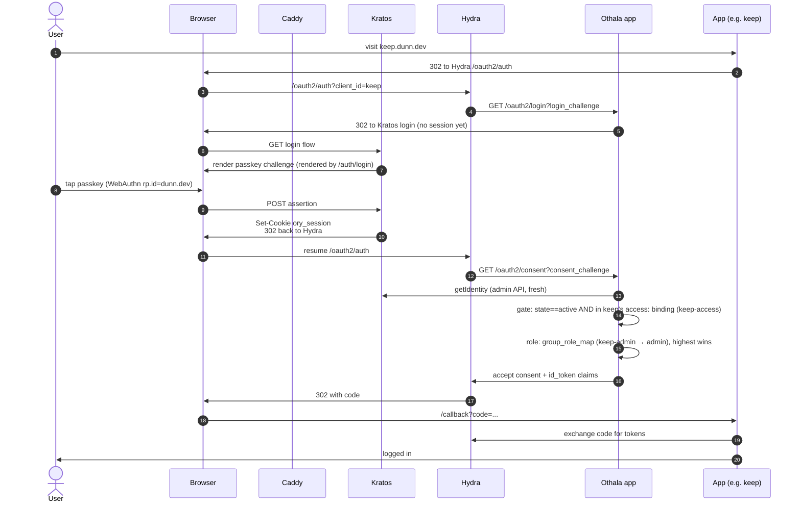
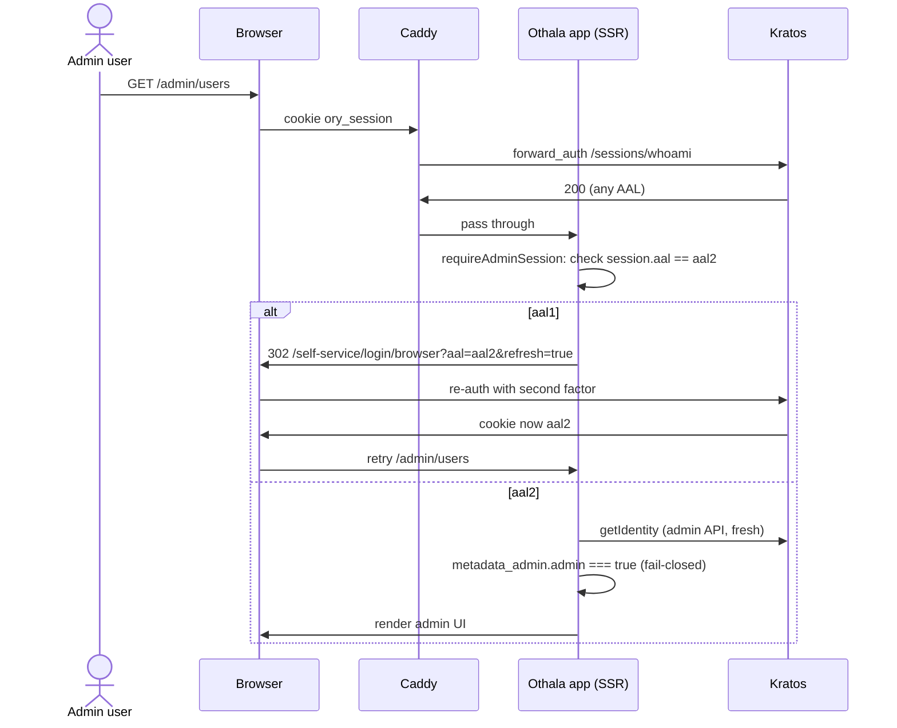
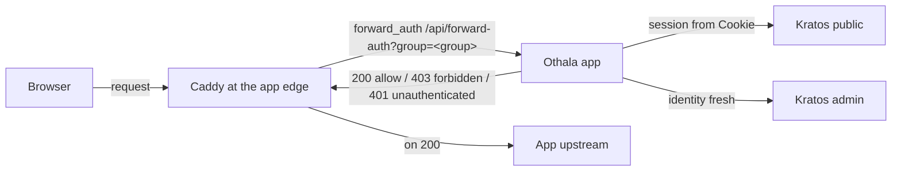

# Architecture map

Load-bearing decisions catalog + topology + flows. Read this if you
(human or LLM) are picking up Othala cold and need to understand where
the landmines are.

This is NOT a tutorial. It is a finger-pointer at the decisions that
matter: what they are, where the code lives, and what would break if you
changed them. Each entry is short on purpose; follow the cross-references
for depth.

## Doc source-of-truth hierarchy

Each doc has exactly one job. Follow this when editing or reading:

- **ARCHITECTURE.md** (this file): cold-start orientation + load-bearing decisions. The authoritative anchor; all other docs defer to it.
- **CHANGELOG.md** and git tags: the only place release/version state is asserted. Do not state versions elsewhere.
- **README.md**: front door; links the others; asserts no version of its own.
- **DEPLOY.md**: consumption contract; links ARCHITECTURE.md LB-12 rather than restating it.
- **AGENTS.md**: house rules for whoever maintains the repo. Instructions, not description; it defers here for what the system *is*.
- **docs/access-model.md**: the access-binding layer in full. The code cites it by section number, so it is the one place that restates the model at length.

This hierarchy is what prevents doc drift from recurring.

## Reading order

1. **Right now (this file)**: what is load-bearing, where to find it, topology + flows.
2. `site/src/content/docs/guides/golden-path.md`: the upgrade-durability commitments.
3. the ADRs (`docs/adr/`): historical substrate rationale (the Ory choice). Architecture section superseded by this file. ADRs are rewritten in place and never renumbered — the numbers are cited from inside the Ory configs the deploy plane vendors verbatim (LB-12).
4. `CHANGELOG.md` and git tags: current release state + what is next.
5. `DEPLOY.md`: bidirectional pointer to the deploy repo where production lives.

## The converged application

At HEAD the auth surface is ONE all-TypeScript application: the Othala
app (`portal/`, an Astro Node SSR app). It fronts the upstream Ory
substrate (Kratos + Hydra + Postgres). Read this before the load-bearing
list; it is the shape every decision below sits inside.

A Go LDAP bridge (`gitlab.com/dunn.dev/kratos-ldap`) exists as a separate
repo. It is an unmaintained reference and is not deployed: shelved
2026-06-26, when Cinema/Jellyfin moved to OIDC plus a Jellyfin-local
password for native clients (`docs/access-model.md` §13). Nothing in the
running system, the e2e stack, or CI touches LDAP. Where the diagrams and
tables below mention the bridge, they are describing a design that was
built and then parked, and they say so.

The app holds, all in one process:

- **Kratos self-service browser flows**: login, registration, recovery, settings, verification. Every flow except login renders generically through ONE `ui.nodes` dispatcher (`portal/src/components/FlowNodes.astro`); login keeps a bespoke passkey-first / password-in-disclosure UX plus the ᛞ→ᛟ rune greeting, and is intentionally NOT a `FlowNodes` consumer (`portal/src/pages/auth/login.astro`).
- **Hydra login / consent / logout CHALLENGE handlers** (`/oauth2/{login,consent,logout}`, `portal/src/lib/oauth2-handlers.ts`). Hydra ships no UI by design; this app IS Hydra's login + consent provider.
- **The access gate** (`portal/src/lib/gate.ts`): two fail-closed checks on BOTH the login and consent challenge: identity `state === 'active'` AND membership in at least one group the app's manifest binds for entry (`presentation.access:`, OR-semantics). A failed identity lookup is a closed gate. See LB-13.
- **The id_token claims builder** (`portal/src/lib/claims.ts`).
- **A dual-listener** (`portal/src/server/listen.mjs`): a public Astro SSR listener and a SEPARATE loopback / pod-only admin listener. Admin endpoints live off the public mux by construction. See LB-14.
- **The revoke fan-out** (`portal/src/lib/revoke.ts`, `revokeSubject`): in-process, wired to admin force-logout, user sign-out-everywhere, and deactivate. See LB-15.
- **Admin authority** (`portal/src/lib/admin-auth.ts`): the `metadata_admin.admin` marker (admin-API-only-writable, read fresh from the Kratos admin API), the SOLE source of admin authz. See LB-6 and LB-16.
- **OIDC client registration** (`portal/src/lib/manifests.ts` parser + `register-clients.ts` registrar + the full `validateClients` lint, bundled to `dist/server/register-clients.mjs`). The in-app registrar is the runner: a deliberate `--rm` one-shot (never on app boot, never route-triggered). CI exercises it via the `e2e` harness's `register-clients` compose service against `MANIFEST_DIR`; the deploy repo runs the same bundle via `just dag-reload-clients` (SIGHUP-driven; also runs on boot).

**The surface split.** Admin / programmatic calls go through the typed
Ory SDK (`@ory/client-fetch`): `admin-api.ts` (IdentityApi),
`oauth2-handlers.ts` and `revoke.ts` (OAuth2Api). The redirect-sensitive
Kratos self-service flows use thin raw-`fetch` wrappers (`kratos.ts`)
instead, because they must forward the incoming Cookie header verbatim
and follow Kratos's flow redirects, behaviour the SDK abstracts away.

**No identity cache.** The hot login/consent path always fetches a fresh
identity (`oauth2-handlers` → `admin-api.getIdentity`). A revoked or
deactivated subject fails the gate's `state` check on the next fetch, so
revocation is correct without any in-process identity cache to
invalidate. Do not add one.

**Back-channel logout is Hydra-native.** Hydra signs back-channel logout
tokens with its own key. The app holds NO signing key at rest.

**Single TS app owns registration.** Do not stand up a separate consent
or apply-runner service; the converged TS app is the sole registrar.
Decided in docs/adr/02-custom-portal-oidc-registrar.md.

## The load-bearing decisions

### LB-1: WebAuthn `rp.id = dunn.dev`

`kratos/kratos.yml: selfservice.methods.webauthn.config.rp.id`
(`${OTHALA_WEBAUTHN_RP_ID}`). One-way. Changing this invalidates every
passkey already enrolled. Documented in the ADRs (`docs/adr/05-passkey-first-auth.md`).

> **Adopters:** `dunn.dev` is this instance's value, set via
> `OTHALA_WEBAUTHN_RP_ID`. Substitute your own registrable domain. The
> caution below is about the one-way passkey-enrollment commitment once
> you have enrolled users — not about using `dunn.dev` specifically.

**If you change it after enrollment**: every user re-enrolls passkeys.
Choose your `rp.id` before first enrollment and don't change it.

### LB-2: Issuer URL `https://dag.dunn.dev/`

`hydra/hydra.yml: urls.self.issuer` (`${OTHALA_PUBLIC_URL}/`). Embedded
in every id_token's `iss` claim. Once a relying party is configured
against this issuer, changing it means re-onboarding that relying party —
one by one, by hand, across every app in the catalog.

> **Adopters:** `https://dag.dunn.dev/` is this instance's value, set
> via `OTHALA_PUBLIC_URL`. Substitute your own public FQDN. The caution
> below is about the lock-in once any RP is wired — not about using
> `dag.dunn.dev` specifically.

A WebFinger response on the dunn.dev apex would have to byte-match this
value. That response is not deployed — see LB-10.

**If you change it**: re-register every OIDC client.

### LB-3: `secrets.system` is non-rotatable

`hydra/hydra.yml: secrets.system`. Hydra's at-rest encryption key for
OAuth2 client secrets. Rotation is a database rebuild. Stored in sops.
Runbook: `docs/runbooks/secrets-rotation.md`.

**If you lose it**: every Hydra-encrypted column is unrecoverable.
Backup the sops file + age key separately and durably.

### LB-4: Cookie domain `.dunn.dev`

`kratos/kratos.yml: session.cookie.domain`. Parent-domain cookie so the
session is readable across every `*.dunn.dev` subdomain. Same-site
implication: `<othala-host>` and `<app>.<parent-domain>` are same-site to the
browser; CSRF posture must account for this (HIGH-1 in the security
review documents the specific path; `csrf.ts` is the mitigation).

**If you change it**: cross-subdomain SSO breaks; tighten the security
review for whatever new posture you adopt.

### LB-5: `subject_types: ["public"]`

`hydra/hydra.yml: oidc.subject_identifiers.supported_types`. Same `sub`
per user across every OIDC client, which is what lets an app key its own
records on `sub` and keep them across a rename. Apps that demand pairwise
(cross-client correlation prevention) would need a separate Hydra config
and a per-client decision. At this scale, with one household behind one
issuer, there is nothing to de-correlate.

### LB-6: Pod is one trust domain, no mTLS

See "Trust boundary" below + `site/src/content/docs/guides/golden-path.md`
"No mTLS in-cluster."
In-pod HTTP is unauthenticated except where specific bearer secrets gate
the Othala app's loopback admin listener (`OTHALA_ADMIN_ENDPOINT_BEARER`
for `/admin/revoke-user`, `RECOVERY_GATE_SECRET` for the kratos→app
recovery-gate webhook). Both are constant-time compared and fail-closed.
All other in-pod calls are trust-by-network-isolation.

**If you change it**: introduce mTLS or SPIFFE, and every in-pod call gets
a new failure mode.

### LB-7: Recovery-gate is the only Kratos hook

`portal/src/server/listen.mjs: handleRecoveryGate` +
`kratos/kratos.yml: selfservice.flows.recovery.after.code.hooks`.
Kratos posts the in-flight identity to the app's admin-port recovery-gate
before issuing a public recovery code; the gate reads the authoritative
`metadata_admin.admin` marker fresh from the Kratos admin API and returns
403 for any admin identity (admin recovery is console-only), fail-closed
(403) on a payload it cannot identify. The `admin` group
is NOT consulted here (display-only; see LB-16).

**If you add more Kratos hooks**: every new hook is a contract with
Kratos's webhook config schema across versions. Each addition is
upgrade-burden.

### LB-8: Othala app owns metadata_admin writes

`portal/src/lib/metadata-admin.ts: validateMetadataAdmin`. Kratos's
schema treats `metadata_admin` as opaque; the app is the only writer.
Documented in the security review, MEDIUM-3.

**If you add a second writer**: factor `validateMetadataAdmin` into a
shared validator so every writer enforces the same shape.

### LB-9: An app is one runtime manifest in `MANIFEST_DIR`

An app is a single unified `<slug>.yaml` manifest, read at request time
from `MANIFEST_DIR` (default `/etc/portal/manifests`) behind a 30-second
in-process cache. The v0.1 split (an Astro Content Collection under
`portal/src/content/apps/*.md` for tiles plus a separate
`hydra/clients/<slug>.yaml` for OIDC) is gone; one file now carries up to
three namespace blocks:

- `presentation:` — tile metadata (name, icon, description, url,
  `auth_kind`) plus `access:`, the list of groups bound for entry. Read by
  `portal/src/lib/tiles.ts` and, for the binding, `manifests.ts`. An
  optional sibling `<slug>.md` in the same directory is education content
  for the `/apps/<slug>` detail page.
- `oidc:` — the client fields forwarded to Hydra at registration. Read by
  `portal/src/lib/manifests.ts`.
- `consent:` — role + claim-emission shape, consulted at consent time.

The tile loader filters by the active user's `metadata_admin.groups` against
the same binding the OIDC gate uses (`userCanSeeTile` → `tileAccessGroups`,
`portal/src/lib/tiles.ts`), so a tile appears exactly when the gate would
admit the user. Every tile gates on group membership; there is no ungated
path. A `presentation:` block that binds no group at all falls back to
`OTHALA_DEFAULT_GROUP` (default `everyone`) for tile visibility only —
`everyone` is an ordinary group an admin assigns by hand, never auto-granted,
and the OIDC entry gate has no equivalent fallback: it denies. OIDC clients
are a **subset**: a manifest with only `presentation:` (a forward_auth or
external tile with no Hydra client) is skipped by the OIDC loader rather than
throwing. Because both loaders read the directory at runtime, adding or
removing an app is a manifest-dir change with **no image rebuild**. The
generic worked examples live in `e2e/manifests/`.

An invalid manifest set must fail loudly and must not take the portal down.
`validateClients` (`manifests.ts`) BLOCKs the reload; `lib/manifest-store.ts`
is what every request path calls and keeps serving the last known good set
while logging under `[portal:manifests]`, surfacing staleness through
`manifestHealth()`. Cold-starting onto a broken catalog serves the empty set,
which denies everywhere. Strict callers — the registrar and the lint CLI —
call `manifests.ts` directly and must keep throwing.

**If you change this convention**: the slug is the filename
(`<slug>.yaml` ⇄ `<slug>.md`) and the `oidc.client_id`. Renaming either side
breaks the lookup. Group names are NOT part of this: they are the operator's,
bound by the manifest, and matched against nothing (see "Group model").

### LB-10: WebFinger belongs at the dunn.dev apex, NOT here — and is not built

**Status: not deployed.** Nothing serves WebFinger today, and Tailscale is
not an OIDC consumer of this instance. The decision is recorded because it
constrains *where* the endpoint may go if it is ever built, and that
constraint is easy to get wrong.

Tailscale KB-1240 requires WebFinger at
`${email-domain}/.well-known/webfinger`. For dunn.dev family emails that is
`dunn.dev/.well-known/webfinger` — the apex, which Othala does not serve.
The intended home is a Cloudflare Pages function in the dunn.dev apex repo;
the work exists there only as an unmerged branch. The dag edge Caddyfile
carries a matching comment saying WebFinger is deliberately not served on
`dag.dunn.dev`.

**If you add a WebFinger handler here**: Tailscale won't find it. Putting it
on a subdomain violates the spec, whatever the subdomain is.

### LB-11: Sops + age is the single secrets source

The operator's sops-encrypted secrets store. Secrets are sops + age.
The deploy plane maps the `dag_*` sops keys onto the app's env targets
(`OTHALA_ADMIN_ENDPOINT_BEARER`,
`RECOVERY_GATE_SECRET`, `CSRF_SECRET`, `LDAP_BRIDGE_ADMIN_URL` /
`LDAP_BRIDGE_ADMIN_TOKEN`, plus the Kratos/Hydra admin tokens and the
per-client `*_CLIENT_SECRET`s). Documented in
`docs/runbooks/secrets-rotation.md`, `docs/runbooks/cookie-rotation.md`,
`docs/runbooks/postgres-backup.md`.

### LB-12: The deploy plane is a separate vendor-pin config repo

The deploy repo is the primary deployment view; this repo is the
transitory upstream (OSS-bound, the standalone Othala project). Deploying
to the SSO host is the promotion event that takes Othala from speculative
to actual.

The deploy repo vendors config files pinned to a released Othala tag,
under the `dag` service grouping (`services/dag/`). Drift between
Othala-HEAD and the deploy pin is expected and permitted; the deploy repo
decides when to consume a new release. There is no submodule or subtree
between the repos; that dependency format was rejected. The contract is a
released tag, not a live pointer.

The published application image is named **othala**. The instance
grouping in the deploy repo is **dag**: `services/dag/`, `dag-*`
quadlets, the `dag.network`, `dag_*` sops keys. The functional Ory
service names (kratos / hydra / postgres) keep their role names.

Topology-specific differences (DSN host) are deploy-local deviations
documented in each vendored file's provenance header.

Four files are stricter than that: `kratos/kratos.yml`, `hydra/hydra.yml`,
`kratos/identity.schema.json`, and `kratos/hooks/recovery-gate.jsonnet` are
vendored **byte for byte** and the deploy plane fails its own check on any
divergence. Editing one of them here is the start of a re-vendor, not a local
change. ADR 13 is the written contract.

See `DEPLOY.md` (in this repo) for the full promotion path and deploy
shape.

**If you change a config file here**: tag a new Othala release, then the
operator bumps the deploy pin (sync configs, review diff, port desired
changes, update provenance headers, commit).

### LB-13: The access gate is fail-closed on binding AND state

`portal/src/lib/gate.ts: enforceAccessGate`. Two checks, both applied on
BOTH the login and consent challenge handlers, both fail-closed:

1. `identity.state` must be exactly `"active"`. Deactivated identities are
   denied. The check is explicit and unconditional, so the skip-login path
   and the consent path (which read the identity via the admin API, where
   `state` is present) also reject inactive identities.
2. The identity must hold at least one group the client's manifest binds
   for entry — `manifest.accessGroups`, OR-semantics, read from
   admin-managed `metadata_admin.groups`. The binding is data
   (`presentation.access:`, parsed by `access-groups.ts`); the gating group
   is never derived from the `client_id` or the slug, and a group's name
   carries no meaning to this code.

Absence denies. A null identity (lookup failed upstream) is a closed gate;
so is an unknown client with no manifest, and so is a manifest whose
binding is empty — `validateClients` BLOCKs that manifest at load, and if
one reached the gate anyway it would be denied, not defaulted.

The one bypass is `consent.skip_access_check: true`, which skips check 2
only. Check 1 is never skipped by anything.

**Entry is not derived from role.** Holding `<svc>-admin` does not admit
anyone; `<svc>-access` does, for everyone, admins included. See "Group
model" for why that is worth the extra group on each admin identity.

These are pure functions over an already-fetched identity, unit-tested
without a running Kratos.

**If you weaken either check**: a deactivated or non-entitled subject can
complete a flow. Both checks are the gate; neither is optional.

### LB-14: Dual-listener, admin off the public mux by construction

`portal/src/server/listen.mjs`. Two in-process HTTP listeners bound
separately:

- **Public** (`PORT`, code default 4321, on `HOST` default `0.0.0.0`;
  set to 8080 in `e2e/compose.yml` and production) serves the Astro SSR
  handler: the OAuth2 challenge providers, the family UI, `/auth/*`,
  `/admin/*` pages. This is the only handler exposed to the network.
- **Admin** (`ADMIN_PORT`, code default 4431, on `ADMIN_HOST` default
  `127.0.0.1`, loopback / pod-only; set to 4431 in `e2e/compose.yml`
  and production) is a SEPARATE `http.createServer` with its own tiny
  mux: `GET /healthz`, `GET /readyz`,
  `POST /admin/revoke-user` (bearer `OTHALA_ADMIN_ENDPOINT_BEARER`),
  `POST /admin/recovery-gate` (bearer `RECOVERY_GATE_SECRET`).

The admin mux NEVER delegates to the Astro handler, and the public handler
never sees the admin POST routes. The two muxes are disjoint, so no
challenge provider and no public route is reachable on the admin port, and
the privileged endpoints are not reachable from the network. Both bearer
checks are constant-time (`timingSafeEqual`) and fail-closed: an unset
secret rejects every request.

**If you collapse the listeners**: the privileged revoke/recovery-gate
endpoints become network-reachable. The split is the boundary.

### LB-15: revokeSubject is the single in-process revocation fan-out

`portal/src/lib/revoke.ts`. One function called by all three triggers:
admin force-logout, user sign-out-everywhere (steps 2-5), and deactivate
(step 1, then 2-5). It calls the Kratos + Hydra admin APIs directly
through the typed Ory SDK: no string-interpolated admin URLs, no
out-of-process HTTP hop (the old portal→consent boundary is gone).

Ordered fan-out (do not reorder; steps 1-2 are the hard cut):

1. (deactivate trigger only) Kratos state → inactive. MUST precede step 2,
   so a session re-minted in the race window is itself for an inactive
   identity (the gate then denies).
2. Kratos sessions revoke. FAILURE ABORTS the fan-out; without this the
   subject keeps a live Kratos session and the cut is a no-op.
3. Hydra login-session revoke. Cuts the `loginRememberFor` window so a
   remembered subject cannot skip-login a fresh token. Idempotent.
4. Hydra consent-session revoke. Invalidates granted consent + associated
   access tokens. Idempotent.
5. LDAP bind-cache flush (BEST-EFFORT). Skipped silently when
   `LDAP_BRIDGE_ADMIN_URL` is unset; a failure here NEVER aborts or rolls
   back steps 1-4.

Upstream failures on steps 1-4 throw a prescriptive `RevokeError` naming
the dependency (`kratos-admin` / `hydra-admin`) and the operator's next
action; the raw upstream error is never surfaced to the caller. There is
no identity cache to invalidate (see "No identity cache" above).

**If you reorder steps 1-2**: you open a revoke race. The abort-on-step-2
behaviour is what makes the cut atomic enough.

### LB-16: metadata_admin.admin is the sole admin authz; the `admin` group is display-only

`portal/src/lib/admin-auth.ts` (`isAdminMarker`). Admin authority is the
`metadata_admin.admin` boolean on the Kratos identity: writable ONLY via
the Kratos admin API (never through self-service flows or OIDC claim
mapping), absent from the public `whoami` response, and read fresh from
the admin API on every check. Strict `=== true`; fail-closed on any other
shape. It is the SOLE authz at `requireAdminSession`, the recovery-gate
refusal, and the admin page gates. See ADR 08 for the full model (the
bootstrap floor, and its honest gaps).

The `admin` group is DISPLAY-ONLY: it still renders in the admin
UI's group chips and may drive per-app role derivation, but no code path
gates admin access, recovery refusal, or admin authority on it. An admin
removing the `admin` group from their own identity therefore cannot drop
their own admin authority; the marker rides the admin-API write boundary,
not a user-editable surface.

**If you re-gate admin on the group**: self-demote becomes a lockout
vector, and a display-group write can grant admin. Keep authz on the
marker.

## Topology

Production topology after the locked Ory pivot. Custom Caddy image at
`registry.gitlab.com/dunn.dev/caddy-estate` (xcaddy +
`caddy-dns/cloudflare`), DNS-only Cloudflare in front, port-forward 443 on
the home router. Kratos + Hydra + the Othala app all run in the same SSO
pod. Single auth surface: `dag.dunn.dev`. No LDAP bridge runs anywhere:
the Jellyfin pod is Jellyfin alone, authenticating browsers over OIDC and
native clients with a Jellyfin-local password.

```
                           Cloudflare DNS (gray cloud, no proxy)
                                  │
                                  ↓
                           home IP : 443 (port-forwarded)
                                  │
                                  ↓
                           SSO host
                             ├─ Envoy (L4 SNI router on 80/443)
                             ├─ per-pod Caddy sidecars (dunn.dev/caddy-estate, DNS-01 ACME)
                             ├─ SSO pod (single pod network)
                             │    ├─ kratos (4433 public, 4434 admin internal-only)
                             │    ├─ kratos-courier (singleton, sends recovery emails)
                             │    ├─ hydra (4444 public, 4445 admin internal-only)
                             │    ├─ hydra-migrate (init container, schema migrations)
                             │    ├─ othala app (Astro Node SSR)
                             │    │    ├─ public listener 8080  → dag.dunn.dev (path-shared with Kratos + Hydra)
                             │    │    │    ├─ /                       session-gated tile dashboard
                             │    │    │    ├─ /apps/<slug>            per-app education page
                             │    │    │    ├─ /oauth2/{login,consent,logout}  Hydra challenge providers
                             │    │    │    ├─ /auth/{login,recovery,settings,verification}
                             │    │    │    └─ /admin/{users,groups,oauth2}
                             │    │    └─ admin listener 4431 (loopback / pod-only)
                             │    │         ├─ /healthz, /readyz
                             │    │         ├─ /admin/revoke-user      (OTHALA_ADMIN_ENDPOINT_BEARER)
                             │    │         └─ /admin/recovery-gate    (RECOVERY_GATE_SECRET)
                             │    │   (WebFinger: not served — see LB-10)
                             │    └─ postgres (kratos + hydra databases)
                             ├─ jellyfin pod
                             │    └─ jellyfin (OIDC; native clients use a local password)
                             └─ all other app pods
                                  ├─ caddy sidecar (TLS via DNS-01 ACME)
                                  └─ app container

home portal health check:
  index.astro → kratos:4433/health/alive (in-pod fetch, 2s timeout)
  No edge cache: state determination is per-request.
```

### Cloudflare's role

DNS hosting + DNS-01 ACME via API. **Not in the auth or app request
path** for the app or OIDC flows. No CF Tunnel, no CF Access, no Worker,
no KV. Cloudflare never sees TLS plaintext for app/auth flows.

One Cloudflare-served endpoint exists on the dunn.dev apex: the landing
page at `dunn.dev/`, outside the auth substrate's concern. A WebFinger
Pages function at `dunn.dev/.well-known/webfinger` is where the OIDC
issuer JRD would go if it were ever needed; it is not deployed (LB-10).

### Why the app on the SSO host, not Workers

With the app on Workers, the admin pages had to fetch `kratos:4434` (the
Kratos admin port). That hostname resolves only inside the SSO pod
network; from a Worker it is unreachable. The locked decision "admin port
stays internal" jointly with "Astro on Workers" was inconsistent.

Running the app in the same pod as Kratos and Hydra makes the admin port
reachable directly. It also collapses runtime complexity: one Node
process, normal `process.env`, no Workers shims, no `wrangler` deploy
step. The dual-listener (LB-14) keeps the privileged endpoints off the
public mux.

### Bootstrap order

1. Host boots (bootc immutable image, storage pools, networking)
2. Postgres pod up
3. **Hydra schema migration** (init container; `hydra migrate sql up`)
4. Kratos + Hydra serve up
5. Othala app up (public + admin listeners)
6. Caddy sidecars obtain DNS-01 certs
7. App pods come up as Hydra OIDC clients, or behind Caddy `forward_auth`.
   Jellyfin's native clients use a Jellyfin-local password, not LDAP.

Nothing joins after that. Tailscale has never been wired as a Hydra client
here, and until a rollout exists it is not part of this topology.

## Request flows

### Login flow with passkey

The default family path. Password is the fallback; AAL2 step-up only fires
for `/admin/*`.



### Tile dashboard render (admin AAL2 step-up)

Admin pages live at `<othala-host>/admin/*`. AAL is per-flow in Kratos, so
the SSR layer is what enforces step-up. The tile dashboard itself
(non-admin `/`) skips the AAL2 branch and renders from
`metadata_admin.groups`. Admin authority itself is the
`metadata_admin.admin` marker (LB-16), checked in
`requireAdminSession` after the AAL2 step-up — the guard enforces the
trinity: active session + AAL2 + admin marker.



Per adversarial review: AAL is enforced at the SSR layer because Kratos
AAL is per-flow, not per-route. Caddy alone cannot conditionally gate on
JSON-body claims.

### Forward-auth (edge-gated apps)

For apps that speak no OIDC, Caddy asks a question at the edge and gets a
yes or no. There are two shapes, and the difference matters:

- **Session only.** `caddy/snippets/forward-auth.caddy` forward-auths to
  Kratos `/sessions/whoami`. It establishes that a valid session exists,
  copies the authenticated identity id through, and strips every spoofable
  inbound identity header. It performs **no group check** — whoami emits no
  groups.
- **Session and group.** The portal ships `/api/forward-auth?group=<group>`
  (`portal/src/pages/api/forward-auth.ts`). It verifies the session from the
  request's own Cookie header, fetches the identity fresh from the Kratos
  admin API, and applies `enforceGroupGate`: `state === 'active'` AND
  membership in the named group. Fail-closed throughout. The 401/403 split is
  load-bearing: 401 is returned ONLY when there is no usable session. Every
  authorization failure — bad `group` param, identity lookup failure, inactive
  identity, not in the group, Kratos unreachable — is a flat 403.

The `group` param is operator-controlled config, and the charset check on it
is an input guard, not a naming policy: `observe-access` and bare `observe`
both pass.

**This gate is why `session.whoami.required_aal` in `kratos/kratos.yml` must
stay `aal1`.** Under `highest_available`, whoami returns
`session.identity = null` for MFA-enabled identities; the endpoint reads that
as no session and 401s, so every forward-auth app would lock out exactly the
users who enrolled a second factor. The setting looks like dead config and is
not — ADR 15 records why, after the constraint was nearly deleted on the
strength of a comment that justified it by the retired LDAP bridge. This is
not laxity: AAL2 is enforced per-flow, at `requireAdminSession` in the SSR
layer (LB-16), and the settings flow carries its own `required_aal`. Note also
that `kratos.yml` is byte-vendored (LB-12), so touching this is a re-vendor.



## Auth patterns

Every app falls into one of these patterns, fixed at deploy time per app via
the Caddyfile snippet it imports. The production Caddy config lives in the
deploy repo's service config (e.g. `services/dag/`).

Each `e2e/manifests/<slug>.yaml` example declares its pattern via
`presentation.auth_kind`. The worked examples below map to those
fixtures.

| Pattern | `auth_kind` | Example fixture | One-line summary |
|---|---|---|---|
| **OIDC native** | `oidc` | grafana (with role mapping), audiobookshelf | App redirects to `<othala-host>/oauth2/auth`, exchanges code for tokens at `/oauth2/token`; Caddy is just TLS + reverse proxy. |
| **Forward auth** | `forward_auth` | proxywatch | Caddy `forward_auth`, either session-only against Kratos `/sessions/whoami` or session-and-group against the portal's `/api/forward-auth?group=` (see the flow above). No Hydra client; presentation-only manifest. |
| **External / link-out** | `external` | statuspage | A tile that links out to an externally-authenticated app; no Othala-managed auth. |
| **Client-credentials** | `oidc` | (machine-to-machine, e.g. vLLM) | Caddy validates `Authorization: Bearer` via Hydra's `/admin/oauth2/introspect`; in-pod sidecar pattern. No `redirect_uris`. |
| **LDAP outpost** | `ldap`, `oidc+ldap` | — | **Parked, not deployed.** The design: a glauth-kratos bridge co-located in the app pod presenting Kratos identities over LDAPS:636, the app binding against `localhost:636`, LDAP traffic never touching Caddy. Shelved 2026-06-26; the values still parse, nothing runs them, and the bridge delegates the group check to the app's own LDAP filter rather than enforcing it (`docs/access-model.md` §13). |

## Group model

`metadata_admin.groups[]` is a flat list of strings on the Kratos identity.
Every group in it is just a string. **A group's type comes from what binds
it, never from what it is called.** `portal/src/lib/group-registry.ts`
derives the type, and its header comment records the deliberate retirement of
the older scheme, in which anything matching `access-*` was treated as an
access group. Three kinds, and one group may carry more than one:

| Kind | Bound by | Grants |
|---|---|---|
| `identity` | listed in `OTHALA_IDENTITY_GROUPS` | nothing on its own; it is assignment vocabulary for the admin UI |
| `access` | some manifest's `presentation.access:` | ENTRY to that app |
| `role` | some manifest's `consent.group_role_map` key | a ROLE inside that app |

### Entry is explicit; nothing is derived

Per service there are exactly two groups: `<svc>-access` and `<svc>-admin`.

- **Entry** comes from holding `<svc>-access`. Always, for everyone, admins
  included.
- **Role** comes from additionally holding `<svc>-admin`.

An identity holding only `<svc>-admin` is **not** admitted. That is a
misconfigured identity, not a supported shortcut, and no code compensates for
it. Admin-implies-access does not exist here and must not be reintroduced:
the manifest's `access:` list names only the `-access` group, and adding the
`-admin` group to that list is exactly the mechanism that would restore the
derivation.

The point is intelligibility. "Can this person get in?" is answered by
looking at one group, with no rule to remember and no second place to check.
The cost is one extra group on each admin identity, paid once at
provisioning. That is the trade, and it was made deliberately.

The names are convention. `<svc>-access` and `<svc>-admin` read well in a
catalog, and nothing enforces them: the only constraint any code applies to a
group name is a charset (`^[a-z0-9][a-z0-9-]*$`, `lib/access-groups.ts`).

### Role resolution is order-independent

Because admins now routinely hold two groups that BOTH appear in one app's
`group_role_map`, stored order would otherwise decide the role — and stored
order is not a safe input. `normalizeGroupOrder` sorts non-identity groups
alphabetically, which puts `cinema-access` before `cinema-admin`, and
identities touched through the Kratos admin API outside the admin form carry
no ordering promise at all.

`lookupRole` (`portal/src/lib/claims.ts`) therefore maps every stored group
through `group_role_map` and keeps the HIGHEST-ranked declared role, where
rank is the role's declaration index in `consent.roles` (0 is highest). The
result is a pure function of the group SET; no permutation changes it.
`normalizeGroupOrder` survives as cosmetic — stable display, stable diffs —
and is NOT what makes role resolution deterministic. Rank-by-declaration-order
is a convention that no code enforces; if it ever needs teeth, the place to
put them is `manifest-lint.ts`.

### Identity groups and the `admin` group

Identity groups are the vocabulary the admin UI offers when assigning
membership: `admin` first, then whatever `OTHALA_IDENTITY_GROUPS` declares,
then the default group (`OTHALA_DEFAULT_GROUP`, default `everyone`). Adding
one is an env change, no code.

The `admin` identity group is DISPLAY-ONLY for authz (LB-16). It renders in
the UI and, like any group, may appear in some app's `group_role_map`, but no
code path gates portal admin authority on it — that is the
`metadata_admin.admin` marker, and only that.

### Tile visibility matches the gate

The tile launcher renders a tile exactly when the entry gate would admit the
user: `userCanSeeTile` reads the same `access:` binding, with the same
OR-semantics (`portal/src/lib/tiles.ts`). There is no ungated tile. A
`presentation:` block that binds no group at all falls back to
`OTHALA_DEFAULT_GROUP` for visibility only; `everyone` is an ordinary group
an admin assigns by hand, never auto-granted, and the OIDC gate has no
matching fallback — it denies.

### Group and credential change lag

Edits to a user's groups or credentials do not propagate instantly.
Worst-case lag per consumer:

| Surface | Lag | Source |
|---|---|---|
| Tile launcher / OIDC consent gate | next flow | reads Kratos fresh per flow |
| Forward-auth edge decision | next request | fetches the identity fresh per request |
| OIDC consent (decision remembered) | up to Hydra `consentRememberFor` | Hydra remember window |
| App refresh-token horizon | up to Hydra refresh-token TTL | Hydra refresh token |
| LDAP bridge SEARCH / BIND | n/a — bridge not deployed | would be the bridge's identity- and bind-cache TTLs |

The fast revocation path is the admin `Revoke user` action, which runs
`revokeSubject` (LB-15): it kills the Kratos session and Hydra's
login + consent remember in one action, and best-effort flushes the LDAP
bind cache — a step that is skipped silently today, since
`LDAP_BRIDGE_ADMIN_URL` is unset and no bridge runs. When a member loses a
device, an admin clicks Revoke rather than waiting for a TTL. The OIDC
consent gate has no app-side identity cache, so the next flow re-fetches and
the deactivated or ungrouped subject is denied at the gate.

## Trust boundary

The SSO pod is one trust domain. Kratos (public + admin), Hydra (public +
admin), the Othala app (public + loopback admin listeners), and Postgres
all sit on the same pod network. Defense-in-depth between services inside
the pod is partial-and-deliberate:

| Edge | Posture | Enforcer |
|---|---|---|
| Caddy → Kratos public / Hydra public / app public | TLS terminated at Caddy; HTTP within the pod | Caddyfile + pod network |
| Kratos → app recovery-gate (admin listener) | Bearer `RECOVERY_GATE_SECRET`, constant-time, fail-closed | `listen.mjs` |
| operator/admin UI → app `/admin/revoke-user` (admin listener) | Bearer `OTHALA_ADMIN_ENDPOINT_BEARER`, constant-time, fail-closed | `listen.mjs` |
| Caddy → app `/api/forward-auth` | Session verified from the request's own cookie; identity fetched fresh; group checked; fail-closed | `forward-auth.ts` + `gate.ts` |
| app → Kratos admin (`:4434`) | No auth; pod-network isolation | pod network |
| app → Hydra admin (`:4445`) | No auth; pod-network isolation | pod network |
| app → kratos-ldap admin | Bearer `LDAP_BRIDGE_ADMIN_TOKEN`, best-effort — inert, no bridge deployed | `revoke.ts` |

The privileged endpoints (`/admin/revoke-user`, `/admin/recovery-gate`)
sit on the loopback admin listener (LB-14), so they are not network
reachable; the bearer checks are defense-in-depth on top of the
listener-split. Tier-2 attackers (RCE on a non-SSO-pod app like
Vaultwarden) are network-isolated to their own pod and cannot reach this
trust domain. Tier-2 RCE on the Othala app yields the bearer tokens in its
process memory; the surface is limited to "things this app was already
authorized to do."

### metadata_admin write boundary (MEDIUM-3)

All `metadata_admin` writes go through `portal/src/lib/metadata-admin.ts`
(`validateMetadataAdmin`). Kratos validates `traits` against the identity
schema but treats `metadata_admin` as opaque, so a typo (`grupos` instead
of `groups`) would otherwise be accepted silently. The application-layer
validator catches that. The Kratos admin port (`:4434`) is reachable only
from inside the SSO pod; no external write path exists.

### Recovery-gate fail-closed (A4)

If the app's admin listener is down during a recovery flow, Kratos's
`web_hook` timeout fires and the flow aborts (fail-closed): Kratos will
not issue a privileged settings session if the can-interrupt hook returns
non-2xx OR times out. UX cost: non-admin family recovery aborts during an
app outage. Acceptable: family-scale outages are operator-resolved within
minutes.

### Cookie domain + CORS posture (A5)

A compromised app on `<app>.<parent-domain>` can read its own cookies but NOT the
Kratos session cookie (HttpOnly). The browser treats `<othala-host>` and
`<app>.<parent-domain>` as same-site (shared registrable parent), so:

- Service-worker fetch-with-credentials is blocked at the IDP CORS layer.
  Kratos `allowed_origins` lists only `https://<othala-host>`. Hydra's
  `allowed_origins` is extensible (`OTHALA_CORS_ALLOWED_ORIGINS`, comma-
  separated) to admit additional browser-SPA client origins (e.g. an oCIS
  Web instance that fetches Hydra's discovery/token endpoints directly) —
  each admitted origin is still an explicit allowlist entry, not a wildcard.
- Form-driven CSRF (HIGH-1): `SameSite=Lax` permits same-site POSTs, so a
  top-level form on `<app>.<parent-domain>` posting to
  `<othala-host>/admin/users/<id>` would carry the session cookie. HIGH-1
  closed this by adding per-request CSRF tokens to every admin form POST
  (`csrf.ts`, secret `CSRF_SECRET`).

Cross-subdomain cookie reach is the design constraint that motivates the
parent-domain decision (locked: WebAuthn rp.id requires it). The CSRF gate
is the matching mitigation.

### Backup correctness across Hydra encryption-at-rest (A6)

`docs/runbooks/postgres-backup.md` covers the basics. Partial-state
restore (Postgres consistent at the database level but not across the
`kratos` and `hydra` databases) yields drift between Kratos identities and
Hydra remembered-consent rows. At family scale the recovery is "wipe Hydra
remembered-consent rows + force re-login," not "fix the row." See the
runbook's "Partial-state restore" section.

### mTLS gap (A7)

No mTLS between SSO-pod services. The pod boundary is the trust unit;
podman network isolation prevents cross-pod traffic; SELinux + backed
storage close other lateral paths. Tier-2 RCE on any SSO-pod service
yields full pod-internal lateral. Family scale and single-tenancy mean
this is acceptable; the gap to enterprise posture (mTLS or SPIFFE) is not
justified at this scale. Documenting the choice so it does not quietly
drift.

## Image tag pinning (L6)

Production posture: pin every image to a known-good version. Renovate
proposes bumps stack-wide. Never roll to `latest` to "see if it fixes
things."

| Image | Pin | Renovate-managed |
|---|---|---|
| `docker.io/oryd/kratos` | see the deploy quadlets (authoritative) | yes |
| `docker.io/oryd/hydra` | see the deploy quadlets (authoritative) | yes |
| `docker.io/library/postgres` | see the deploy quadlets (authoritative) | yes |
| `registry.gitlab.com/dunn.dev/caddy-estate` | see the deploy quadlets (authoritative) | yes |
| `registry.gitlab.com/dunn.dev/othala` | see the deploy quadlets (authoritative) | self-managed |

The `othala` image is the converged app. Current pinned versions live in the
deploy quadlets (`Image=` lines). `CHANGELOG.md` and git tags state the
deployed version. Do not restate version numbers here.

A `registry.gitlab.com/dunn.dev/kratos-ldap` image exists and its quadlet is
shelved, so it is pinned but not running. It is not part of this stack.

Bumping pins:

1. Pull the candidate image to a lab VM (or the QEMU-CI lab, when wired).
2. Run the lab substrate against it; smoke-test through Playwright.
3. If green, update the pin in the deploy quadlets.
4. Deploy, verify, document.

Ory's release cadence is roughly annual minor releases with infrequent
breaking changes. `site/src/content/docs/guides/golden-path.md` lists the
integration choices that keep the integration durable through those
transitions.

## Custom Caddy image

`registry.gitlab.com/dunn.dev/caddy-estate`: built with xcaddy +
`caddy-dns/cloudflare`. Forward-auth uses Caddy's built-in `forward_auth`
directive, pointed either at Kratos (session only) or at the portal's
`/api/forward-auth?group=` endpoint (session and group).

## Reversibility

If lab outcomes go red, the documented fallback is kanidm (single binary;
bus-factor and AI-ban accepted in exchange for substrate quality). The
bench harness is reusable. Eval evidence is retained in git history.

## Where the code lives

| Service | Path | Language | Purpose |
|---|---|---|---|
| Kratos config | `kratos/` | YAML | Identity (login, recovery, MFA, session) |
| Hydra config | `hydra/` | YAML | OIDC OP, OAuth2 AS |
| App manifests (runtime) | `MANIFEST_DIR` (`/etc/portal/manifests`) | YAML + MD | Per-app `presentation:` / `oidc:` / `consent:` blocks + optional `<slug>.md` education content; read at request time. Examples in `e2e/manifests/`. |
| Access model | `docs/access-model.md` | Markdown | The binding layer in full; the code cites it by section |
| Othala app | `portal/` | Astro + TS | Tile dashboard + Kratos flows + Hydra login/consent/logout + access gate + forward-auth endpoint + claims + revoke + admin UI + manifest loaders + client registrar |
| LDAP bridge (shelved) | `gitlab.com/dunn.dev/kratos-ldap` | Go | glauth-kratos: LDAPS → Kratos identity backend. Separate repo, unmaintained reference, not deployed |
| E2E harness | `e2e/` | Shell + YAML | QEMU-CI smoke harness (compose stack + smoke scripts + gen-secrets) |
| CI / build | `.gitlab-ci.yml` | GitLab CI YAML | Per-service verify + container-image + sbom + release |

## Test surface and honest strengths

The substantive, real test coverage (from the CV audit):

| Test set | Lives in | Asserts |
|---|---|---|
Two harnesses, both wired into CI's `test-portal` job: `portal/scripts/*.test.mjs`
under tsx `--test`, and `portal/src/lib/*.test.ts` under vitest.

| Test set | Lives in | Asserts |
|---|---|---|
| Access gate | `portal/` gate tests | Fail-closed on BOTH the manifest binding AND state, on login and consent; null-identity denial; empty-binding denial (LB-13) |
| Forward-auth endpoint | `portal/scripts/forward-auth.test.mjs` | The 401-vs-403 contract, no trust in inbound identity headers, HEAD matching GET |
| Revoke fan-out | `portal/` revoke tests | Step ordering, abort-on-step-2, best-effort step-5 isolation, prescriptive error mapping (LB-15) |
| Dual-listener | `portal/` listen tests | Admin/public mux disjointness, constant-time fail-closed bearer checks (LB-14) |
| Admin authz | `portal/` admin-auth tests | `metadata_admin.admin` marker as sole authz; `admin` group not consulted (LB-16) |
| Client registrar | `portal/scripts/register-clients.test.mjs` | Field mapping, `consent:`-never-forwarded, create/update idempotency |
| E2E smoke evidence | `e2e/` + the project's adversarial security reviews | Live-stack validation |

Native back-channel logout with no signing key at rest (Hydra signs) is a
real reduction in attack surface, not a stub.

**Caveats, stated honestly.**

- `astro check` runs in CI's `check-portal` job, but it emits type hints that
  job does not fail on. It is a gate on hard errors, not a clean-tree gate.
- `npm run lint:manifests` exists and is NOT wired into CI. The manifest
  checks that actually gate are the BLOCK-class ones `validateClients`
  applies at load, exercised by the e2e job's registrar against
  `e2e/manifests/`.
- No test exercises LDAP, because nothing deploys it.

## Where to look when you're confused

| Question | Answer |
|---|---|
| "Why does this code exist?" | `git log --follow <file>` first; then the ADRs (`docs/adr/`) for high-level rationale. |
| "Why is this CHOICE locked-in?" | `site/src/content/docs/guides/golden-path.md` for upgrade-durability choices; the ADRs (`docs/adr/`) for one-time decisions. |
| "Who can get into app X?" | Whoever holds a group in that manifest's `presentation.access:`. One list, no derivation. See "Group model". |
| "Why does an admin need two groups?" | Because entry is never derived from role. See "Entry is explicit; nothing is derived". |
| "Where does production-X live?" | The deploy repo's service config (e.g. `services/dag/`) for runtime configs; THIS repo for application code. |
| "What's open vs fixed?" | `CHANGELOG.md` and git tags for top-level; the security review for findings. |
| "How do I deploy?" | `DEPLOY.md` (this repo's root). |
| "How do I add a new OIDC client?" | Drop a unified `<slug>.yaml` manifest (`presentation:` + `oidc:` + `consent:`, optional `<slug>.md` education sidecar) into `MANIFEST_DIR`, add `<SLUG>_CLIENT_SECRET` to sops, sync the dir to the host, then run the registrar from the deploy repo. No image rebuild. See `e2e/manifests/` for worked examples and `site/src/content/docs/guides/per-app-oidc.md` for the per-RP runbook. |
| "How do I rotate a secret?" | `docs/runbooks/*-rotation.md`. |

## Don't-Add-Here list

Things that would expand the codebase without obvious value at family
scale:

- **A full audit-log subsystem**. `/admin/activity` redirects to `/admin`
  (admin gate preserved). The audit-ingest path (alloy → Loki for archival, a Postgres
  summary table for the UI) is out of scope for the public release.
  `journalctl` is the current audit; expand only if family scale requires.
- **An in-process identity cache**. Revocation is correct without one (see
  "No identity cache"). Adding one reintroduces a stale-authz window.
- **A custom back-channel-logout signer**. Hydra signs natively; the app
  holds no key at rest. Do not reintroduce one.
- **OIDC self-service registration**. See
  `site/src/content/docs/guides/golden-path.md`.
- **mTLS / SPIFFE inside the SSO pod**. See LB-6.
- **Pairwise OIDC subjects**. See LB-5.
- **A federated identity story**. Single Kratos instance is the family scope.
- **K8s migration / Helm charts**. Podman + quadlets is the substrate.
- **Account Experience UI from Ory (closed-source OEL)**. The Othala app is the family UI.
- **Any rule that derives entry from something other than the access
  binding** — admin-implies-access, role-implies-access, a name prefix, a
  marker. It was removed on purpose. See "Group model".
- **Abstraction or config surface for hypothetical adopters.** This runs one
  household. A knob nobody here turns is maintenance somebody here pays for.
  Describing what is ours is the right generosity; promising to generalise is
  not.

If you find yourself adding one of these, ask first: is this what "single
maintainer + LLM leverage at family scale" actually needs?
