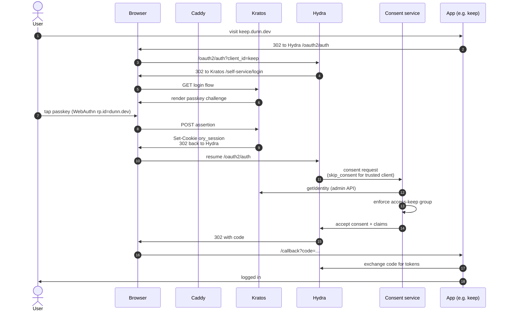
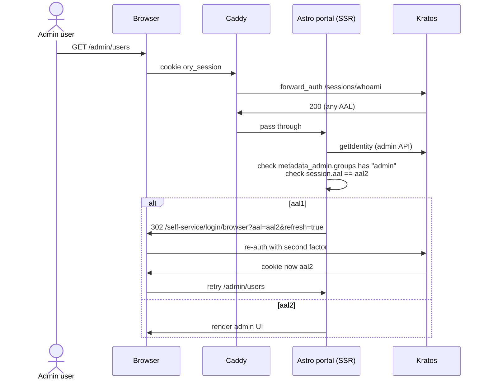
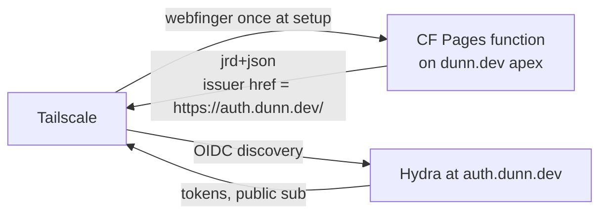

# Architecture map

Load-bearing decisions catalog + topology + flows. Read this if you
(human or LLM) are picking up the codebase cold and need to understand
where the landmines are.

This is NOT a tutorial. It's a finger-pointer at the decisions that
matter — what they are, where the code lives, and what would break
if you changed them. Each entry is short on purpose; follow the
cross-references for depth.

## Doc source-of-truth hierarchy

Each doc has exactly one job. Follow this when editing or reading:

- **ARCHITECTURE.md** (this file) — cold-start orientation + load-bearing decisions. The authoritative anchor; all other docs defer to it.
- **docs/STATUS.md** — the only place release/version state is asserted. Do not state versions elsewhere.
- **README.md** — front door; links the others; asserts no version of its own.
- **DEPLOY.md** — consumption contract; links ARCHITECTURE.md LB-12 rather than restating it.

This hierarchy is what prevents doc drift from recurring.

## Reading order

1. **Right now (this file)** — what's load-bearing, where to find it, topology + flows.
2. `docs/golden-path.md` — the upgrade-durability commitments.
3. `docs/decision.md` — historical substrate rationale (the Ory choice); architecture superseded.
4. `docs/STATUS.md` — current release state + what's next.
5. `DEPLOY.md` — bidirectional pointer to `dunn.dev/iac` where production lives.

## The 12 load-bearing decisions

### LB-1: WebAuthn `rp.id = dunn.dev`

`kratos/kratos.yml: selfservice.methods.webauthn.config.rp.id`. One-way.
Changing this invalidates every passkey already enrolled. Documented
in `docs/decision.md` "WebAuthn rp.id" row.

**If you change it**: every family member re-enrolls passkeys. Don't.

### LB-2: Issuer URL `https://auth.dunn.dev/`

`hydra/hydra.yml: urls.self.issuer`. Embedded in every id_token's
`iss` claim. Once a consumer (Tailscale, Vaultwarden, etc.) is
configured against this issuer, changing it means re-onboarding the
consumer.

Also byte-matches the WebFinger response on the dunn.dev apex (see
`docs/apex-webfinger-followup.md`).

**If you change it**: re-register every OIDC client and Tailscale
contacts support to migrate.

### LB-3: `secrets.system` is non-rotatable

`hydra/hydra.yml: secrets.system`. Hydra's at-rest encryption key for
OAuth2 client secrets. Rotation is a database rebuild. Stored in sops
(`carmine.hydra_system_secret`). Runbook: `docs/runbooks/secrets-rotation.md`.

**If you lose it**: every Hydra-encrypted column is unrecoverable.
Backup the sops file + age key separately and durably.

### LB-4: Cookie domain `.dunn.dev`

`kratos/kratos.yml: session.cookie.domain`. Parent-domain cookie so
the session is readable across every `*.dunn.dev` subdomain. Same-site
implication: `auth.dunn.dev` and `<app>.dunn.dev` are same-site to
the browser; CSRF posture must account for this (HIGH-1 in the security
review documents the specific path; csrf.ts is the mitigation).

**If you change it**: cross-subdomain SSO breaks; tighten the security
review for whatever new posture you adopt.

### LB-5: `subject_types: ["public"]`

`hydra/hydra.yml: oidc.subject_identifiers.supported_types`. Same `sub`
per user across every OIDC client. Tailscale needs this for stable user
identity. Apps that demand pairwise (cross-client correlation prevention)
would need a separate hydra config and a per-client decision.

### LB-6: Pod is one trust domain, no mTLS

See "Trust boundary" below + `docs/golden-path.md` "No mTLS in-cluster."
In-pod HTTP is unauthenticated except where specific bearer tokens gate
(`CONSENT_ADMIN_BEARER` for portal→consent admin, `X-Webhook-Auth` for
kratos→consent recovery-gate). All other in-pod calls are
trust-by-network-isolation.

**If you change it**: introduce mTLS or SPIFFE — every in-pod call
gets a new failure mode.

### LB-7: Recovery-gate is the only Kratos hook

`consent/recovery_gate.go` + `kratos/kratos.yml: selfservice.flows.recovery.after.code.hooks`.
Intercepts the post-recovery-code session-issue and returns 403 for
admin identities (admin email recovery is disabled; console-only). LOW-5
extends this to refuse-on-empty-groups as a defense against schema drift.

**If you add more Kratos hooks**: every new hook is a contract with
Kratos's webhook config schema across versions. Each addition is
upgrade-burden.

### LB-8: Portal owns metadata_admin writes

`portal/src/lib/metadata-admin.ts: validateMetadataAdmin`. Kratos's
schema treats `metadata_admin` as opaque; the portal is the only
writer. Documented in `docs/security-review-2026-05-04.md` MEDIUM-3.

**If you add a second writer**: factor `validateMetadataAdmin` into a
Go package shared with consent so both languages enforce.

### LB-9: Apps registry is `portal/src/content/apps/*.md`

Astro Content Collection. Each Markdown file is one app's metadata
(frontmatter: name, slug, url, icon, description, access_group) plus
education content (Markdown body). The tile dashboard reads this
collection, filters by the active user's `metadata_admin.groups` (must
include `access-<slug>`), and renders.

OIDC clients are a **subset**: only apps that need Hydra registration
have a corresponding `hydra/clients/<slug>.yaml`. Forward-auth apps
(tune/Navidrome, gather/Sonarr, etc.) have Markdown entries but no Hydra yaml.

**If you change this convention**: the slug across the Markdown file and
yaml is the cross-reference; renaming either side breaks the lookup.

### LB-10: WebFinger lives at dunn.dev apex, NOT here

Tailscale KB-1240 requires WebFinger at `${email-domain}/.well-known/webfinger`.
For dunn.dev family emails this is `dunn.dev/.well-known/webfinger`,
served by a Cloudflare Pages function in the dunn.dev apex repo.
**Not** by this project, **not** by the portal.

Consulted exactly once during Tailscale tenant setup; lock-in
afterward. See `docs/apex-webfinger-followup.md`.

**If you add a Webfinger handler here**: Tailscale won't find it.
Spec-violating to put it on a subdomain.

### LB-11: Sops + age is the single secrets source

`dunn.dev/iac/pyinfra/secrets.enc.yaml`. Bitwarden is OUT (the migration
landed in iac on 2026-05-30). Documented in `docs/runbooks/secrets-rotation.md`,
`docs/runbooks/cookie-rotation.md`, `docs/runbooks/postgres-backup.md`.

**If you write a Bitwarden mention into a runbook**: stale; correct
to sops.

### LB-12: `dunn.dev/iac` is the deploy plane (vendor-pin model)

iac is the primary deployment view; this repo is the transitory upstream
(OSS-bound, heading toward a standalone open-source project). Deploying
to carmine is the promotion event that takes auth from speculative to actual.

iac vendors config files pinned to a released auth tag (`services/auth/`).
Drift between auth-HEAD and the iac pin is expected and permitted — iac
decides when to consume a new auth release. There is no submodule or
subtree between the repos; that dependency format was rejected. The
contract is a released tag, not a live pointer.

Topology-specific differences (DSN host = `auth-postgres` in iac vs
`postgres` in lab compose) are iac-local deviations documented in each
vendored file's provenance header.

See `DEPLOY.md` (in this repo) + `dunn.dev/iac/services/auth/` (the
deploy plane).

**If you change a config file here**: tag a new auth release, then the
operator bumps the iac pin (`make auth-sync-configs`, review diff, port
desired changes, update provenance headers, commit).

## Topology

Production topology after the locked Ory pivot. Custom Caddy image at
`registry.gitlab.com/dunn.dev/caddy-estate` (built with xcaddy +
`caddy-dns/cloudflare` plugin), DNS-only Cloudflare in front,
port-forward 443 on home router. Kratos + Hydra + glauth-kratos +
consent service + Astro portal all on carmine, in the same pod network.
Single auth surface: `auth.dunn.dev` (Topology B — `home.dunn.dev` is
reserved, not served).

```
                           Cloudflare DNS (gray cloud, no proxy)
                                  │
                                  ↓
                           home IP : 443 (port-forwarded)
                                  │
                                  ↓
                           carmine
                             ├─ Envoy (L4 SNI router on 80/443)
                             ├─ per-pod Caddy sidecars (dunn.dev/caddy-estate, DNS-01 ACME)
                             ├─ auth pod (single pod network)
                             │    ├─ kratos (4433 public, 4434 admin internal-only)
                             │    ├─ kratos-courier (singleton, sends recovery emails)
                             │    ├─ hydra (4444 public, 4445 admin internal-only)
                             │    ├─ hydra-migrate (init container, schema migrations)
                             │    ├─ consent service (4477 internal)
                             │    ├─ portal (Astro Node SSR, 8080 internal)
                             │    │    └─ auth.dunn.dev (path-shared with Kratos+Hydra+consent)
                             │    │        ├─ /                       session-gated tile dashboard
                             │    │        ├─ /apps/<slug>            per-app education page
                             │    │        ├─ /auth/{login,recovery,settings,verification}
                             │    │        └─ /admin/{users,groups,oauth2,activity}
                             │    │   (home.dunn.dev: reserved, not served)
                             │    │   (WebFinger: dunn.dev apex Pages function, not here)
                             │    └─ postgres (kratos + hydra databases)
                             ├─ jellyfin pod
                             │    ├─ jellyfin
                             │    └─ glauth-kratos bridge (LDAPS 636 in-pod)
                             └─ all other app pods
                                  ├─ caddy sidecar (TLS via DNS-01 ACME)
                                  └─ app container

home portal health check:
  index.astro → kratos:4433/health/alive (in-pod fetch, 2s timeout)
  No Workers KV: state determination is per-request, no edge cache.
```

### Cloudflare's role

DNS hosting + DNS-01 ACME via API. **Not in the auth or app request
path** for the portal or OIDC flows. No CF Tunnel, no CF Access, no
Worker for the portal, no KV for state. Cloudflare never sees TLS
plaintext for app/auth flows.

Two narrow Cloudflare-served endpoints exist on the dunn.dev apex:

- **WebFinger** at `dunn.dev/.well-known/webfinger` — Pages function
  returning the OIDC issuer JRD for Tailscale tenant setup (consulted
  once, never per-login).
- The marketing landing page at `dunn.dev/` — outside the auth
  substrate's concern.

### Why portal-on-carmine, not Workers

adversarial-review-2 C1: with the portal on Workers, the admin pages
had to fetch `kratos:4434` (the Kratos admin port). That hostname
resolves only inside the carmine pod network; from a Worker it's
unreachable. The locked decision "admin port stays internal" jointly
with "Astro on Workers" was inconsistent.

Putting the portal on carmine in the same pod network as Kratos and
Hydra makes the admin port reachable directly. It also collapses
runtime complexity: one Node process, normal `process.env`, no Workers
shims, no `wrangler` deploy step.

(Note: an earlier shape of this repo served WebFinger from the portal
at `auth.dunn.dev/.well-known/webfinger`. That handler was deleted in
v0.1.4 — Tailscale's KB-1240 requires WebFinger at the email-domain
apex, not on the IdP subdomain. Production serves it from a Cloudflare
Pages function on the dunn.dev apex repo. See
`docs/apex-webfinger-followup.md`.)

### Bootstrap order on carmine

1. Carmine boots (bootc immutable image, ZFS pools, networking)
2. Postgres pod up
3. **Hydra schema migration** (init container; runs `hydra migrate sql up`)
4. Kratos + Hydra serve up
5. Consent service up
6. Caddy sidecars obtain DNS-01 certs
7. App pods come up as Hydra OIDC clients (or LDAP via bridge for Jellyfin)
8. Tailscale joins as Hydra OIDC client (custom-OIDC + WebFinger)

Tailscale is not load-bearing. Admin paths work without it.

## Request flows

### Login flow with passkey

The default family path. Password is the fallback, AAL2 step-up only
fires for `/admin/*`.



### Tile dashboard render (admin AAL2 step-up)

Admin pages live at `auth.dunn.dev/admin/*`. AAL is per-flow in Kratos,
so the SSR layer is what enforces step-up. The tile dashboard itself
(non-admin `/`) skips the AAL2 branch and renders from `metadata_admin.groups`.



Per adversarial review: AAL is enforced at the SSR layer because Kratos
AAL is per-flow, not per-route. Caddy alone can't conditionally gate on
JSON-body claims.

### WebFinger / Tailscale custom-OIDC

Tailscale custom-OIDC against Hydra. Doesn't use PKCE. WebFinger lives
at the email-domain apex (`dunn.dev/.well-known/webfinger`), served by
a Cloudflare Pages function in the dunn.dev apex repo, not here.



The Cloudflare Pages function returns `Content-Type: application/jrd+json`,
`Access-Control-Allow-Origin: *`, issuer `href` byte-matching Hydra's
`urls.self.issuer` in `hydra/hydra.yml` (currently `https://auth.dunn.dev/`
with trailing slash; Tailscale rejects any mismatch).

The WebFinger endpoint is consulted exactly once during tailnet setup;
the issuer is locked-in afterward and changing it requires Tailscale
support per KB-1240. See `docs/apex-webfinger-followup.md` for
implementation + verification.

## Auth patterns

Every family app falls into one of five patterns. The pattern is fixed
at deploy time per app via the Caddyfile snippet it imports. See
`caddy/` for the canonical snippets.

| Pattern | Apps | One-line summary |
|---|---|---|
| **OIDC native** | keep, larder, listen, memory, vault, library, forge, observe | App redirects to `auth.dunn.dev/oauth2/auth`, exchanges code for tokens at `/oauth2/token`; Caddy is just TLS + reverse proxy. |
| **LDAP outpost** | cinema (Jellyfin) | glauth-kratos bridge co-located in the Jellyfin pod presents Kratos identities over LDAPS:636; Jellyfin binds against `localhost:636`. LDAP traffic never hits Caddy. |
| **Forward auth** | tune (Navidrome), gather/* (Sonarr, Radarr, etc.) | Caddy `forward_auth` against Kratos `/sessions/whoami`. Subsonic API + shares bypass auth (native clients use HTTP Basic). |
| **Client-credentials** | llm (vLLM) | Caddy validates `Authorization: Bearer` via Hydra's `/admin/oauth2/introspect`; in-pod sidecar pattern. |
| **Custom OIDC** | Tailscale | Custom-OIDC against Hydra (no PKCE); WebFinger at email-domain apex (see flow above). |

## Group model

Two types of groups in `metadata_admin.groups[]`:

**Identity groups**: who you are. Canonical order:
`admin`, `family`, `friends`, `kids`. The admin form writes
`metadata_admin.groups` in canonical order on save (see
`portal/src/lib/access.ts: normalizeGroupOrder`); both the consent
service (`consent/manifest.go: LookupRole`) and the portal Effective
Access view walk stored order, so canonical order IS the precedence.
Adding a new identity group means updating `IDENTITY_GROUP_ORDER` in
`access.ts` AND the form's checkbox list (M11 / C4); otherwise the
new group lands out of order and the cross-implementation invariant
breaks.

**Access groups**: what you can reach (one per app):
`access-keep`, `access-larder`, `access-listen`, `access-cinema`,
`access-tune`, `access-memory`, `access-vault`, `access-gather`,
`access-library`, `access-llm`, `access-forge`, `access-observe`.

The home portal tile launcher renders only tiles for `access-*` groups
the user is in. Apps enforce authz reading the OIDC `groups` claim
(injected by the consent service from `metadata_admin.groups`). The
consent service ALSO enforces `access-<client_id>` membership at the
OIDC entry gate (D2 / C2): a user without the matching access group
cannot complete consent regardless of session state.

### Group and credential change lag (M5)

Edits to a user's groups or credentials don't propagate instantly.
Worst-case lag per consumer:

| Surface | Lag | Source |
|---|---|---|
| Home portal tile launcher | next page load | reads Kratos directly |
| LDAP bridge SEARCH | up to 30s | identity cache TTL |
| LDAP bridge BIND (old password) | up to 30s | bind cache TTL (positive results) |
| Consent flow (new flow) | up to 30s | consent identity cache TTL |
| Consent flow (decision remembered) | up to 1h | Hydra `consentRememberFor` |
| App refresh-token horizon | up to 30 days | Hydra refresh token TTL |

The fast revocation path is `Revoke sessions` on the admin user page,
which kills the Kratos session and Hydra's remember in one action.
Family runbook: when a member loses a device, an admin clicks Revoke,
not Wait.

## Trust boundary

The auth pod is one trust domain. Kratos (public + admin), Hydra
(public + admin), the consent service, the portal, and Postgres all
sit on the same pod network. Defense-in-depth between services inside
the pod is partial-and-deliberate:

| Edge | Posture | Enforcer |
|---|---|---|
| Caddy → Kratos public / Hydra public / consent public | TLS terminated at Caddy; HTTP within the pod | Caddyfile + pod network |
| Kratos → consent (recovery-gate webhook) | Shared secret in `X-Webhook-Auth`, constant-time compared (MEDIUM-2) | consent code + Kratos web_hook config |
| portal → consent (`/admin/revoke-user`) | Bearer in `Authorization`, constant-time compared (MEDIUM-1) | consent code |
| portal → Kratos admin (`:4434`) | No auth; pod-network isolation | pod network |
| portal → Hydra admin (`:4445`) | No auth; pod-network isolation | pod network |
| consent → Hydra admin (`:4445`) | No auth; pod-network isolation | pod network |
| consent → ldap-bridge admin (MEDIUM-5) | Bearer in `Authorization`, constant-time compared | bridge code |
| ldap-bridge → Kratos admin (`:4434`) | Admin token (env-resolved) | Kratos admin token |

Tier-2 attackers (RCE on a non-auth-pod app like Vaultwarden) are
network-isolated to their own pod and cannot reach this trust domain.
Tier-2 RCE on an auth-pod service (consent, portal) yields the bearer
tokens in that service's process memory; the listener-split posture
(MEDIUM-1) limits the blast radius to "things this service was already
authorized to do."

### metadata_admin write boundary (MEDIUM-3)

All `metadata_admin` writes go through `portal/src/lib/metadata-admin.ts`
(`validateMetadataAdmin`). Kratos validates `traits` against the
identity schema but treats `metadata_admin` as opaque, so a typo
(`grupos` instead of `groups`) would otherwise be accepted silently.
The application-layer validator catches that.

Production posture: the Kratos admin port (`:4434`) is reachable only
from inside the auth pod (`portal`, `consent`, `ldap-bridge`). No
external write path exists. If a future write path is added (CLI
tool, migration script), the validator factors out into a Go package
shared with consent so both languages enforce the same shape.

### Recovery-gate fail-closed (A4)

If the consent service is down during a recovery flow, Kratos's
`web_hook` timeout fires and the flow aborts (fail-closed): Kratos
will not issue a privileged settings session if the can_interrupt hook
returns non-2xx OR times out. UX cost: non-admin family recovery
aborts during a consent outage. Acceptable: family-scale outages are
operator-resolved within minutes, not autoscaled away.

### Cookie domain + CORS posture (A5)

A compromised app on `<app>.dunn.dev` can read its own cookies but
NOT the Kratos session cookie (HttpOnly). The browser treats
`auth.dunn.dev` and `<app>.dunn.dev` as same-site (registrable parent
`dunn.dev`), so:

- Service-worker fetch-with-credentials: blocked at the IDP CORS
  layer. Kratos `allowed_origins` lists only `https://auth.dunn.dev`;
  Hydra likewise. A service worker on `<app>.dunn.dev` calling
  `auth.dunn.dev` carrying the session cookie is rejected at CORS.
- Form-driven CSRF (HIGH-1): SameSite=Lax permits same-site POSTs, so
  a top-level form on `<app>.dunn.dev` posting to
  `auth.dunn.dev/admin/users/<id>` would carry the session cookie.
  This is the path HIGH-1 closed by adding per-request CSRF tokens to
  every admin form POST.

Cross-subdomain cookie reach is the design constraint that motivates
the parent-domain decision (locked: WebAuthn rp.id requires it). The
CSRF gate is the matching mitigation.

### Backup correctness across Hydra encryption-at-rest (A6)

`docs/runbooks/postgres-backup.md` covers the basics. Partial-state
restore (Postgres consistent at the database level but not across
the `kratos` and `hydra` databases) yields drift between Kratos
identities and Hydra remembered-consent rows. At family scale the
recovery is "wipe Hydra remembered-consent rows + force re-login,"
not "fix the row." See the runbook's "Partial-state restore" section.

### mTLS gap (A7)

No mTLS between auth-pod services. Plain HTTP across `consent →
hydra:4445`, `portal → kratos:4434`, `kratos → consent:4478`. The pod
boundary is the trust unit; podman network isolation prevents
cross-pod traffic; SELinux + ZFS-backed storage close other lateral
paths.

Tier-2 implication: RCE on any auth-pod service yields full
pod-internal lateral. Family scale and single-tenancy mean this is
acceptable; the gap to enterprise-grade posture (mTLS or SPIFFE) is
not justified at this scale. Documenting the choice so it doesn't
quietly drift.

## Image tag pinning (L6)

Production posture: pin every image to a known-good version. Renovate
proposes bumps stack-wide. Never roll to `latest` to "see if it fixes
things."

| Image | Pin | Renovate-managed |
|---|---|---|
| `docker.io/oryd/kratos` | see `dunn.dev/iac` quadlets (authoritative) | yes |
| `docker.io/oryd/hydra` | see `dunn.dev/iac` quadlets (authoritative) | yes |
| `docker.io/library/postgres` | see `dunn.dev/iac` quadlets (authoritative) | yes |
| `registry.gitlab.com/dunn.dev/caddy-estate` | see `dunn.dev/iac` quadlets (authoritative) | yes |
| `registry.gitlab.com/dunn.dev/auth/consent` | see `dunn.dev/iac` quadlets (authoritative) | self-managed |
| `registry.gitlab.com/dunn.dev/auth/portal` | see `dunn.dev/iac` quadlets (authoritative) | self-managed |
| `registry.gitlab.com/dunn.dev/auth/ldap-bridge` | see `dunn.dev/iac` quadlets (authoritative) | self-managed |
| `registry.gitlab.com/dunn.dev/auth/util` | see `dunn.dev/iac` quadlets (authoritative) | self-managed |

Current pinned versions live in `dunn.dev/iac/services/auth/.config/containers/systemd/auth-*.container` (`Image=` lines). `docs/STATUS.md` states the deployed version. Do not restate version numbers here.

Bumping pins:

1. Pull the candidate image to a lab VM (or the QEMU-CI lab, when wired).
2. Run the lab substrate against it; smoke-test through Playwright.
3. If green, update the pin in `dunn.dev/iac/services/auth/` quadlets.
4. `make auth-deploy HOST=carmine`, verify, document.

Ory's release cadence is approximately annual minor releases with
infrequent breaking changes (v1.3 → v25.4 → v26.2 spanned ~16 months
with one breaking-change set in v25.4 that didn't touch our integration).
The `docs/golden-path.md` doc lists the integration choices that kept
us durable through that transition.

CVE-driven bumps follow the same loop with the lab step compressed:
review the advisory, decide whether the surface area is in scope (the
consent service uses zero non-stdlib deps for HTTP, so most Hydra/Kratos
CVEs are scoped to the Hydra/Kratos containers themselves).

## Custom Caddy image

`registry.gitlab.com/dunn.dev/caddy-estate`: built with xcaddy +
`caddy-dns/cloudflare` plugin. Forward-auth via Caddy's built-in
`forward_auth` directive against Kratos.

## Reversibility

If lab outcomes red, fallback is kanidm (single-binary, bus-factor and
AI-ban accepted in exchange for substrate quality). Bench harness
reusable. Eval evidence in `lab/docs/` (historical; current set was
pruned in v0.1.4).

## Where the code lives

| Service | Path | Language | Purpose |
|---|---|---|---|
| Kratos config | `kratos/` | YAML | Identity (login, recovery, MFA, session) |
| Hydra config | `hydra/` | YAML | OIDC OP, OAuth2 AS |
| OIDC client manifests | `hydra/clients/` | YAML | Per-app `oidc:` + `consent:` blocks |
| Consent service | `consent/` | Go | Login/consent/logout handlers + recovery-gate webhook + admin revoke-user |
| LDAP bridge | `ldap-bridge/` | Go | glauth-kratos: LDAPS → Kratos identity backend (Jellyfin native clients) |
| Portal | `portal/` | Astro + TS | Tile dashboard + auth flows + admin UI |
| Apps registry | `portal/src/content/apps/` | Markdown | Per-app tile metadata + education content |
| Util image | `util/` | Bash + UBI 9 | One-shot apply-clients runner (deployed as a quadlet, not a long-running service) |
| Lab compose | `lab/compose/` | YAML | LEGACY single-VM lab; replaced by QEMU-CI lab (follow-up) |
| CI / build | `.gitlab-ci.yml` | GitLab CI YAML | Per-service verify + container-image + sbom + release |

## Test surface

| Test set | Lives in | Asserts |
|---|---|---|
| Consent unit + integration | `consent/*_test.go` | Per-client role lookup, back-channel logout signing, recovery-gate logic, HTTP handlers |
| Consent fuzz | `consent/*_fuzz_test.go` | Manifest parsing edge cases, JWK alg-confusion |
| LDAP bridge unit | `ldap-bridge/kratos/*_test.go` | Bind cache, DN parse + escape (caught a real bug) |
| Portal unit | `portal/scripts/*.test.mjs` | csrf token shape, admin-recovery-gate fail-closed |
| Lab evidence | `lab/docs/*-evidence.md` | Live-stack validation (current set is from v0.1.3 GREEN runs) |
| CI lab (TODO) | `.gitlab-ci.yml` + `lab/ci/` | Full substrate up + smoke + teardown on every push |

## Where to look when you're confused

| Question | Answer |
|---|---|
| "Why does this code exist?" | `git log --follow <file>` first; then `docs/decision.md` for high-level rationale. |
| "Why is this CHOICE locked-in?" | `docs/golden-path.md` for upgrade-durability choices; `docs/decision.md` for one-time decisions. |
| "Where does production-X live?" | `dunn.dev/iac/services/auth/` for runtime configs; THIS repo for application code. |
| "What's open vs fixed?" | `docs/STATUS.md` for top-level; `docs/security-review-2026-05-04.md` for security findings. |
| "How do I deploy?" | `DEPLOY.md` (this repo's root). |
| "How do I add a new OIDC client?" | Add `hydra/clients/<slug>.yaml` + `portal/src/content/apps/<slug>.md` + `<slug>_oidc_client_secret` to sops + `make auth-apply-clients HOST=carmine` in iac. |
| "How do I rotate a secret?" | `docs/runbooks/*-rotation.md`. |

## Don't-Add-Here list

Things that would expand the codebase without obvious value at family
scale. Each is something an over-eager future contributor (or LLM)
might propose:

- **A full audit-log subsystem**. Stub TODO exists in `portal/src/pages/admin/activity.astro`. `journalctl` is the current audit; expand only if family scale requires.
- **OIDC self-service registration**. See `docs/golden-path.md` LB#1.
- **mTLS / SPIFFE inside the auth pod**. See LB-6.
- **Pairwise OIDC subjects**. See LB-5.
- **A federated identity story**. Single Kratos instance is the family scope.
- **K8s migration**. Podman + quadlets is the substrate. No K8s.
- **Helm charts**. Same.
- **Account Experience UI from Ory (closed-source OEL)**. Astro portal is the family UI.

If you find yourself adding one of these, ask first: is this what
"single maintainer + LLM leverage at family scale" actually needs?
