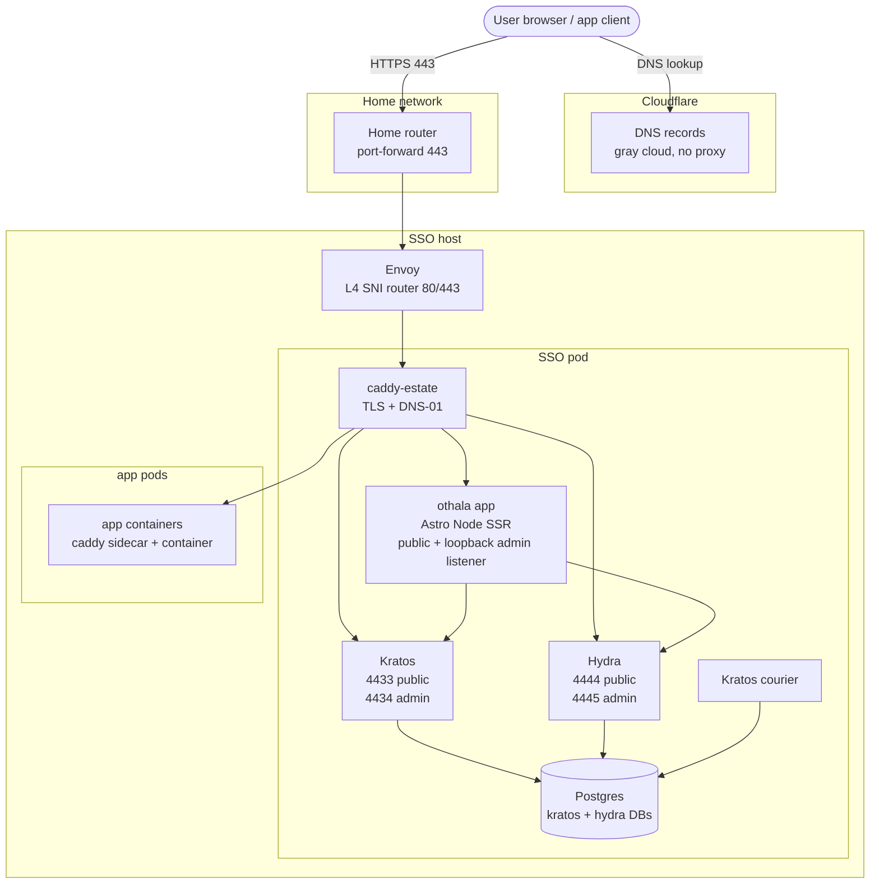

# Othala

[](LICENSE) 

Othala is the single sign-on for one family's house. It runs at **dag.dunn.dev**, the front door for a handful of family members and a dozen or so friends across the self-hosted apps we actually use. One all-TypeScript application (Astro Node SSR) fronts upstream Ory Kratos (identity) + Hydra (OAuth2/OIDC) + Postgres, and supplies the four pieces Kratos and Hydra deliberately ship without: the login provider, the consent provider, the access gate, and the id_token claims builder. Passkey-first: passkeys are the primary credential, email code and password are the fallback paths. WebAuthn security keys are supported as a legacy second factor, not as a peer to passkeys.

It is public because the work is worth reading, not because it is looking for users. Running Ory at household scale means writing those four pieces yourself, and there are few complete worked examples of that in the open. This is one, in production, with the decisions written down next to the code that implements them.

Read it, copy it, lift whole files out of it. That is what it is for. What it is not is a product: one maintainer, no roadmap, no support, and every choice in here was made for one house. It will not be generalized to fit another setup, because a configuration surface for people we have never met is maintenance owed forever. If it does not drop into your setup unchanged, that is the design working, not a gap in it. The two channels that are open are in [If you copy this](#if-you-copy-this).

The name is the rune ᛟ *othala* (home, inheritance, the estate). The instance is **dag.dunn.dev** (ᛞ *dagaz*, the threshold rune). The login screen renders the motif **ᛞ→ᛟ "door to home"**: through the door (dag), into the home (othala).

## What it is

One converged application, not a fleet of services:

- **The Othala app** (`portal/`, Astro Node SSR + TypeScript). It renders the Kratos self-service browser flows, acts as Hydra's login + consent + logout provider (Hydra ships no UI by design), holds the access gate and the id_token claims builder, runs the in-process revoke fan-out, and exposes admin endpoints on a separate loopback listener. It reads per-app manifests at runtime from a mounted directory (`MANIFEST_DIR`), so adding an app is a manifest drop, not an image rebuild. It runs as a Node process inside the SSO pod so Kratos's and Hydra's admin ports are reachable directly.
- **The Ory substrate** (Kratos + Hydra + Postgres). Kratos owns identity (login, recovery, settings, passkeys). Hydra owns OAuth2/OIDC. Single-source-of-truth identity in Kratos; OIDC is the primary presentation layer downstream.

The OSS project is **Othala**; the GitLab project is `dunn.dev/othala`. The app package is `@dunn.dev/othala-portal`; the image publishes at `registry.gitlab.com/dunn.dev/othala`.

A companion Go LDAP bridge (glauth-kratos) sits at `gitlab.com/dunn.dev/kratos-ldap`. **It is an unmaintained reference.** It was shelved on 2026-06-26, it is not deployed here, it is not maintained, and no one should plan a deployment around it. It stays published because the code is worth reading if you are solving the same problem.

## If you copy this

Copy freely, it is MIT. A few things worth knowing first.

- **The guides live at [othala.dunn.dev](https://othala.dunn.dev).** How the apps are wired over OIDC, how requests are denied, how it is hardened, and the page written for the family who sign in. The decision records are in [`docs/adr/`](docs/adr/).
- **Instance values are ours, not defaults.** `dag.dunn.dev`, `dunn.dev`, and the app slugs run through everything. [`ARCHITECTURE.md`](ARCHITECTURE.md) marks the ones that become one-way commitments the moment someone enrols a passkey against them.
- **Corrections are wanted. Generalization requests are not.** A statement in the docs that is false, a dead link, a config that does not do what it claims: those are bugs, and an issue or a merge request for one is genuinely welcome. Feature requests, and changes that add configuration surface so the project fits a deployment other than this one, are not taken, even when the patch is good. Fork it; that is what the MIT licence is for.
- **Security reports go to [`SECURITY.md`](SECURITY.md)**, privately, never a public issue. That channel is staffed.
- **There is no support and no compatibility promise.** Tags move when the house needs them to.

## Apps are manifests (runtime-driven)

An app is one unified `<slug>.yaml` manifest, read at request time from `MANIFEST_DIR` (default `/etc/portal/manifests`). One file can carry up to three namespace blocks:

- `presentation:` — the tile metadata (name, icon, description, URL, `auth_kind`, `access_group`). Read by `portal/src/lib/tiles.ts` to render the dashboard. An optional sibling `<slug>.md` is education content shown on the `/apps/<slug>` detail page.
- `oidc:` — the OAuth2/OIDC client fields forwarded to Hydra at registration. Read by `portal/src/lib/manifests.ts`.
- `consent:` — role and claim-emission shape, read by the app at consent time.

A manifest with only `presentation:` (a forward_auth, LDAP, or external tile with no Hydra client) is skipped by the OIDC loader. Because both loaders read the directory at runtime behind a 30-second cache, **adding or removing an app is a manifest-dir change with no image rebuild**.

The generic worked examples live in [`e2e/manifests/`](e2e/manifests/): `grafana` (OIDC + role mapping), `audiobookshelf` (OIDC), `jellyfin` (presentation-only, the LDAP tile the OIDC loader skips), `proxywatch` (forward_auth), `statuspage` (external). They double as the release-gate fixtures the smoke harness registers.

## Run it locally

The honest first-run path. Two modes, depending on what you want.

### Full stack (the e2e compose harness)

The complete worked example is the e2e harness. It stands up Postgres + Kratos + Hydra + Othala + Mailpit behind Caddy, renders the Ory configs, registers the example clients from `e2e/manifests/`, and runs the OIDC dance + smoke matrix. Everything runs on the RFC 6761 reserved test domain `othala.test`, so nothing touches a real domain. No e2e spec exercises the LDAP bridge.

```sh
cd e2e
AUTH_VERSION=latest bash validate.sh   # generates .env, renders configs, up, health-wait, smoke
```

Needs a Docker or Podman compose runtime. See [`e2e/README.md`](e2e/README.md) for the harness in detail.

### Portal-only dev (`npm run dev`)

To iterate on the Astro UI alone, run the dev server. The dashboard is built from the manifest directory, so **you must point `MANIFEST_DIR` at one or the dashboard renders empty.** The example manifests in `e2e/manifests/` are the easy choice:

```sh
cd portal
npm install
MANIFEST_DIR=../e2e/manifests npm run dev   # http://localhost:4321
```

Other `OTHALA_*` config falls back to safe dev defaults (with a warning), so the dev server comes up without the full Ory substrate. The OIDC and consent flows need Kratos + Hydra, so they only work in the full-stack mode above; portal-only dev is for the dashboard, self-service UI chrome, and `/apps/<slug>` pages.

```sh
npm test          # node --test over scripts/*.test.mjs (incl. fuzz suites)
npm run check     # astro check (type + content checks)
npm run build     # astro build + bundle the listener / admin / registrar
```

## Where to start

- **Cold-start orientation** (the anchor): [`ARCHITECTURE.md`](ARCHITECTURE.md). What the converged app holds, the load-bearing decisions, topology, and trust boundary.
- **The guides and the decision records, published**: [othala.dunn.dev](https://othala.dunn.dev).
- **Release / version state**: [`CHANGELOG.md`](CHANGELOG.md) and git tags. The only place a deployed version is asserted.
- **Deploy**: [`DEPLOY.md`](DEPLOY.md).
- **Network topology**: see the [Topology section of ARCHITECTURE.md](ARCHITECTURE.md#topology) (Envoy SNI router, SSO pod, app pods).

This README asserts no version. It is the front door.

## Layout

| Path | Contents |
|---|---|
| `docs/` | Architecture decision history (ADRs), the access model, research (Ory ecosystem survey, standards audit, QEMU-CI lab), runbooks |
| `kratos/` | Kratos server config + identity schema |
| `hydra/` | Hydra server config |
| `portal/` | The Othala application (Astro Node SSR + TS): Kratos self-service flows, Hydra login/consent/logout challenge handlers, the access gate, claims builder, revoke fan-out, dual-listener admin endpoints, the runtime manifest loaders (`tiles.ts` + `manifests.ts`), and the OIDC client registrar. Publishes as the `othala` image. |
| `gitlab.com/dunn.dev/kratos-ldap` | glauth-kratos LDAP bridge, separate repo. **Unmaintained reference.** Shelved 2026-06-26, not deployed, not maintained. |
| `e2e/` | QEMU-CI smoke harness: compose stack + smoke scripts + gen-secrets + the generic example manifests (`e2e/manifests/`). Runs on lodestone via the `e2e` CI job. |

## Architecture in brief



Cloudflare's role is DNS hosting + DNS-01 ACME via API. It is **not in the auth or app request path**. Visual language via [`@dunn.dev/reference`](https://gitlab.com/dunn.dev/reference) (tokens + site chrome).

Full topology, request flows, auth patterns, image-pin table, and trust boundary: [`ARCHITECTURE.md`](ARCHITECTURE.md).

## Validation

The Othala app (flows + login/consent + admin) is validated end-to-end through the QEMU-CI smoke harness (`e2e/`). Adversarial security review remediated HIGH + MEDIUM + LOW + architectural findings across two independent passes; fuzz harnesses caught two real bugs before merge (JWK algorithm allowlist). The fail-closed gate, revoke fan-out, and dual-listener boundary carry substantive unit tests.

## Working conventions

- Push requires explicit human approval per action
- `CHANGELOG.md` and git tags are the only place release state is asserted; cold-start orientation is `ARCHITECTURE.md`
- Apply estate voice in external text: no em-dashes, direct phrasing, no filler
- `@dunn.dev/reference` is the single source for tokens and site chrome; do not redefine locally
- Secrets: sops + age, operator-managed and never committed

## License

MIT. See [`LICENSE`](LICENSE).

---

Built by Andrew Dunn with GitLab. The rune is ᛟ *othala* (home, inheritance); the door is ᛞ *dagaz* (the threshold).
