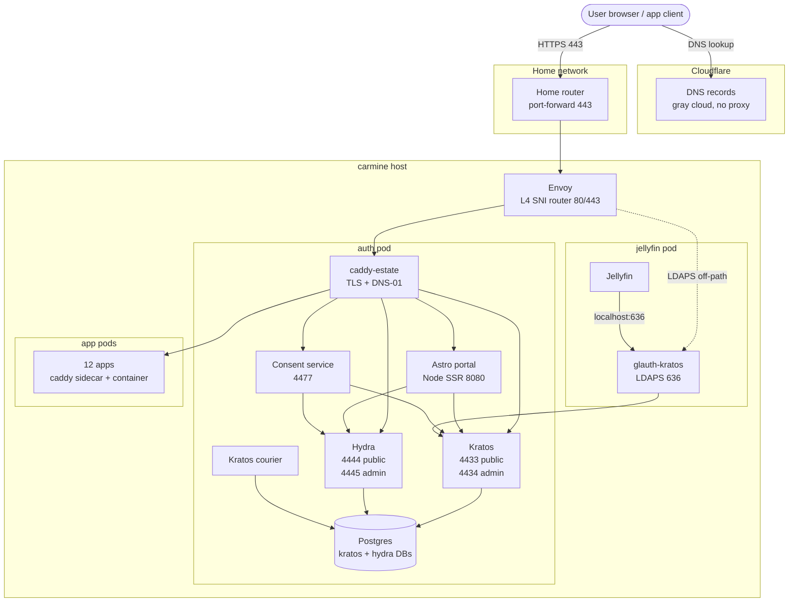

# auth

 

SSO substrate for the dunn.dev estate: Ory Kratos + Hydra + custom glauth-kratos LDAP bridge + Astro Node SSR portal on carmine + custom Caddy image. IaC, lab harness, reference implementation.

## Status

Phase 0 — locked configs and skeletons in `kratos/`, `hydra/`, `consent/`, `ldap-bridge/`, `caddy/`, `portal/`, `lab/`. See `docs/STATUS.md` for the cross-session "where we are" entry point.

Phase 1 (lab spike) is next; full plan and decision history at `docs/decision.md`.

## Layout

| Path | Contents |
|---|---|
| `docs/` | Decision, architecture, contribution strategy, substrate comparison, STATUS |
| `kratos/` | Kratos server config + identity schema |
| `hydra/` | Hydra server config + 11 OIDC client manifests + apply script |
| `consent/` | Consent service (Go, runs on carmine alongside Hydra) |
| `ldap-bridge/` | glauth-kratos: custom glauth binary with embedded Kratos backend |
| `caddy/` | Custom registry.gitlab.com/dunn.dev/caddy-estate image build (xcaddy + caddy-dns/cloudflare plugin) + reusable Caddyfile snippets |
| `portal/` | Astro UI on Cloudflare Workers (login + recovery + settings + tile launcher + admin) |
| `lab/` | GCP-based test environment (compose stack, scripts, Playwright suite, eval+feasibility+adversarial docs) |
| `upstream/` | Maintainer-walk findings and contribution drafts |

## Architecture

Three layers:

1. **Substrate (Ory Kratos + Hydra).** Kratos handles identity (login, recovery, settings, passkeys). Hydra handles OAuth2/OIDC. Single-source-of-truth identity in Kratos; LDAP and OIDC are presentation layers downstream.
2. **Bridges (glauth-kratos, consent service).** Custom glauth binary with Kratos backend exposes identities over LDAPS for Jellyfin's plugin (Apple TV / Infuse SSO). Small Go consent service co-located with Hydra handles OAuth2 login/consent challenges without exposing Hydra's admin port publicly.
3. **Family-facing UI (Astro Node SSR on carmine).** All flows we render: login, recovery, settings, tile launcher, admin. Direct Kratos public API consumption; Hydra consent handoff via the consent service. Hosted on carmine in the same pod network as Kratos and Hydra so the admin port is reachable.

Cloudflare's role: DNS hosting + DNS-01 ACME via API. **Not in the auth or app request path.**

Full set of diagrams (integration patterns, login flow, admin AAL2 step-up, trust boundary, identity lifecycle, session AAL state machine, recovery-gate decision): [`docs/architecture-diagram.md`](docs/architecture-diagram.md).

## Working conventions

- All commits require explicit human approval before push
- Synthesist tasks (in `auth/bench` spec) track build phases for cross-session continuity
- `docs/STATUS.md` is the canonical "where we are" doc; updated when phases shift
- Apply estate voice conventions to external text (no em-dashes, direct phrasing, no filler)
