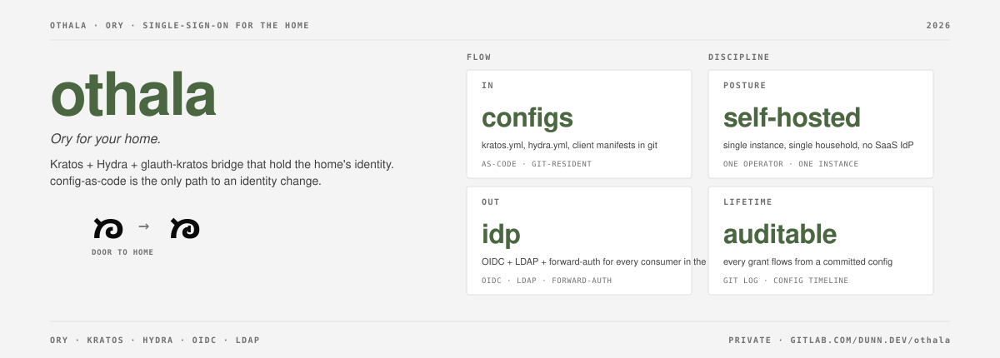

# Othala

[](LICENSE) 

Ory for your home. Othala is a self-hosted Ory substrate for a personal estate: the on-prem, family-scale analog to Ory Network. One all-TypeScript application (Astro Node SSR) fronts upstream Ory Kratos (identity) + Hydra (OAuth2/OIDC) + Postgres, alongside a separate Go glauth-kratos LDAP bridge for the clients that cannot speak OAuth.

The name is the rune ᛟ *othala* (home, inheritance, the estate). Andrew's deployed instance runs on **dag.dunn.dev** (ᛞ *dagaz*, the threshold rune). The login screen renders the motif **ᛞ→ᛟ "door to home"**: through the door (dag), into the home (othala).

## What it is

One converged application, not a fleet of services:

- **The Othala app** (`portal/`, Astro Node SSR + TypeScript). It renders the Kratos self-service browser flows, acts as Hydra's login + consent + logout provider (Hydra ships no UI by design), holds the access gate and the id_token claims builder, runs the in-process revoke fan-out, and exposes admin endpoints on a separate loopback listener. It runs as a Node process inside the SSO pod so Kratos's and Hydra's admin ports are reachable directly.
- **The Ory substrate** (Kratos + Hydra + Postgres). Kratos owns identity (login, recovery, settings, passkeys). Hydra owns OAuth2/OIDC. Single-source-of-truth identity in Kratos; LDAP and OIDC are presentation layers downstream.
- **The LDAP bridge** (`ldap-bridge/`, Go). A custom glauth binary with a Kratos backend that presents identities over LDAPS for the non-OAuth clients (Jellyfin's plugin, Apple TV / Infuse SSO). Stays Go: it is a protocol adapter, not part of the web app.

The OSS project is **Othala**; the GitLab project is `dunn.dev/othala`. Go modules are `dunn.dev/othala/{consent,ldap-bridge}`; the app package is `@dunn.dev/othala-portal`; images publish under `registry.gitlab.com/dunn.dev/othala/*`.

## Relationship to dunn.dev/iac

`dunn.dev/iac` is the primary deployment view. It vendors config files from this repo, pinned to a released Othala tag, under the `dag` service grouping (`services/dag/`). The dependency is a released tag, not a live pointer; git submodule and similar shared-history formats were rejected.

iac decides when to consume a new Othala release. Topology-specific differences (for example the Postgres DSN host) are iac-local deviations documented in each vendored file's provenance header. The published application image is named **othala**; the instance grouping inside iac is **dag** (`services/dag/`, `dag-*` quadlets, the `dag.network`). The functional Ory service names (kratos / hydra / postgres) keep their role names.

For the deploy model, see [`DEPLOY.md`](DEPLOY.md) and `dunn.dev/iac/services/dag/`. For the load-bearing decision record, see [`ARCHITECTURE.md`](ARCHITECTURE.md) LB-12.

## Where to start

- **Cold-start orientation** (the anchor): [`ARCHITECTURE.md`](ARCHITECTURE.md). What the converged app holds, the load-bearing decisions, topology, and trust boundary.
- **Release / version state**: [`docs/STATUS.md`](docs/STATUS.md). The only place a deployed version is asserted.
- **Deploy / consumption contract**: [`DEPLOY.md`](DEPLOY.md) and `dunn.dev/iac/services/dag/`.

This README asserts no version. It is the front door.

## Layout

| Path | Contents |
|---|---|
| `docs/` | Architecture decision history, STATUS, security review, Ory ecosystem survey, per-app integration, runbooks |
| `kratos/` | Kratos server config + identity schema |
| `hydra/` | Hydra server config + OIDC client manifests |
| `portal/` | The Othala application (Astro Node SSR + TS): Kratos self-service flows, Hydra login/consent/logout challenge handlers, the access gate, claims builder, revoke fan-out, dual-listener admin endpoints, and the OIDC client registrar. Publishes as the `othala` image. |
| `ldap-bridge/` | glauth-kratos: custom glauth binary linked against Kratos public + admin APIs. Stays Go: a protocol adapter for non-OAuth clients (Jellyfin / Apple TV). |
| `caddy/` | Reusable Caddyfile snippets; the Caddy image is built in the sibling `caddy-estate` repo |
| `lab/` | GCP-based test environment: compose stack, gen-secrets, Playwright suite, evidence docs |
| `upstream/` | Maintainer-walk findings and contribution drafts |

## Architecture in brief


Cloudflare's role is DNS hosting + DNS-01 ACME via API. It is **not in the auth or app request path**. Visual language via [`@dunn.dev/reference`](https://gitlab.com/dunn.dev/reference) (tokens + site chrome).

Full topology, request flows, auth patterns, image-pin table, and trust boundary: [`ARCHITECTURE.md`](ARCHITECTURE.md).

## Validation

Substrate, LDAP bridge, and the Othala app (flows + login/consent + admin) are lab-validated end-to-end through Playwright. Adversarial security review remediated HIGH + MEDIUM + LOW + architectural findings; fuzz harnesses caught two real bugs before merge (JWK algorithm allowlist, LDAP DN escape). The fail-closed gate, revoke fan-out, and dual-listener boundary carry substantive unit tests. Evidence in `lab/docs/`.

## Lab harness

GCP-based compose stack at `lab/`. Driven via `make`:

```sh
make lab-secrets   # generate compose/.env (CURRENT + PREVIOUS slots)
make lab-up        # provision GCP VM
make lab-dns-up    # create lab Cloudflare A records
make lab-sync      # rsync repo to VM (auto-fires lab-deploy)
make lab-ssh       # shell into VM for validate / security checks
make lab-dns-down  # remove DNS records
make lab-down      # tear down VM
```

Required env: `GCP_PROJECT`, `CF_API_TOKEN`, `CF_ZONE_ID`. Evidence lives in `lab/docs/`.

## Working conventions

- Push requires explicit human approval per action
- `docs/STATUS.md` is the only place release state is asserted; cold-start orientation is `ARCHITECTURE.md`
- Apply estate voice in external text: no em-dashes, direct phrasing, no filler
- `@dunn.dev/reference` is the single source for tokens and site chrome; do not redefine locally
- Secrets: sops + age via `dunn.dev/iac/pyinfra/secrets.enc.yaml`

## License

MIT. See [`LICENSE`](LICENSE).

---

Built by Andrew Dunn with GitLab. The rune is ᛟ *othala* (home, inheritance); the door is ᛞ *dagaz* (the threshold).
