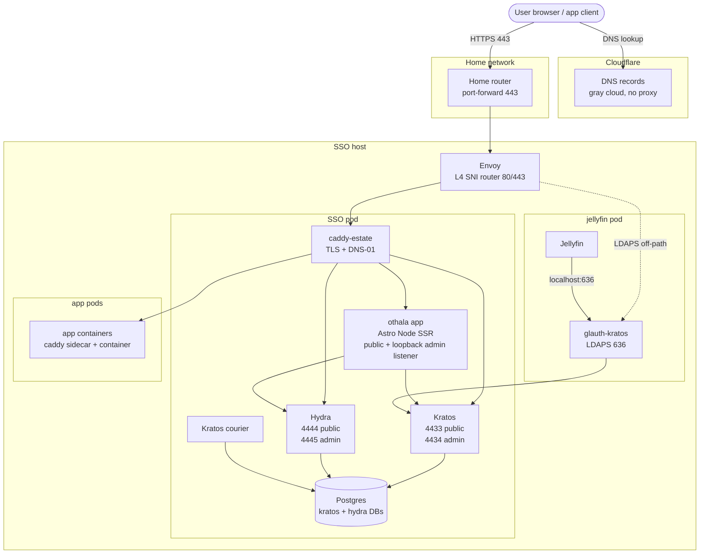

# Othala

[](LICENSE) 

Ory for your home. Othala is a self-hosted Ory substrate for a personal estate: the on-prem, family-scale analog to Ory Network. One all-TypeScript application (Astro Node SSR) fronts upstream Ory Kratos (identity) + Hydra (OAuth2/OIDC) + Postgres, alongside a separate Go glauth-kratos LDAP bridge for the clients that cannot speak OAuth.

The name is the rune ᛟ *othala* (home, inheritance, the estate). Andrew's deployed instance runs on **dag.dunn.dev** (ᛞ *dagaz*, the threshold rune). The login screen renders the motif **ᛞ→ᛟ "door to home"**: through the door (dag), into the home (othala).

## What it is

One converged application, not a fleet of services:

- **The Othala app** (`portal/`, Astro Node SSR + TypeScript). It renders the Kratos self-service browser flows, acts as Hydra's login + consent + logout provider (Hydra ships no UI by design), holds the access gate and the id_token claims builder, runs the in-process revoke fan-out, and exposes admin endpoints on a separate loopback listener. It reads per-app manifests at runtime from a mounted directory (`MANIFEST_DIR`), so adding an app is a manifest drop, not an image rebuild. It runs as a Node process inside the SSO pod so Kratos's and Hydra's admin ports are reachable directly.
- **The Ory substrate** (Kratos + Hydra + Postgres). Kratos owns identity (login, recovery, settings, passkeys). Hydra owns OAuth2/OIDC. Single-source-of-truth identity in Kratos; LDAP and OIDC are presentation layers downstream.
- **The LDAP bridge** (`ldap-bridge/`, Go). A custom glauth binary with a Kratos backend that presents identities over LDAPS for the non-OAuth clients (Jellyfin's plugin, Apple TV / Infuse SSO). Stays Go: it is a protocol adapter, not part of the web app.

The OSS project is **Othala**; the GitLab project is `dunn.dev/othala`. The Go module is `dunn.dev/othala/ldap-bridge`; the app package is `@dunn.dev/othala-portal`; images publish under `registry.gitlab.com/dunn.dev/othala/*`.

## Relationship to dunn.dev/iac

`dunn.dev/iac` is the primary deployment view. It vendors config files from this repo, pinned to a released Othala tag, under the `dag` service grouping (`services/dag/`). The dependency is a released tag, not a live pointer; git submodule and similar shared-history formats were rejected.

iac decides when to consume a new Othala release. Topology-specific differences (for example the Postgres DSN host) are iac-local deviations documented in each vendored file's provenance header. The published application image is named **othala**; the instance grouping inside iac is **dag** (`services/dag/`, `dag-*` quadlets, the `dag.network`). The functional Ory service names (kratos / hydra / postgres) keep their role names.

For the deploy model, see [`DEPLOY.md`](DEPLOY.md) and `dunn.dev/iac/services/dag/`. For the load-bearing decision record, see [`ARCHITECTURE.md`](ARCHITECTURE.md) LB-12.

## Apps are manifests (runtime-driven)

An app is one unified `<slug>.yaml` manifest, read at request time from `MANIFEST_DIR` (default `/etc/portal/manifests`). One file can carry up to three namespace blocks:

- `presentation:` — the tile metadata (name, icon, description, URL, `auth_kind`, `access_group`). Read by `portal/src/lib/tiles.ts` to render the dashboard. An optional sibling `<slug>.md` is education content shown on the `/apps/<slug>` detail page.
- `oidc:` — the OAuth2/OIDC client fields forwarded to Hydra at registration. Read by `portal/src/lib/manifests.ts`.
- `consent:` — role and claim-emission shape, read by the app at consent time.

A manifest with only `presentation:` (a forward_auth, LDAP, or external tile with no Hydra client) is skipped by the OIDC loader. Because both loaders read the directory at runtime behind a 30-second cache, **adding or removing an app is a manifest-dir change with no image rebuild**.

The generic worked examples live in [`e2e/manifests/`](e2e/manifests/): `grafana` (OIDC + role mapping), `audiobookshelf` (OIDC), `jellyfin` (LDAP via the bridge), `proxywatch` (forward_auth), `statuspage` (external). They double as the release-gate fixtures the smoke harness registers.

## Run it locally

The honest first-run path. Two modes, depending on what you want.

### Full stack (the e2e compose harness)

The complete worked example is the e2e harness. It stands up Postgres + Kratos + Hydra + Othala + the LDAP bridge + Mailpit behind Caddy, renders the Ory configs, registers the example clients from `e2e/manifests/`, and runs the OIDC dance + smoke matrix. Everything runs on the RFC 6761 reserved test domain `othala.test`, so nothing touches a real domain.

```sh
cd e2e
AUTH_VERSION=latest bash validate.sh   # generates .env, renders configs, up, health-wait, smoke
```

Needs a Docker or Podman compose runtime. See [`e2e/README.md`](e2e/README.md) for the harness in detail.

### Portal-only dev (`npm run dev`)

To iterate on the Astro UI alone, run the dev server. The dashboard is built from the manifest directory, so **you must point `MANIFEST_DIR` at one or the dashboard renders empty.** The example manifests in `e2e/manifests/` are the easy choice:

```sh
cd portal
npm install
MANIFEST_DIR=../e2e/manifests npm run dev   # http://localhost:4321
```

Other `OTHALA_*` config falls back to safe dev defaults (with a warning), so the dev server comes up without the full Ory substrate. The OIDC and consent flows need Kratos + Hydra, so they only work in the full-stack mode above; portal-only dev is for the dashboard, self-service UI chrome, and `/apps/<slug>` pages.

```sh
npm test          # node --test over scripts/*.test.mjs (incl. fuzz suites)
npm run check     # astro check (type + content checks)
npm run build     # astro build + bundle the listener / admin / registrar
```

## Where to start

- **Cold-start orientation** (the anchor): [`ARCHITECTURE.md`](ARCHITECTURE.md). What the converged app holds, the load-bearing decisions, topology, and trust boundary.
- **Release / version state**: [`docs/STATUS.md`](docs/STATUS.md). The only place a deployed version is asserted.
- **Deploy / consumption contract**: [`DEPLOY.md`](DEPLOY.md) and `dunn.dev/iac/services/dag/`.

This README asserts no version. It is the front door.

## Layout

| Path | Contents |
|---|---|
| `docs/` | Architecture decision history, STATUS, security review, Ory ecosystem survey, per-app integration, runbooks |
| `kratos/` | Kratos server config + identity schema |
| `hydra/` | Hydra server config |
| `portal/` | The Othala application (Astro Node SSR + TS): Kratos self-service flows, Hydra login/consent/logout challenge handlers, the access gate, claims builder, revoke fan-out, dual-listener admin endpoints, the runtime manifest loaders (`tiles.ts` + `manifests.ts`), and the OIDC client registrar. Publishes as the `othala` image. |
| `ldap-bridge/` | glauth-kratos: custom glauth binary linked against Kratos public + admin APIs. Stays Go: a protocol adapter for non-OAuth clients (Jellyfin / Apple TV). |
| `e2e/` | QEMU-CI smoke harness: compose stack + smoke scripts + gen-secrets + the generic example manifests (`e2e/manifests/`). Runs on carmine via the `e2e` CI job. |

## Architecture in brief



Cloudflare's role is DNS hosting + DNS-01 ACME via API. It is **not in the auth or app request path**. Visual language via [`@dunn.dev/reference`](https://gitlab.com/dunn.dev/reference) (tokens + site chrome).

Full topology, request flows, auth patterns, image-pin table, and trust boundary: [`ARCHITECTURE.md`](ARCHITECTURE.md).

## Validation

Substrate, LDAP bridge, and the Othala app (flows + login/consent + admin) are validated end-to-end through the QEMU-CI smoke harness (`e2e/`). Adversarial security review remediated HIGH + MEDIUM + LOW + architectural findings; fuzz harnesses caught two real bugs before merge (JWK algorithm allowlist, LDAP DN escape). The fail-closed gate, revoke fan-out, and dual-listener boundary carry substantive unit tests. Evidence in `e2e/` (smoke harness) and `docs/security-review-2026-05-04.md`.

## Working conventions

- Push requires explicit human approval per action
- `docs/STATUS.md` is the only place release state is asserted; cold-start orientation is `ARCHITECTURE.md`
- Apply estate voice in external text: no em-dashes, direct phrasing, no filler
- `@dunn.dev/reference` is the single source for tokens and site chrome; do not redefine locally
- Secrets: sops + age via `dunn.dev/iac/pyinfra/secrets.enc.yaml`

## License

MIT. See [`LICENSE`](LICENSE).

---

Built by Andrew Dunn with GitLab. The rune is ᛟ *othala* (home, inheritance); the door is ᛞ *dagaz* (the threshold).
