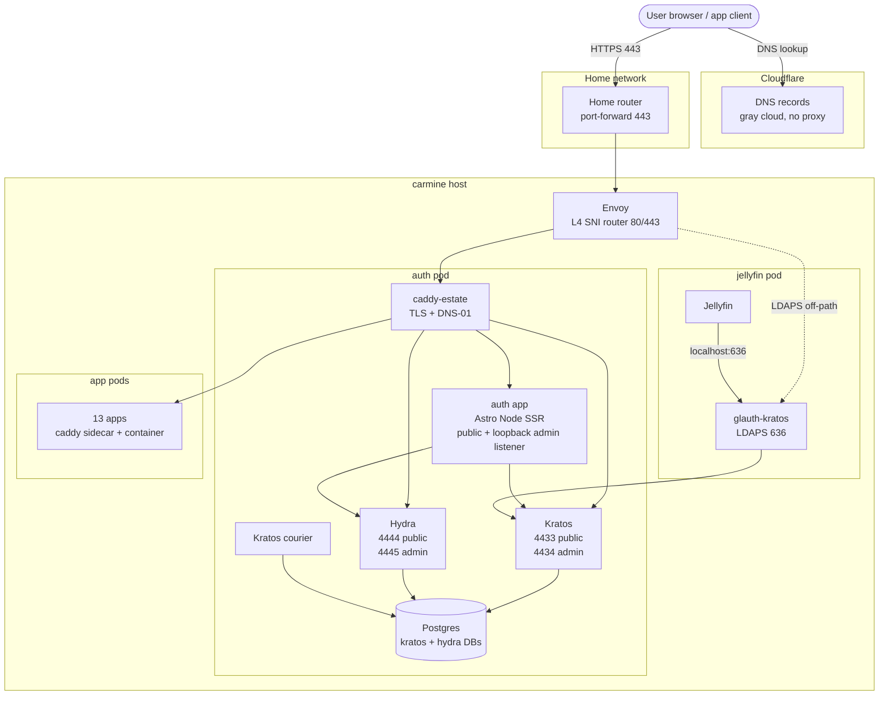

# othala

[](LICENSE) 

SSO substrate for the dunn.dev estate: one all-TypeScript auth application (Astro Node SSR) fronting upstream Ory Kratos + Hydra, alongside a custom Go glauth-kratos LDAP bridge for non-OAuth clients. IaC, lab harness, reference implementation.

## Status

Load-bearing; deployed by dunn.dev/iac via vendored tag-pin. Drift between this repo's HEAD and the iac pin is expected and permitted. Transitory, OSS-bound. Cold-start orientation: [`ARCHITECTURE.md`](ARCHITECTURE.md). Release state: [`docs/STATUS.md`](docs/STATUS.md).

## Relationship to dunn.dev/iac

`dunn.dev/iac` is the deploy plane. It vendors config files from this repo, pinned to a released auth tag, under `iac/services/auth/`. The dependency is a released tag, not a live pointer; git subtree and similar shared-history formats were rejected.

iac decides when to consume a new auth release. Topology-specific differences (e.g., DSN host = `auth-postgres` in iac vs `postgres` in lab compose) are iac-local deviations documented in each vendored file's provenance header.

For the full deploy model, see [`DEPLOY.md`](DEPLOY.md) and `dunn.dev/iac/services/auth/`. For the load-bearing decision record, see [`ARCHITECTURE.md`](ARCHITECTURE.md) LB-12.

## Layout

| Path | Contents |
|---|---|
| `docs/` | Architecture, decision log, STATUS, security review, Ory ecosystem survey, per-app integration, runbooks |
| `kratos/` | Kratos server config + identity schema |
| `hydra/` | Hydra server config + 11 OIDC client manifests + apply script |
| `portal/` | The converged auth application (Astro Node SSR + TS): Kratos self-service flows, Hydra login/consent/logout challenge handlers, the access gate, claims builder, revoke fan-out, dual-listener admin endpoints, and client registration. The published image will be named `auth` (rename in flight). |
| `ldap-bridge/` | glauth-kratos: custom glauth binary linked against Kratos public + admin APIs. Stays Go — a protocol adapter for non-OAuth clients (Jellyfin / Apple TV). |
| `consent/`, `util/` | Legacy Go consent service + apply-clients runner. Pending removal at the iac E1 cutover; NOT the current architecture (their behaviour now lives in `portal/`). |
| `caddy/` | Reusable Caddyfile snippets (auth-specific); the Caddy image is built in the sibling `caddy-estate` repo |
| `lab/` | GCP-based test environment: compose stack, gen-secrets, Playwright suite, evidence docs |
| `upstream/` | Maintainer-walk findings and contribution drafts |

## Architecture

One converged auth application (Astro Node SSR + TS) fronts the upstream Ory substrate; a separate Go bridge serves the non-OAuth clients.

1. **Substrate (Ory Kratos + Hydra + Postgres).** Kratos owns identity (login, recovery, settings, passkeys). Hydra owns OAuth2/OIDC and ships no UI by design. Single-source-of-truth identity in Kratos; LDAP and OIDC are presentation layers downstream.
2. **The converged app (`portal/`).** Renders the Kratos self-service browser flows AND acts as Hydra's login + consent + logout provider. It also holds the access gate, the id_token claims builder, the in-process revoke fan-out, the dual-listener admin endpoints, and the OIDC client registrar. Runs as a Node process in the auth pod so Kratos's and Hydra's admin ports are reachable directly.
3. **LDAP bridge (`ldap-bridge/`, Go).** Custom glauth binary with a Kratos backend exposes identities over LDAPS for Jellyfin's plugin (Apple TV / Infuse SSO). Stays Go — a protocol adapter for clients that cannot speak OAuth.

Cloudflare's role: DNS hosting + DNS-01 ACME via API. **Not in the auth or app request path.** Visual language via [`@dunn.dev/reference`](https://gitlab.com/dunn.dev/reference) ^0.2.0 (tokens + site chrome).



Full topology, request flows, auth patterns, image pin table, and trust boundary: [`ARCHITECTURE.md`](ARCHITECTURE.md).

## Validation

Phase 0 substrate, Phase 2 LDAP bridge, Phase 3 auth app (flows + login/consent + admin): all lab-validated end-to-end through Playwright. Adversarial security review remediated 4 HIGH + 7 MEDIUM + 5 LOW + 7 architectural findings. Three fuzz harnesses caught two real bugs before merge (JWK algorithm allowlist, LDAP DN escape). Evidence in `lab/docs/`.

## Lab harness

GCP-based compose stack at `lab/`. Driven via `make`:

```sh
make lab-secrets   # generate compose/.env (CURRENT + PREVIOUS slots)
make lab-up        # provision GCP VM
make lab-dns-up    # create auth-lab + keep-lab Cloudflare A records
make lab-sync      # rsync repo to VM (auto-fires lab-deploy)
make lab-ssh       # shell into VM for validate-phase3 / validate-security
make lab-dns-down  # remove DNS records
make lab-down      # tear down VM
```

Required env: `GCP_PROJECT`, `CF_API_TOKEN`, `CF_ZONE_ID`. Evidence from the spike, phase 2, phase 3, security validation, and adversarial review lives in `lab/docs/`.

## Working conventions

- Push requires explicit human approval per action
- `docs/STATUS.md` is the only place release state is asserted; cold-start orientation is `ARCHITECTURE.md`
- Apply estate voice in external text: no em-dashes, direct phrasing, no filler
- `@dunn.dev/reference` is the single source for tokens and site chrome; do not redefine locally
- Secrets: sops + age via `dunn.dev/iac/pyinfra/secrets.enc.yaml`
