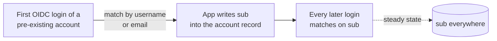

# 0004 — Identity linking: username is the migration join key, `sub` is the durable key

## Status

Accepted 2026-06-08. **Revised 2026-06-27** (source-verified audit, workflow
`oidc-linking-audit`): adds the match-once / persist-`sub` convergence model,
corrects `sub` provenance (Kratos, not Hydra), and replaces the Audiobookshelf
SQL pre-seed with the admin-UI username match. Reference:
`campaigns/othala/account-linking-overrides.md` (per-app verdicts) and
`campaigns/othala/account-linking-plan.md` (migration sequence).

## Context

When an OIDC-capable app receives a first login from the IdP it must link the
incoming identity to an existing local account (or create a new one). The claim
it links on decides whether re-linking, orphaning, or takeover is possible.

Othala emits three claims to every client (`portal/src/lib/claims.ts`):

- `sub` — the **Kratos identity UUID** (`subject = session.identity.id` in
  `portal/src/lib/oauth2-handlers.ts`). Subjects are public, not pairwise, so the
  token `sub` is the raw identity id. Stable for the life of the Kratos identity
  record. The most stable key.
- `preferred_username` — `traits.username` (`first.last`). Read-only in the
  portal settings UI; stable in practice. **Caveat:** Kratos has no schema-level
  trait immutability and there is no before-settings hook, so a username change
  is UI-blocked, not API-blocked (see Consequences).
- `email` — `traits.email`. User-editable via the Kratos settings flow (no
  session revoke). Mutable.

The decisive property for **migration**: `sub` is minted when the Kratos identity
is created and exists *nowhere* in pre-existing app data. It cannot be a *join*
key against old records — there is nothing to match a fresh UUID to. The only
key present in *both* the old data and Kratos is the human one: username (or
email where username is unavailable).

## Decision

**`sub` is the durable identity; username is the migration on-ramp.** These are
not in tension because most apps already converge: they match a returning login
by a human key on first contact, then persist `sub` and match on it forever
after.

So the engineered choice is the **first-link key**, set explicitly per app
*before* OIDC is enabled. Email is never a configured link key. Because the
migration is DB-level (operator 2026-06-27 — move the data stores at the
filesystem/ZFS layer, no reimport), the on-ramp is executed as a **SQL pre-seed
of the `sub`** into each app's link record before first login, for apps that
store one; username-match apps need only consistent usernames. Apps fall into
three groups (verified per app at pinned versions in
`account-linking-overrides.md`):

- **Username-then-`sub`** (Jellyfin, Audiobookshelf, Immich, Open WebUI,
  GitLab): match once by a human key, then persist `sub`. This *is* "sub
  everywhere" — earned for free, no per-user `sub` pre-seed.
  - Jellyfin: provider preset `generic`/`authelia` → `UsernameClaim`
    defaults to `preferred_username`; persists `sub`.
  - Audiobookshelf: set admin-UI **"Match existing users by" = Username**
    (persists `sub` in `extraData.authOpenIDSub`). *No SQL pre-seed* — the
    earlier `openIdIssuer`/`openIdSub` column pre-seed was wrong (the field is
    JSON `extraData.authOpenIDSub`).
  - Immich: DB-level migration, no reimport (operator 2026-06-27) → SQL
    pre-seed `users.oauthId = <kratos sub>` per user before first login. The
    deterministic path: establishes sub-linking directly, skips the fragile
    email-adopt fallback.
  - Open WebUI: SQL pre-seed the `oauth_sub` link (or set
    `OAUTH_MERGE_ACCOUNTS_BY_EMAIL=true` for the migration window only); `sub`
    persists thereafter.
  - GitLab: `uid_field` defaults to `sub` (extern_uid); a pre-existing account
    does **not** auto-match by username — link via password-login + connect, or
    pre-seed the `identities` table. Never enable `omniauth_auto_link_user`.
- **Username-forever** (Mealie `OIDC_USER_CLAIM=preferred_username`, oCIS
  `PROXY_USER_OIDC_CLAIM=preferred_username`): re-match `preferred_username`
  every login; never store `sub`. They have **no `sub` safety net**, so username
  immutability is load-bearing for them specifically.
- **Email-forever** (Vaultwarden): the email field is the username *and* the
  master-password KDF salt. Cannot be re-keyed to username or `sub`. After first
  login it stores `{issuer}/{sub}` for matching, but the account stays
  email-identified. Accepted exception; keyed on the stable `firstname@dunn.dev`
  convention (operator-confirmed stable), which must not change.

LiteLLM keeps `GENERIC_USER_ID_ATTRIBUTE=sub` set explicitly (resilient to a
default-value change in a future release) even though it links on `sub` anyway.

## Consequences

- Each OIDC migration is gated on a **pre-migration username reconciliation**:
  the user's `traits.username` must equal their existing local username in every
  app, matching that app's case rule (Audiobookshelf is case-sensitive; Mealie
  is case-insensitive). One Kratos username matches one spelling — so the same
  person must carry the same username across all apps. Operator-confirmed
  (2026-06-27): usernames are historically consistent across apps, so this
  reconciliation is low-risk.
- **`sub` is tied to the Kratos identity record, not Hydra.** Rebuilding Hydra
  (e.g. losing `secrets.system`) preserves `sub`. Recreating Kratos identities
  changes every `sub`, breaking every sub-link. The carmine rebuild must either
  preserve Kratos identity IDs (export/import identities *with* their ids) or
  budget a re-link pass for the Username-then-`sub` group. Record in the DR
  runbook.
- **Username immutability is UI-soft.** A direct Kratos settings-API call could
  change `traits.username`; for the Username-forever group that orphans data with
  no recovery key. If username self-change is ever exposed, or to harden now, add
  an API-level guard (a before-settings web-hook rejecting a username delta).
- Vaultwarden's durability requires `OTHALA_PUBLIC_URL` never changes (it is part
  of the stored `{issuer}/{sub}` key); a URL rename forces `TRUNCATE sso_users` +
  re-link.
- Linking behavior is verified per pinned version. A major upstream bump can
  change defaults — gate major bumps on a linking re-verify.

## Alternatives considered

- **Link on `sub` everywhere (pre-seed it into every app).** Universally stable
  but requires writing a fresh UUID into each app's DB per user before first
  login — fragile, app-specific work that buys nothing the convergence model
  doesn't already deliver. Reserved for where there is no human on-ramp (GitLab)
  or to skip an email-adopt (Immich).
- **Link on email by default.** Works at migration if all emails match, unsafe
  thereafter because email is mutable. Rejected as a default.
- **Restrict email mutability (require AAL2 for settings).** Already in place
  (`required_aal: highest_available`), but harder-to-change is not immutable; it
  does not make email safe as a link key. The fix is to not link on email.
