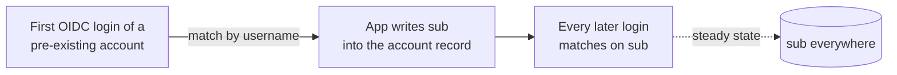

# 04 — Identity linking on username, never email

## Status

Accepted (2026-08-15). `sub` — the Kratos identity UUID — is the durable
identity every app should end on; `username` is the one-time migration and
first-link key; email is never a configured link key. Mealie is the sole
remaining username-forever consumer, and username is still user-mutable with no
enforcement, which is the one open obligation this record carries.

See also [01](01-auth-substrate-ory.md) (the Kratos/Hydra substrate that mints
the identity and issues the token) and
[09](09-capability-group-access-model.md) (the `groups` claim carried on the
same token).

## Context

When an OIDC-capable app receives a first login from the IdP it must link the
incoming identity to an existing local account (or create a new one). The claim
it links on decides whether re-linking, orphaning, or takeover is possible.

Othala emits three identity claims to every client
(`portal/src/lib/claims.ts`, `buildIDTokenClaims`):

- **`sub`** — the Kratos identity UUID. The portal hands Hydra
  `subject = session.identity.id` at login
  (`portal/src/lib/oauth2-handlers.ts`, `handleLogin`); Hydra copies it into the
  token `sub`. `claims.ts` never sets `sub` itself. Hydra runs
  `subject_identifiers.supported_types: [public]` (`hydra/hydra.yml`), not
  pairwise, so every client sees the same raw identity id. Stable for the life
  of the Kratos identity record. The most stable key.
- **`preferred_username`** — `traits.username` (`first.last`, schema pattern in
  `kratos/identity.schema.json`). A human-facing companion to `sub`, not the
  durable key, and **user-mutable**: the profile settings method is enabled
  (`kratos/kratos.yml` `selfservice.methods.profile.enabled: true`) and the
  settings page renders an editable username input through the Kratos profile
  flow (`portal/src/pages/auth/settings.astro`, `FlowNodes group="profile"`).
  The Membership section shows the current username as a display-only chip — the
  edit surface is the Profile form above it, not that chip. The schema marks no
  trait immutable and there is no before-settings hook (`selfservice.flows.
  settings` has only `after` hooks), so nothing stops a user from renaming
  themselves — username stability is neither UI-blocked nor API-enforced (see
  Consequences).
- **`email`** — `traits.email`. User-editable via the Kratos settings profile
  flow. Mutable.

The decisive property for **migration**: `sub` is minted when the Kratos
identity is created and exists *nowhere* in pre-existing app data. It cannot be
a *join* key against old records — there is nothing to match a fresh UUID to.
The only key present in *both* the old data and Kratos is the human one:
username.

## Decision

**`sub` is the durable identity; username is the migration on-ramp.** These are
not in tension because most apps already converge: they match a returning login
by a human key on first contact, then persist `sub` and match on it forever
after.

The engineered choice is therefore the **first-link key**, set explicitly per
app *before* OIDC is enabled. Email is never a configured link key. Where an app
stores a `sub` link column, the on-ramp is a one-time seed of that column keyed
by the human username before first login; username-match apps need only
consistent usernames. Apps fall into three groups, verified per app at pinned
versions:

- **Username-then-`sub`** (Jellyfin, Audiobookshelf, Immich, Open WebUI,
  GitLab): match once by the human key, then persist `sub`. This *is* "sub
  everywhere", earned without a per-user `sub` pre-seed.
  - Jellyfin: provider preset `generic`/`authelia` → `UsernameClaim` defaults to
    `preferred_username`; persists `sub`.
  - Audiobookshelf: admin-UI **"Match existing users by" = Username** (persists
    `sub` in `extraData.authOpenIDSub`, a JSON field — there is no SQL column to
    pre-seed).
  - Immich: seed `users.oauthId = <kratos sub>` per user before first login; the
    deterministic path skips the fragile email-adopt fallback.
  - Open WebUI: seed the `oauth_sub` link (or set
    `OAUTH_MERGE_ACCOUNTS_BY_EMAIL=true` for the migration window only); `sub`
    persists thereafter.
  - GitLab: `uid_field` defaults to `sub` (extern_uid); a pre-existing account
    does **not** auto-match by username — link via password-login + connect, or
    seed the `identities` table. Never enable `omniauth_auto_link_user`.
- **Username-forever** (Mealie, `OIDC_USER_CLAIM=preferred_username`): re-matches
  `preferred_username` on every login and never stores `sub`. Mealie is the
  **only** consumer in this group — it has no `sub` safety net, so username
  stability is load-bearing for it and for nothing else. (An earlier revision of
  this record listed oCIS here as a second username-forever consumer. oCIS was
  descoped from the estate on 2026-07-02 and its service, its OIDC client and all
  its wiring were removed; it is not deployed and no linking config for it is
  carried here.)
- **Email-forever** (Vaultwarden): the email field is the username *and* the
  master-password KDF salt, so it cannot be re-keyed to username or `sub`. After
  first login it stores `{issuer}/{sub}` for matching, but the account stays
  email-identified. Accepted exception, keyed on a stable `firstname@dunn.dev`
  convention that must not change.

LiteLLM sets `GENERIC_USER_ID_ATTRIBUTE=sub` explicitly (resilient to a default
change in a future release) even though it links on `sub` anyway.

## Consequences

- Each OIDC migration is gated on a **pre-migration username reconciliation**:
  the user's `traits.username` must equal their existing local username in every
  app, matching that app's case rule (Audiobookshelf is case-sensitive; Mealie
  is case-insensitive). One Kratos username maps to one spelling, so the same
  person must carry the same username across all apps.
  `UNENFORCED — convention only`: nothing checks the reconciliation; it is a
  per-migration runbook step.
- **`sub` is tied to the Kratos identity record, not Hydra, and the Kratos
  database is the only copy of it.** Rebuilding Hydra (e.g. losing
  `secrets.system`) preserves `sub`. Recreating Kratos identities changes every
  `sub`, breaking every sub-link in every app in the Username-then-`sub` group.
  A rebuild must export and import identities **with their ids** or budget a
  full re-link pass across those apps.

  This consequence is currently **maximal, not theoretical**: as of 2026-08 the
  Kratos database has no backup. That database holds every `sub` *and* every
  enrolled passkey — losing it is not "re-run the deploy", it is re-enrolling
  every person and re-linking every app by hand. Treat the backup gap as the
  highest-severity open item this record depends on; the re-litigation trigger
  is the first Kratos backup landing, at which point this paragraph shrinks back
  to an ordinary rebuild-verification note.
- **Username is user-mutable — not UI-blocked, not API-immutable.** There is no
  Kratos primitive that freezes a trait: the schema marks no trait immutable and
  no before-settings hook exists. The profile settings form renders an editable
  username input, so a user can rename their own `traits.username` through the
  ordinary UI — not only via a direct settings-API call. That silently orphans
  their Mealie account, with no recovery key. The hardening this record owes is
  a before-settings web-hook rejecting any `traits.username` delta.
  `UNENFORCED — convention only` until that hook exists; the re-litigation
  trigger is the first user rename, which will be discovered as a Mealie
  account that lost its history.
- Vaultwarden's durability requires `OTHALA_PUBLIC_URL` never changes (it is
  part of the stored `{issuer}/{sub}` key); a URL rename forces
  `TRUNCATE sso_users` + re-link.
- Linking behavior is verified per pinned version. A major upstream bump can
  change a client's default link claim — gate major bumps on a linking
  re-verify.

## Alternatives considered

- **Link on `sub` everywhere (seed it into every app).** Universally stable but
  requires writing a fresh UUID into each app's DB per user before first login —
  fragile, app-specific work that buys nothing the convergence model does not
  already deliver. Reserved for where there is no human on-ramp (GitLab) or to
  skip an email-adopt (Immich).
- **Link on email by default.** Works at migration if all emails match, unsafe
  thereafter because email is mutable. Rejected as a default.
- **Restrict email mutability (require AAL2 for settings).** Already in place
  (`required_aal: highest_available` on the settings flow), but harder-to-change
  is not immutable and does not make email safe as a link key. The fix is to not
  link on email.
