# 06 — Two-PKI: step-ca internal mesh CA + LE edge, never chained

## Status

Accepted (2026-08-15), estate-wide. Two independent trust roots, never
cross-signed: Let's Encrypt (Caddy DNS-01 via Cloudflare) issues every browser-
and device-facing FQDN, and a self-hosted step-ca root (`federatedRoots: null`)
issues internal mesh identities. **dag is single-PKI as deployed** — its Caddy
edge terminates Let's Encrypt only, and no dag quadlet mounts a step-ca leaf.
The mTLS consumer this record was written around, the `dag-kratos-admin-proxy`
hop to the Kratos admin API, was removed 2026-07-01
([03](03-proxy-originated-mtls.md)); the dag admin plane rests on network
isolation instead. The live consumer of the internal root is the inference
metering hop, and this record is the single home for that path's cert facts (see
Decision).

## Context

The estate has two classes of TLS:

1. **Browser/device-facing TLS** on public FQDNs (`dag.dunn.dev`,
   `infer.dunn.dev`, `prompt.dunn.dev`, …). Certificates must be trusted by
   public root stores out of the box — an iOS device or a family browser cannot
   be asked to install a private root. The standard approach is ACME with Let's
   Encrypt, via Caddy's DNS-01 challenge using the Cloudflare API. This is in
   production at every edge.

2. **Internal service-to-service TLS** for cross-network hops between estate
   services that are not browser-facing. Such an endpoint presents or verifies a
   certificate issued by a CA the peer trusts, and that CA is deliberately not a
   browser-trusted one — the endpoint is never on the public web, and a
   browser-trusted internal CA needlessly widens blast radius.

The question was whether to run one PKI (extend LE to internal certs) or two.

**One PKI (chain LE to internal).** Let's Encrypt could theoretically sign an
intermediate that issues internal certs. Operationally wrong: a compromise of the
internal CA (stored on the homelab) would also compromise the publicly-trusted
chain, because the internal CA's cert was signed by a publicly-trusted root. The
blast radius crosses from "internal service compromise" to "public TLS
compromise." The reverse — getting LE to cross-sign an internal root — is not
possible; LE does not sign intermediate CAs for non-public use.

**Two PKIs (separate roots, never chained).** step-ca runs as its own rootless
service with a self-signed root (`federatedRoots: null` — no federation, no
cross-signing). It issues certs only for internal service identities. Public
browsers never see a step-ca cert; internal endpoints never present an LE cert.
Each PKI has its own blast radius and upgrade cycle.

step-ca is the natural internal CA: a single static binary (same pattern as
Kratos/Hydra), native ACME plus JWK/X5C provisioners for one-shot issuance, a
`step` CLI for inspection, and clean integration with Caddy's `tls_client_auth` /
mesh-cert patterns. The crown-jewel posture: the running instance holds only the
intermediate key; the root key lives sops-encrypted and, in the production flow,
never touches the CA host (the live prototype collapses generation onto the host,
so the material is sops-encrypted but the shred step is operator-manual —
recorded in the deploy plane at
`iac deploy/hosts/lodestone/services/stepca/deploy.py`).

## Decision

Two independent trust roots, never chained. Let's Encrypt (via Caddy DNS-01 ACME)
issues certs for browser/device-facing FQDNs. step-ca (self-hosted, rootless,
self-signed root, `federatedRoots: null`) issues certs for internal service
identities. No cross-signing, no shared intermediate: a browser never sees a
step-ca cert; an internal mesh endpoint never presents an LE cert.

**As deployed, the live consumer of the internal root is the inference serving
path, not dag.** The CA is deployed as the `stepca` service (unit
`stepca.container`, service user `stepca`; the upstream project is Smallstep's
step-ca). Its issuance API is fronted at the internal-only mesh FQDN
`tyr.dunn.dev` — envoy SNI passthrough to a loopback-bound `:9000` — and gated by
a JWK provisioner, so network reachability alone never authorizes issuance.

**One sidecar, two listeners, one CA each.** The `infer` service's
`litellm-caddy` is where the split is visible, and this record is its single
home:

- **`infer.dunn.dev`** — the public inference edge, holding a Let's Encrypt
  device cert (`tls { dns cloudflare }`). This is the **sanctioned LE
  exception**: it faces iOS and agent clients that must trust it out of the box,
  so it is LE even though the fabric behind it is internal.
- **`:8444` serving `norn.dunn.dev`** — the metering listener, holding a
  step-ca-issued mesh leaf (`CN=norn.dunn.dev`, Othala Mesh CA), issued and
  renewed **on the host** against `tyr.dunn.dev` through the JWK provisioner —
  a self-healing systemd user timer (`infer-cert-renew.timer`) rewrites the
  mounted cert files and Caddy re-reads them on the next handshake, no reload.
  open-webui reaches it through envoy's L4 SNI
  passthrough, so envoy never decrypts and this backend terminates TLS itself.
  This is the metering data-plane hop; othala is deliberately absent from it
  (bouncer, never meter).

That one sidecar can hold both is exactly what the two-root split buys: the
question "does this endpoint face a browser or a device?" decides the CA, and the
two answers coexist in one Caddyfile without either root learning about the
other.

dag is out of the internal-PKI picture entirely: its Caddy edge terminates LE
(`tls { dns cloudflare }`), and no dag quadlet mounts a step-ca leaf. dag is
single-PKI as deployed.

## Consequences

- step-ca is a hard dependency only for services that need an internal mesh cert.
  Today that is the inference metering hop (`infer` / `litellm-caddy` on
  `norn.dunn.dev`); step-ca is a tier-0 unit, and its consumers cannot converge
  until it is healthy — the `infer` deploy verifies first-issuance and the
  renewal mechanism before `litellm-caddy` starts
  (`iac deploy/hosts/lodestone/services/infer/deploy.py`). dag no longer depends
  on it.
- Mesh certs have no browser to complain when renewal stops. The deploy verify
  watches the **renewal mechanism** (is the timer active, did its last run
  succeed) rather than the cert's `notAfter`, because the estate hosts ship no
  `openssl` or `step` outside the stepca container — and a stalled renewal fails
  dark: `litellm-caddy` keeps serving a stale leaf until a mesh client's
  handshake breaks. That is the accepted shape today, recorded so the next
  handshake failure is diagnosed in one step instead of three.
- dag's admin-plane security is now network isolation, not mTLS: the Kratos admin
  API binds an `Internal=true` + `isolate=true` bridge reachable only by
  co-networked dag containers. Simpler surface, but the
  mTLS-authenticated-caller property (which specific service is calling admin) is
  gone — the boundary is now "is on `dag-internal`," not "presents a rostered
  client cert" (see [03](03-proxy-originated-mtls.md)).
- Root-key custody is sops-backed. If the sops age key and the step-ca root /
  intermediate material are compromised together, all internal certs are
  untrustworthy. Accepted at family scale; documented, not airgapped.
- The two-PKI boundary keeps reasoning cheap: "does this endpoint face a browser
  or device?" decides which CA issues it — LE if yes (`dag.dunn.dev`,
  `infer.dunn.dev`, `prompt.dunn.dev`), step-ca if it is an internal mesh hop
  (`norn.dunn.dev`, `tyr.dunn.dev`). A single mixed PKI would add that question
  to every new endpoint.
- The internal CA can face the WAN through the edge (envoy SNI → `tyr.dunn.dev`)
  without becoming an open issuer, because issuance requires the JWK provisioner
  credential, not mere network reachability. A network overlay would be additive
  defense-in-depth on top of that, never the thing that gates issuance — and none
  is deployed today.

## Alternatives considered

- **Single PKI everywhere (chain internal under LE).** LE does not sign
  intermediate CAs for non-public use; reverse-chaining an internal root under a
  public CA is not possible via ACME. Rejected on both feasibility and blast
  radius.
- **One private CA for both edge and internal (no LE).** Requires pre-installing
  the root in every family browser and device — ongoing trust-store maintenance,
  broken auto-update paths, and no clean story for an iOS client that trusts LE
  out of the box. The edge is served by public FQDNs where LE is the correct CA.
- **No internal CA; bearer tokens or pre-shared keys instead of mesh certs.**
  Simpler for a single hop. Does not carry service identity (you learn a caller
  holds the token, not which service it is) and needs per-endpoint secret
  rotation. Where an internal hop remains (inference metering), a step-ca leaf
  gives confidentiality plus authenticated identity for free.
- **A WireGuard mesh overlay (Tailscale was the candidate) as the internal
  layer, no explicit mTLS.** Device auth at the network layer secures the path
  but not application-layer service identity. **No overlay is deployed** —
  Tailscale is struck from the estate until a rollout exists, and nothing here
  depends on one. Additive if one is ever adopted; not a substitute for the CA,
  and not load-bearing auth infrastructure now.
