# 09 — Access model: two groups per service, explicit by default

## Status

Accepted (2026-06-27). Rewritten 2026-08-15 to the model as deployed.

Three things earlier revisions of this model described are gone, with zero
residue in the catalog or the portal: the estate-wide **`root`** capability; the
**`family` / `friends` / `kids`** cohort layer; and **deriving entry from
`<svc>-admin`** by binding both groups in a manifest's access list. The third
was live in the deploy plane until 2026-08 and was abolished deliberately, in
the same pass as this rewrite — see Alternatives. None of the three is a
fallback, a compatibility layer, or a shortcut still available to a reader.

Sits alongside [08](08-admin-authority-model.md): that record governs who
administers **Othala** (the portal-admin bit); this one governs how access to
**apps** is expressed. ADR 15 owns the forward-auth gate that reads these groups
at the edge. The concrete roster — which services exist, who holds which group —
is deploy-plane data living in the instance's catalog manifests, which are the
enforcing artifacts. It is not restated here, so it cannot rot here.

## Context

Othala issues app authorization off Kratos identity groups
(`metadata_admin.groups`, admin-API-writable only). Three forces shaped the
model, and a fourth shaped this rewrite.

**Cohorts bundle identity with reach.** The early convention used cohort groups
— `family` / `friends` / `kids` / `admin` — naming *who a person is* rather than
*what they may reach*. Adding a service, or changing one person's access to one
service, forces re-cutting cohorts or special-casing. Cohorts also conflate "may
use app X" with "may administer app X", and put a single flat `admin` next to
user-visible display groups. No cohort survives in the catalog; the argument is
retained because "I'll just make a `family` group" is the instinct anyone
returns to, and this is the answer to it.

**Public surfaces exist.** Some apps behind forward-auth have legitimately
public paths — landing pages, share links, health endpoints. An all-or-nothing
gate breaks them, so gating is path-selective at the edge. That mechanism, and
its status contract, are ADR 15's.

**The OIDC `groups` claim was wrong twice** (audit of 2026-06-20). A role's
`claim_emit.groups` *overwrote* the real membership array (last-write-wins
merge), silently dropping a membership; and claims were emitted without honoring
the requested scope. Both are fixed in the merge/emit path below.

**And the access rule itself was wrong twice, in the direction of cleverness.**
Both earlier revisions answered "can this person get in?" with something other
than one group: first a `root` capability that conferred a role everywhere, then
a manifest access list that bound `<svc>-admin` alongside `<svc>-access` so that
holding the admin group granted entry as a side effect of the binding. Each was
defensible in isolation and each cost the same thing — a reader who greps a
service's access list did not have the answer in front of them. This repo is
co-maintained with an LLM working from greps; a rule that must be *remembered*
to be applied is a rule that will be misremembered. Reconstructibility is
therefore a first-class requirement of the model, not a documentation nicety.

## Decision

**Entry comes from `<svc>-access` — always, for everyone, admins included.
Role comes from additionally holding `<svc>-admin`. Nothing is derived from
anything else.**

That is the whole rule. "Can this person get in?" is answered by looking at one
group, with no second clause to remember.

**Shape as deployed.** A service binds at most two groups:

- **`<svc>-access`** — the access binding. Membership is what admits an
  identity; its absence is what excludes one. Every deployed service has one.
- **`<svc>-admin`** — mapped in the manifest's `group_role_map` to the app's
  admin role. Only services that declare in-app roles have one; a tile fronted
  by forward-auth with no OIDC client behind it binds an access group and
  nothing else. An access group may also be shared by a cluster of related
  tiles, because a group is access-bearing by virtue of *being bound*, not by
  standing in some one-to-one relation to a service.

An identity holding only `<svc>-admin` is **not admitted**. That is a
misconfigured identity, not a supported shortcut, and it fails in the safe
direction (locked out, never let in). Admin identities hold **both** groups,
explicitly.

**There is no estate-wide group.** No `root`, no global `admin` group, no
cohort. The operator holds `<svc>-access` and `<svc>-admin` per service like
everyone else. Portal-admin authority is not a group at all — it is the
`metadata_admin.admin` marker of [08](08-admin-authority-model.md).

**Type is binding-derived, never name-derived.** A group is `access` because
some manifest's access list binds it, `role` because some `group_role_map`
references it, `identity` because it is listed in `OTHALA_IDENTITY_GROUPS`. A
group may carry several kinds at once, and an identity group grants nothing by
itself. *Enforced by:* `portal/src/lib/group-registry.ts:1-16,61` — the registry
that retired name-based type inference and is the source of truth for the admin
UI's identity/access split, the lint's known-group set, and Group → Apps
discoverability.

**The `<svc>-access` / `<svc>-admin` suffix style is `UNENFORCED — convention
only`.** No code requires it, and no code may be "fixed" to reintroduce it. The
only name checks in the tree are charset input guards that accept any lowercase
name: `ACCESS_GROUP_NAME_RE` (`portal/src/lib/access-groups.ts:28`) and
`GROUP_RE` (`portal/src/pages/api/forward-auth.ts:52`). Neither requires a
prefix or a suffix. Naming is how a human reads the catalog; the binding is what
the runtime obeys.

**The `groups` claim emits the full membership set (set-union), scope-gated.** A
role's `claim_emit` arrays are *unioned* into the user's real membership array
(`deepMergeClaims`, `portal/src/lib/claims.ts:261`), never overwriting it, and
the claim ships only when the `groups` scope is granted to the client
(`shouldEmitGroups`, `portal/src/lib/manifests.ts:153`). No membership is
shadowed; a client without the scope gets no claim.

### Where each half of the rule is actually enforced

| Rule | Enforcer |
|---|---|
| Entry = membership in a bound access group, OR-semantics over the list | `enforceAccessGate` — `portal/src/lib/gate.ts:109-147` |
| The bound list comes from `presentation.access:` (with a singular `access_group:` compat shim), never from a role map | `parseAccessGroups` — `portal/src/lib/access-groups.ts:43`, wired at `portal/src/lib/manifests.ts:336` |
| No access binding ⇒ no access, loudly, at load | `validateClients` BLOCK — `portal/src/lib/manifests.ts:686-692` (mirrored as a lint at `portal/src/lib/manifest-lint.ts:68`) |
| Tile visibility uses the same binding as the gate | `computeEffectiveAccess` — `portal/src/lib/access.ts:135` |
| Role = highest-ranked role over the whole group set | `lookupRole` — `portal/src/lib/claims.ts:160` |
| Every role named in a `group_role_map` is declared in `roles[]` | `validateClients` — `portal/src/lib/manifests.ts:722-728` |
| Edge gating on a single named group | `portal/src/pages/api/forward-auth.ts` — contract in ADR 15 |

`docs/access-model.md` remains the mechanism reference these modules cite by
section; it is not duplicated here.

## Consequences

- **The question is answerable from one field.** Read a service's
  `presentation.access:` and you have the entry list, complete. Nothing else in
  the manifest, the portal, or another repo modifies it. That intelligibility is
  the thing being bought.
- **Admin identities carry two group assignments per service.** This is the
  price, paid knowingly. It is one extra checkbox at grant time in exchange for
  no derivation to remember at read time.
- **Role resolution must be order-independent, and now is.** Because an admin
  holds two groups that both map to a role, "first match in
  `metadata_admin.groups` order" would decide the role by array order — and
  `normalizeGroupOrder` (`portal/src/lib/access.ts`) sorts alphabetically, which
  puts `cinema-access` before `cinema-admin` and would hand every admin the
  `user` role. `lookupRole` (`portal/src/lib/claims.ts:160`) instead takes the
  highest-ranked *declared* role over the whole set, so the same group set
  yields the same role in any permutation. `normalizeGroupOrder` is cosmetic.
  **Honest gap:** "rank = declaration order in `consent.roles`" is itself a
  convention enforced by nobody; a manifest listing roles in ascending privilege
  would silently downgrade (the fail-safe direction). If that must stop being a
  convention, `manifest-lint.ts` is where to enforce it.
- **The portal-admin boundary stays clean.** `<svc>-admin` is *app* authority
  and lives in the user-visible group namespace; the security-critical
  Othala-admin bit stays the `metadata_admin.admin` marker, admin-API-writable
  only ([08](08-admin-authority-model.md)), not a group. `metadata_admin.groups`
  is display and derivation input, never authority.
- **Public-by-design apps keep working**, because gating is path-selective at
  the edge. Each forward-auth app must declare its public paths; an undeclared
  path is gated (ADR 15, fail-closed).
- **The `groups` claim is trustworthy and minimal.** An RP that tests
  `<svc>-admin in groups` gets the true, complete set; a client that never
  requested the scope never sees it.
- **Footgun:** flat groups have no referential integrity and no hierarchy. A
  typo in an access binding fails closed — it locks out, it never opens. The
  guardrails are the load-time BLOCK on an empty binding
  (`portal/src/lib/manifests.ts:686-692`) and the manifest lint's cross-check of
  referenced groups against the registry's known-group set
  (`portal/src/lib/manifest-lint.ts`).

## Alternatives considered

- **Derive access from admin — bind both `<svc>-access` and `<svc>-admin` in
  the manifest access list.** This was live in the deployed catalog and was
  removed in 2026-08. It saved one group assignment per admin per service and,
  because no identity then held both groups for one service, it structurally
  sidestepped the ordering hazard in role resolution. Rejected anyway: it makes
  "can this person get in?" a two-clause question whose second clause is a rule
  no artifact states, and it makes a service's access list a thing that must be
  *interpreted* rather than read. The ordering hazard is a real cost of dropping
  it, and it was paid properly instead — by making the resolver order-independent
  (`portal/src/lib/claims.ts:160`) rather than by arranging for the ambiguity
  never to arise. Explicit assignment is the cheaper thing to maintain and the
  far cheaper thing to reason about.
- **An estate-wide `root` group conferring the admin role everywhere.**
  Rejected and removed. It collapsed per-service admin into a single
  ambient grant, re-introduced the display-group / authority-bit conflation, and
  meant a reader could not tell from a service's own manifest who could
  administer it. Verified to grant entry nowhere before removal; the operator
  now holds the per-service groups explicitly, like everyone else.
- **One global `admin` group for all app admin.** Rejected for the same reason
  as `root`: it collapses per-service elevation into one grant that every
  manifest must then individually decline. `<svc>-admin` scopes elevation to
  exactly one service, which is what makes granting and revoking it a one-line
  change in one place.
- **Keep cohort groups (`family` / `friends` / `kids` / `admin`).** Rejected:
  they bundle identity with reach and conflate use with administration, so every
  new service or per-person change re-cuts a cohort. Retired entirely rather
  than kept as a compatibility layer — a compatibility layer is a second live
  path to entry, which is precisely what this model exists to not have.
- **Code-enforce the `access-` / `admin-` affix.** Rejected: the affix was a
  hidden runtime type-tag, so the string and the binding could disagree and the
  string would win. Deriving type from bindings keeps the mechanism and makes
  the name inert; the registry, not the string, is the discriminator.

---

Related: `docs/access-model.md` is the mechanism reference (the modules above
cite it by section). The per-service roster and the manifests that bind these
groups live in the deploy plane's catalog, which is the enforcing artifact —
this record describes the model, never the roster. The filename
`09-capability-group-access-model.md` is a stable identifier, not a title: it is
linked by path from outside this repo and does not change when the title does.
