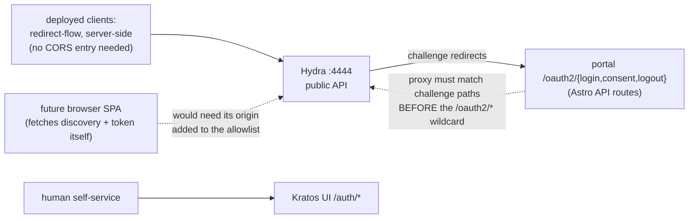

# 12 — OIDC client topology: portal-owned challenge routes, single-origin CORS

## Status

Accepted (2026-08-15). The portal owns the OAuth2 challenge routes; the
standalone Go consent service is deleted. Hydra's CORS allowlist as deployed is
**a single origin, identical to `OTHALA_PUBLIC_URL`** — that is live production,
not a lab fallback. The type-keyed allowlist rule below is the recorded
procedure for a future browser SPA, not a description of anything running.

See also [02](02-custom-portal-oidc-registrar.md) (portal + in-app registrar),
[10](10-first-party-skip-consent.md) (consent posture),
[11](11-hardening-tuning.md) (hardening tuning),
[13](13-vendored-config-contract.md) (`hydra/hydra.yml` is byte-vendored).

## Context

Two client-facing topology questions were settled only in config comments:
where OAuth2 challenge flows land, and which origins may call Hydra from a
browser. The first has history — v0.1.x ran a standalone Go consent service;
v0.2.0 converged all challenge handling into the portal.

## Decision

**Topology B: the portal owns the challenge routes.** The entire SSO stack lives
on `OTHALA_PUBLIC_URL`. Hydra redirects OAuth2 challenge flows to
`/oauth2/{login,consent,logout}` — portal (Astro) API routes implementing the
Hydra challenge protocol, at `portal/src/pages/oauth2/login.ts`, `consent.ts` and
`logout.ts` — while `/auth/*` remains the Kratos self-service human UI, a
separate concern. The standalone Go consent service (`consent:4477`) is deleted;
no consent unit exists among the deployed systemd units. All challenge handling
versions with the portal, as one deployable.

This puts a **routing-order constraint on the fronting proxy**: the challenge
path set (`/oauth2/login`, `/oauth2/consent`, `/oauth2/logout`) must route to
the portal *before* any wider `/oauth2/*` wildcard routes to Hydra. Violating the
order silently breaks every login, and it is invisible until it does.

**Enforced by the deployed proxy config, and only there.** The dag Caddyfile
matches `@portal_challenges` on the exact challenge paths and handles it before
the wider `@hydra` matcher that carries `/oauth2/*` — the ordering is correct as
deployed, and the Caddyfile is the artifact to check when rewriting proxy config
or standing up a new edge. `UNENFORCED — convention only` from this repo's side:
no othala gate can see the deployment's proxy config, so nothing here fails if
the order is inverted.

**CORS: a single origin today; an allowlist keyed by client type if that ever
changes.** `serve.public.cors.allowed_origins` is populated from
`OTHALA_CORS_ALLOWED_ORIGINS`. As deployed that list holds exactly one entry,
byte-identical to `OTHALA_PUBLIC_URL` — the IdP's own origin and nothing else —
because no browser-SPA client exists. Methods are trimmed to `GET, POST`
(nothing on the public token/discovery endpoints needs more), headers to
`Authorization` and `Content-Type`, and `allow_credentials: true` is set, which
is what makes the strictness load-bearing rather than cosmetic (see
Alternatives).

The rule that decides membership, should a second origin ever be needed:

- A **browser SPA client** performs its own `fetch()` against
  `/.well-known/openid-configuration` and `/oauth2/token`; the browser enforces
  CORS against that origin, so **every such origin needs an allowlist entry**.
- A **redirect-flow (server-side) client** never browser-fetches Hydra directly
  and **needs no entry**, no matter how many such clients exist. Every deployed
  client is in this group.

An earlier revision of this record organized the whole CORS section around oCIS
Web as the worked SPA example and described single-origin as the degenerate
e2e-lab case. oCIS was descoped from the estate on 2026-07-02; single-origin is
the production shape, and the SPA case is a procedure held in reserve.

## Diagram

## Consequences

- The challenge protocol implementation lives in one place and versions with
  the portal — no protocol drift between a separate consent service and the
  portal UI.
- Adding redirect-flow clients costs zero Hydra config. Adding a browser-fetching
  client costs one origin entry plus its client manifest, and would be the first
  time the allowlist has held more than one value — treat it as a change to
  verify, not a config append.
- The proxy ordering constraint is invisible until violated, and nothing in this
  repo can catch a violation. Verify it when standing up a new deployment or
  rewriting proxy config; the failure mode is total, not partial.
- `hydra/hydra.yml` carries the CORS block and its rationale comment, and it is
  byte-vendored: correcting or extending that comment is a re-vendor, not a
  local edit ([13](13-vendored-config-contract.md)).

## Alternatives considered

- **Wildcard / permissive CORS.** Rejected: with `allow_credentials: true` a
  permissive origin list turns the token endpoint into an account-takeover
  surface; the strict allowlist is the control.
- **Hardcoding the single origin instead of templating the list.** Simpler for
  today's shape, and rejected: the extensible list costs nothing, and hardcoding
  would make the first SPA a config-format change rather than a value change.
- **Keeping the standalone Go consent service.** Rejected at v0.2.0: a second
  deployable implementing half the challenge protocol, with its own auth to
  the admin API and its own drift surface, bought nothing the portal routes
  don't.
- **Per-client CORS.** Hydra has no such mechanism; the typed allowlist is
  the available control.
