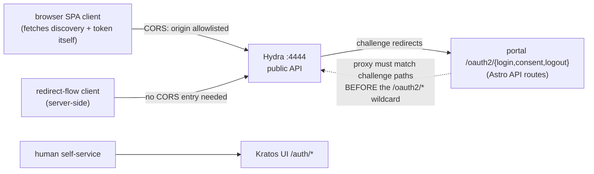

# 12 — OIDC client topology: CORS origins and portal-owned challenge routing

## Status

Accepted. See also [02](02-custom-portal-oidc-registrar.md) (portal + in-app
registrar), [10](10-first-party-skip-consent.md) (consent posture),
[11](11-hardening-tuning.md) (client-capability quirks).
Reference: `hydra/hydra.yml` (`serve.public.cors`, `urls`).

## Context

Two client-facing topology questions were settled only in config comments:
which origins may call Hydra from a browser, and where OAuth2 challenge flows
land. The second has history — v0.1.x ran a standalone Go consent service;
v0.2.0 converged all challenge handling into the portal.

## Decision

**CORS: an allowlist keyed by client type.**
`serve.public.cors.allowed_origins` is an extensible list, never a single
hardcoded entry. The distinction that decides membership:

- A **browser SPA client** (e.g. oCIS Web) performs its own `fetch()` against
  `/.well-known/openid-configuration` and `/oauth2/token`; the browser
  enforces CORS against that origin, so **every such origin needs an
  allowlist entry**.
- A **redirect-flow (server-side) client** never browser-fetches Hydra
  directly and **needs no entry**, no matter how many such clients exist.

Methods are trimmed to `GET, POST` (nothing on the public token/discovery
endpoints needs more), and because `allow_credentials: true`, the allowlist
must stay strict — see Alternatives. Single-origin instances (the e2e lab)
set the list to the value of `OTHALA_PUBLIC_URL`, preserving the original
one-origin behavior.

**Topology B: the portal owns the challenge routes.** The entire SSO stack
lives on `OTHALA_PUBLIC_URL`. Hydra redirects OAuth2 challenge flows to
`/oauth2/{login,consent,logout}` — portal (Astro) API routes that implement
the Hydra challenge protocol — while `/auth/*` remains the Kratos
self-service human UI, a separate concern. The standalone Go consent service
(`consent:4477`) is deleted; all challenge handling versions with the portal,
one deployable.

This puts a **routing-order constraint on the fronting proxy**: the challenge
path set (`/oauth2/login`, `/oauth2/consent`, `/oauth2/logout`) must route to
the portal *before* any wider `/oauth2/*` wildcard routes to Hydra. That
ordering lives in the deployment's reverse-proxy config, and each deployment
must uphold it.

## Diagram

## Consequences

- Adding a browser-fetching client costs one origin entry (plus its client
  manifest); adding redirect-flow clients costs zero Hydra config.
- The challenge protocol implementation lives in one place and versions with
  the portal — no protocol drift between a separate consent service and the
  portal UI.
- The proxy ordering constraint is invisible until violated (challenge paths
  swallowed by the Hydra wildcard breaks every login) — verify it when
  standing up a new deployment or rewriting proxy config.

## Alternatives considered

- **Wildcard / permissive CORS.** Rejected: with `allow_credentials: true` a
  permissive origin list turns the token endpoint into an account-takeover
  surface; the strict allowlist is the control.
- **Keeping the standalone Go consent service.** Rejected at v0.2.0: a second
  deployable implementing half the challenge protocol, with its own auth to
  the admin API and its own drift surface, bought nothing the portal routes
  don't.
- **Per-client CORS.** Hydra has no such mechanism; the typed allowlist is
  the available control.
