# 14 — Enrollment: admin-created identities, out-of-band link and code

## Status

Accepted (2026-08-15); deployed. There is no self-service registration. Every
identity is created by an admin, and the new member's first credential is
established by them, in their own browser, from a one-time link **and** code that
the admin hands over by chat.

See also [05](05-passkey-first-auth.md) (the credential posture the enrollee
lands in), [08](08-admin-authority-model.md) (why admin identities are refused
this path), and [09](09-capability-group-access-model.md) (why a freshly enrolled
identity can sign in but cannot yet reach any app).

## Context

Kratos supports self-service registration. It is switched off:

```yaml
    registration:
      # Admin-driven onboarding (one-time enrollment URLs); no self-service signup
      enabled: false
```

(`kratos/kratos.yml:237-239` — a vendored file, see [13](13-vendored-config-contract.md).)

That is the right shape for a household identity provider of roughly a dozen and
a half people: there is no cohort of strangers to onboard, membership is decided
in conversation before it is decided in software, and a public registration form
on the internet edge would be pure attack surface for zero saved effort — the
admin still has to grant app access by hand afterwards either way.

Switching registration off moves the whole problem to a different question: **how
does a person who has no credential get their first one, without a secret
travelling over a channel we do not control?** Emailing an initial password is
the classic answer and it is the one thing this design refuses. The recipient's
email address is unverified at the moment the identity is created, and a password
chosen by someone else is a password the user did not choose and will reuse.

## Decision

Enrollment is a single admin action producing a single pasteable message.

**1. Create the identity with no credential.** `/admin/users/new` posts to
`createIdentity` (`portal/src/lib/admin-api.ts`), whose request body carries
`schema_id`, `traits` and `metadata_admin` and **no `credentials` block at all**.
The identity therefore exists and can be administered, but there is no password,
no passkey, and no way to log in as it.

Group membership at creation is `metadata_admin.groups = [defaultGroup]` — the
value of `OTHALA_DEFAULT_GROUP`, which defaults to `everyone`
(`portal/src/lib/config.ts`). Per-service `<svc>-access` grants are a separate,
later admin act on the user's own page. A newly enrolled member can sign in and
sees no app tiles until someone grants them.

**2. Mint a one-time recovery link and code in the same request.** The page then
calls the portal's own `getRecoveryLink(id, ENROLLMENT_TTL)`
(`portal/src/lib/admin-api.ts`) — grep that symbol, not the SDK call it wraps.
It wraps Kratos's `createRecoveryCodeForIdentity` and returns three values:
`recovery_link`, `recovery_code` and `expires_at`. `ENROLLMENT_TTL` is `24h`.

**Both values are required.** The link lands on the recovery UI with an **empty
code field**; the code is what fills it. A link on its own is a dead end that
looks fine from the admin's side, which is exactly how this broke once — see
Consequences.

**3. Deliver out of band.** Nothing is emailed. The portal composes the exact
bytes the admin will paste — link, code and expiry as one block — server-side, so
the visible textarea and the copy button cannot disagree and the two halves
cannot be sent apart by accident. The admin sends that message over Signal or
iMessage, in a conversation that already exists with that person.

**4. The recipient sets up their own credentials.** They open the link, enter the
code, and Kratos issues a privileged settings session. From there they set up
**password and passkey** — both, not passkey only. Password is the tertiary
recovery on-ramp of [05](05-passkey-first-auth.md) and is what the recovery flow
re-establishes; passkey is the credential they will actually use day to day.

**The invariant is not "no password exists". It is: no password ever transits a
channel.** The only secret in motion is the enrollment link and code, which is
single-use and expires in 24 hours. The password is chosen by its owner, in their
own browser, and is never seen by the admin.



**Admin identities are refused this path.** The portal refuses first —
`shouldRefuseRecovery` (`portal/src/lib/access.ts:219`) blocks the
`issue-recovery` action for any identity carrying the admin marker and points the
operator at `docs/runbooks/admin-recovery.md` — and Kratos refuses second, via the
recovery-gate webhook (`kratos/hooks/recovery-gate.jsonnet`, see
[08](08-admin-authority-model.md)), which fails closed. An admin who has lost
everything goes to the break-glass floor, not through this flow.

**The same primitive is the lost-device path.** `/admin/users/[id]` offers
`issue-recovery` on an existing identity, with the same 24-hour TTL and the same
link-plus-code rendering. Combined with credential eviction (`deleteCredential`,
`portal/src/lib/admin-api.ts` — passkey and webauthn are evictable, password is
not) and session revocation (`revokeUserSessions`, `portal/src/lib/admin.ts`), a
compromised device is handled as: evict the credential, revoke the sessions,
re-enroll with a fresh link and code.

## Consequences

- **Dropping `recovery_code` silently dead-ends every enrollment, and it
  happened.** Both admin pages once kept only `recovery_link` from the
  `getRecoveryLink` result. Nothing looked wrong: a link rendered, the admin sent
  it, and the invitee reached a form demanding a code that nobody had. The
  failure is invisible from the side that performs the action and only surfaces
  as a person saying "this doesn't work". Both call sites now render and ship
  both values, and both carry a comment saying why. *UNENFORCED — convention
  only*: no CI gate or e2e assertion covers it. The e2e recovery specs exercise
  the recovery flow itself, not the admin-side rendering of the code.

- **Two clocks, deliberately different.** The admin-minted code carries an
  explicit 24-hour `expires_in`. The self-service recovery flow in
  `kratos/kratos.yml` has `lifespan: 1h`, which governs a user-initiated recovery
  attempt. They are not in conflict and neither should be "corrected" to match
  the other: an enrollment message may sit unread overnight; a recovery a user
  started themselves should not.

- **`ENROLLMENT_TTL` is declared twice** — once in `portal/src/pages/admin/users/new.astro`
  and once in `portal/src/pages/admin/users/[id].astro`. Each declaration is
  local to the page so the UI copy and the Kratos call cannot drift *within* a
  page, but the two pages can drift *from each other*. They agree today (`24h`).
  If a third call site appears, hoist it.

- **The enrollment path has no mail dependency.** Kratos's courier is configured
  for other flows, but nothing in enrollment sends mail, so a broken or
  unconfigured SMTP path cannot block onboarding — and a mistyped email address
  cannot misroute the one secret in motion.

- **This is a hand operation and does not scale.** One admin, one message per
  person, one grant per service afterwards. At household scale that is a feature:
  the admin is forced to look at who is being added and what they are being given.
  It would be unworkable at organisational scale, which is not a defect of this
  design but a statement of what it is for.

- **A revoked invitation is not a revoked identity.** Letting a link expire leaves
  a credential-less identity in Kratos. If the invitation should not have been
  issued, delete or deactivate the identity from the admin UI; do not rely on the
  TTL to undo the decision.

## Alternatives considered

- **Self-service registration with an email allowlist.** Rejected: it puts a
  public registration surface at the internet edge for a household of under
  twenty, and it saves no admin work — group grants are still a manual act
  afterwards, so the admin ends up in the same UI either way, just later and with
  less context.

- **Have Kratos email the recovery code.** Rejected. At enrollment the address is
  an unverified trait the admin just typed; a mailed code is a delivery guess to
  an address nobody has confirmed, and mail is the channel most likely to be
  filtered or misrouted. The admin is already in a chat with the person they are
  enrolling. Kratos remains capable of it — this is a deployment choice, not a
  missing feature.

- **Admin sets an initial password and sends it.** Rejected outright: it is
  exactly "a password transits a channel". It also creates a credential the user
  did not choose, which is the credential most likely to be reused elsewhere and
  least likely to be replaced.

- **Passkey-only enrollment — no password ever.** Genuinely attractive, and *not*
  what is deployed: the flow establishes password and passkey. Password is load-
  bearing as the recovery on-ramp in [05](05-passkey-first-auth.md), and a
  household member locked out of a passkey with no second credential becomes an
  admin support call every time. If passkey-only enrollment is wanted, that is a
  change to the flow first and to this record second — do not document it as an
  aspiration.

- **Self-service password reset as the enrollment path (send them to "forgot
  password").** Rejected: it is the same Kratos primitive with worse ergonomics
  and a worse security story — the user would have to already know their username
  and have a verified email, neither of which is true at enrollment.
