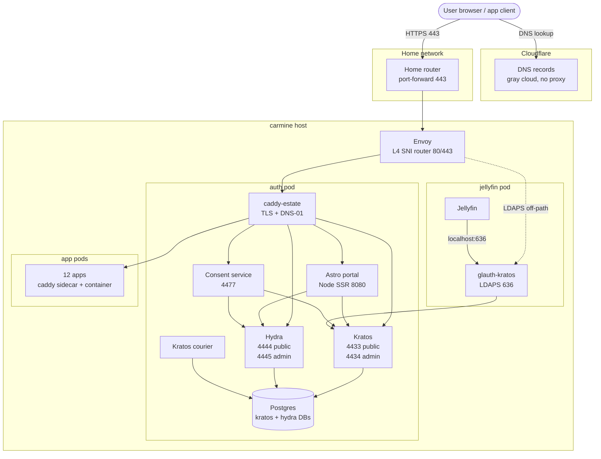
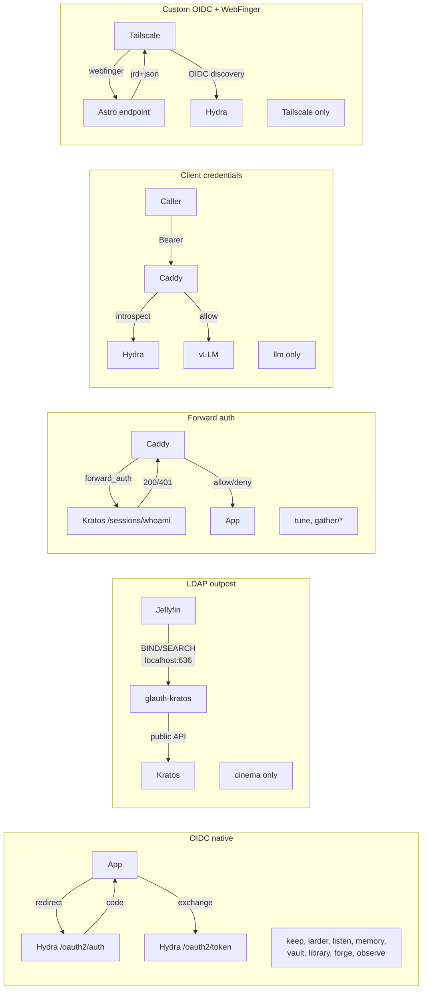
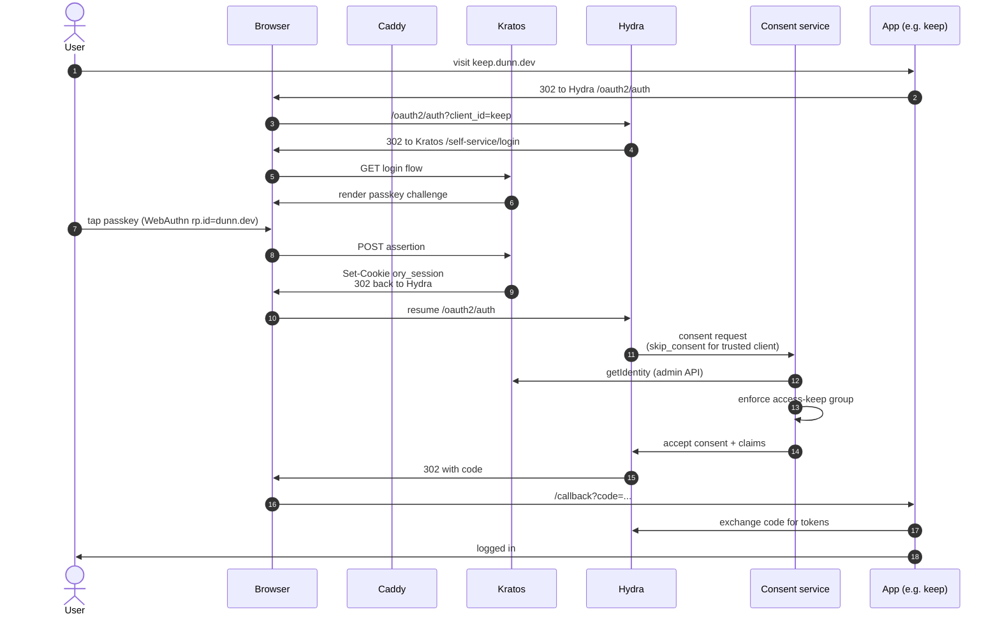
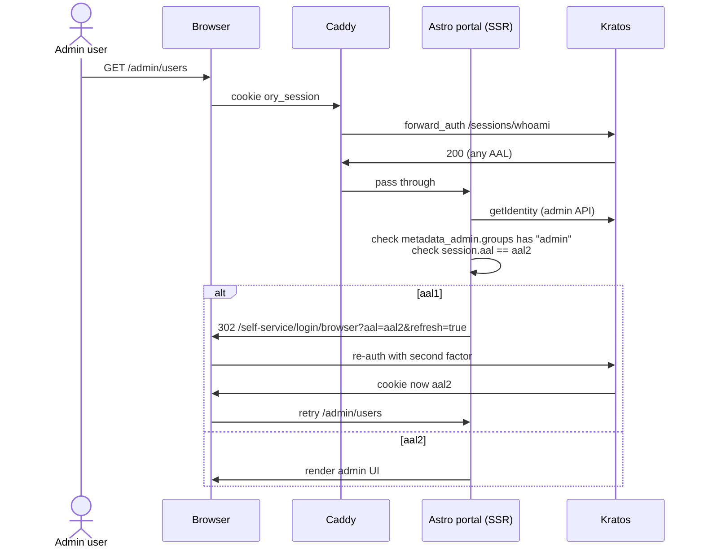
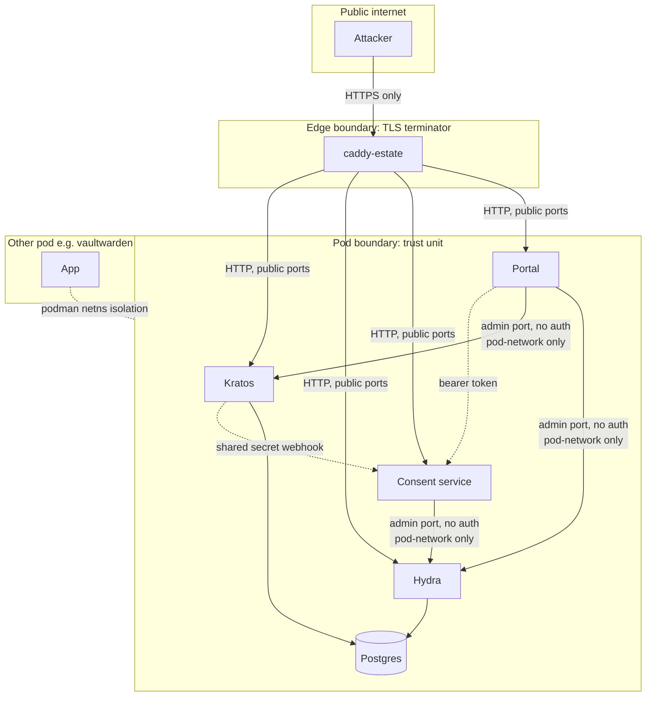
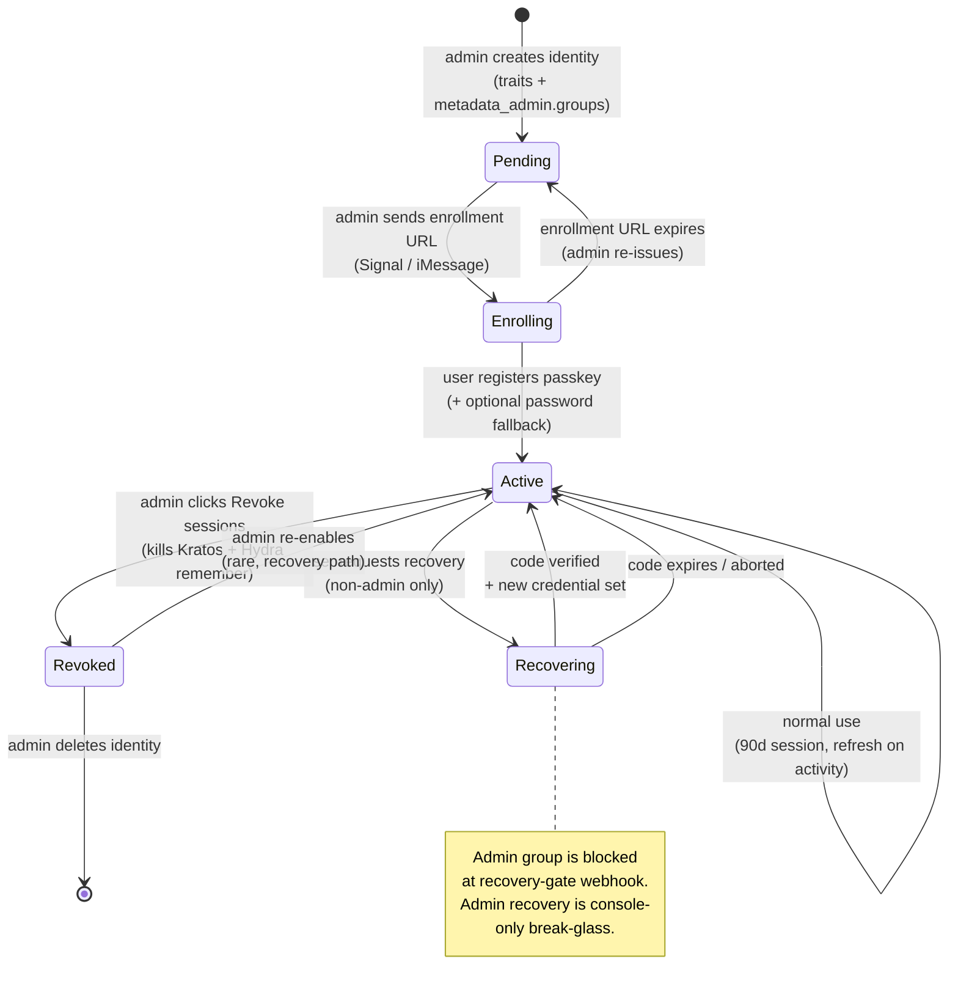
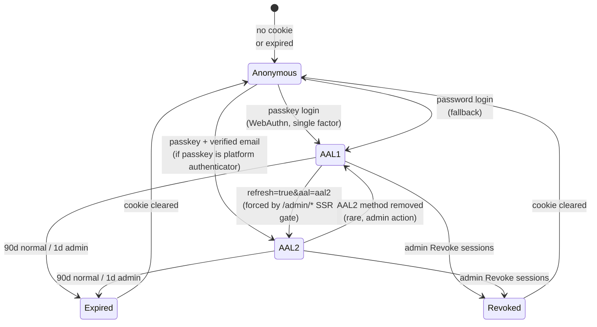
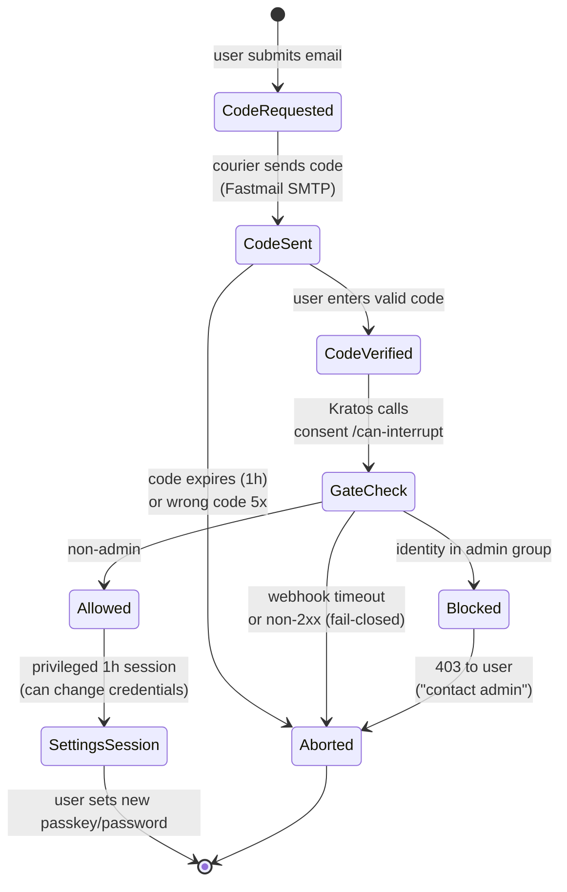

# Architecture diagrams

Companion to `docs/architecture.md`. Use these when explaining the
approach to someone who has not read the spec.

## 1. System topology

Where the bytes go. Cloudflare is DNS only; carmine terminates TLS and
runs every auth-pod service.

## 2. Five integration patterns

Every family app falls into one of these. The pattern is fixed at
deploy time per app via the Caddyfile snippet it imports.

## 3. Login flow with passkey

The default family path. Password is the fallback, AAL2 step-up only
fires for `/admin/*`.

## 4. Admin path with AAL2 step-up

Admin pages live at `auth.dunn.dev/admin/*`. AAL is per-flow in
Kratos, so the SSR layer is what enforces it.

## 5. Trust boundary

One pod, one trust domain. The pod boundary is the wall; in-pod
defense-in-depth is partial and deliberate.

Key: solid arrows are normal traffic, dotted arrows mark application-
layer auth (HMAC webhook, bearer token), the dotted boundary line
between pods is podman network isolation.

## 6. Identity lifecycle

What happens to a family member from "doesn't exist yet" to "off the
system." Admin actions in italics; user actions in regular text.

## 7. Session AAL state machine

A browser session moves between AAL levels. The cookie is the same
across transitions; only the `authenticator_assurance_level` claim
changes. AAL2 step-up is forced at the SSR layer for `/admin/*`.

## 8. Recovery-gate decision

A recovery flow does NOT issue a privileged settings session until the
consent service's `can_interrupt` webhook returns 2xx. Fail-closed: if
the consent service is down, the flow aborts.

